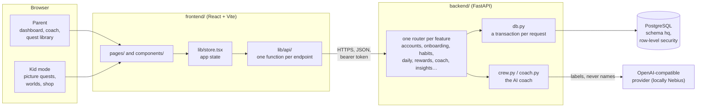
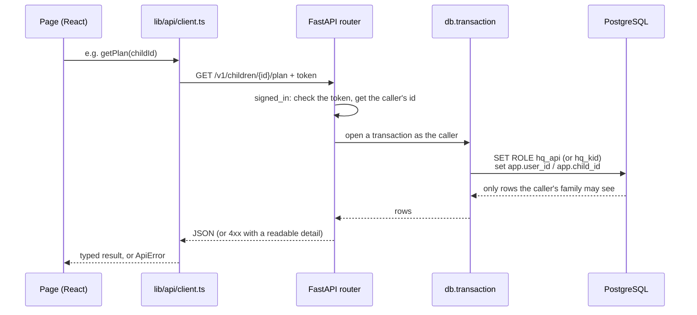
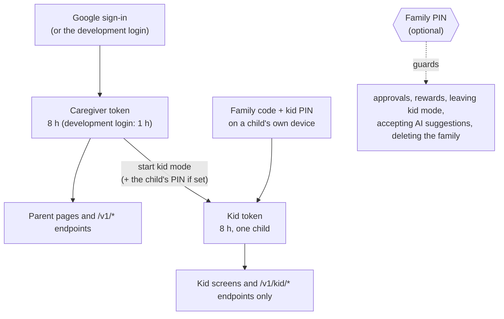
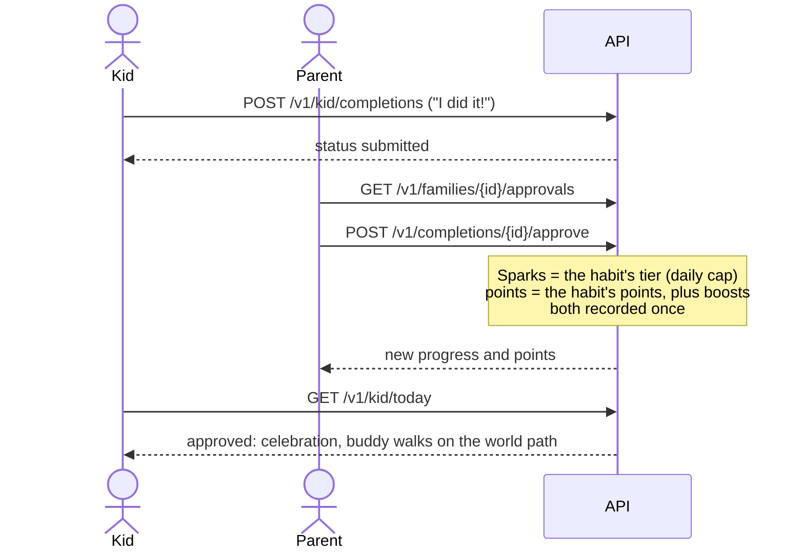
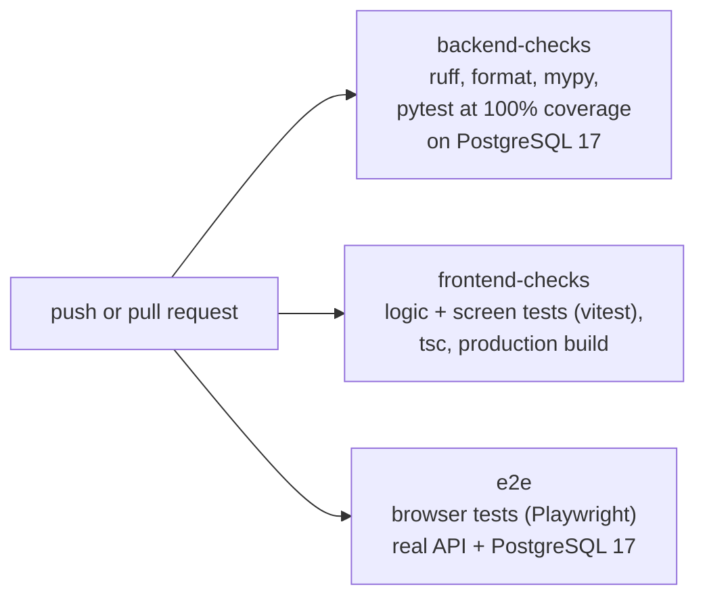

# How HabitQuest works

The consolidated November 6 design is in [docs-design](docs-design/README.md),
including current AI, database and AWS deployment diagrams. This file retains
the earlier repository-level walkthrough; prefer the current design where they differ.

For the dated implementation review, verified local configuration and known coach limitations, see
[earlier system design](docs-detailed/system-design.md) and the
[HabitCoach investigation](docs-detailed/habitcoach-investigation.md).

A guide for someone new to the code: what the parts are, how a request travels, and where to look for what.
Every file also opens with a comment saying what it is for, and every exported function, component and class has
one too, so once this page points you at a file, the file explains itself.

## The parts

| Folder | What lives there | Start with |
|---|---|---|
| `frontend/src/pages/` | One file per screen | `App.tsx` (which route shows which page) |
| `frontend/src/components/` | Pieces the pages share | the page that uses them |
| `frontend/src/lib/` | State, the API client, storage, helpers | `store.tsx`, `api/index.ts` |
| `frontend/src/styles/` | One stylesheet per area, loaded in order | `index.css` |
| `backend/src/habitquest_backend/` | One module per feature, each with its router | `main.py` |
| `backend/db/migrations/` | The database schema, in order | `202610310001_lean_schema.sql` |
| `backend/docs/` | API contract, local setup, the coach crew | `frontend-integration.md` |

## How one request travels

The database itself enforces who sees what. Every family table has a row-level security policy that reads the
caller's id, so even a query that forgets a `WHERE family_id = …` cannot return another family's rows. Kid tokens
use a narrower role that sees only that one child's rows and can only submit today's quests.

## Who can do what

## The daily loop

**Sparks** count approved quests and are never spent: they unlock worlds and harder quest tiers. **Points** are
spent in the reward shop; a reward request holds them until a grown-up says yes or "not this time" (refunded).
The points ledger is append-only and a database trigger keeps every balance from going below zero.

## The AI pieces

| Feature | Code | Notes |
|---|---|---|
| Habit coach | `crew.py` (selected locally) or `coach.py` | A parent describes a problem; the coach cites guidance and suggests catalog habits as cards. `Settings` defaults to the agent; `COACH_ENGINE=crew` selects the crew. See `backend/docs/coach-crew.md` for its diagram. |
| Pain point → goals | `ai.py` | Used in onboarding; keyword matching when the model is unavailable. |
| Weekly review, quest planner | `insights.py` | Proposed changes become suggestion cards. |
| Buddy lines in kid mode | `insights.py` | Safety-checked before a child sees them; a built-in line otherwise. |
| Safety | `safety.py` | Word lists first, then a model. Risk-guidance replies do not save the submitted conversation message. The model-backed risk check sees redacted text before deciding whether it is risky. |

Every AI suggestion waits for a grown-up to accept it. Known children's names are replaced with labels
("Child A"), and custom habit titles are masked in the plan snapshot. The review found an accepted-suggestion
note path that can reintroduce a custom title into later model history; see
[the investigation](docs-detailed/habitcoach-investigation.md#additional-findings).

## Checks that run on every change

Run them locally: `backend/` → `uv run python -m pytest` (needs PostgreSQL; on Windows set `PYTHONUTF8=1`), and
`frontend/` → `npm test`, `npm run e2e` and `npm run build` (see the Tests section of `frontend/README.md`). `backend/scripts/eval_coach.py` scores the coach against realistic
parent messages with real models; it is not part of CI because it calls a paid API.
