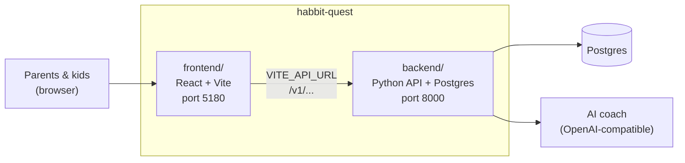
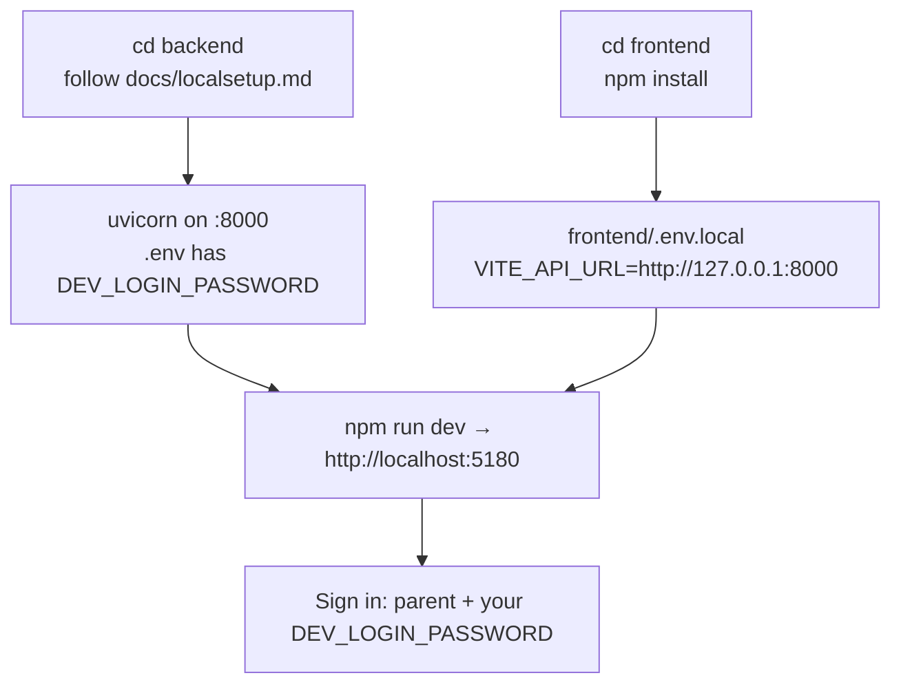

# HabitQuest

Habit quests for kids, with an AI habit coach. One repo, two apps:



| Folder or file | What it is | Start here |
|---|---|---|
| [ARCHITECTURE.md](ARCHITECTURE.md) | How the parts fit together, with diagrams | start here |
| [frontend/](frontend/) | The web app families use | [frontend/README.md](frontend/README.md) (pages, game rules, code layout, tests) |
| [backend/](backend/) | The API, database and AI coach | [backend/README.md](backend/README.md), [backend/docs/localsetup.md](backend/docs/localsetup.md) |
| [docs/product/](docs/product/) | Executive brief, product tour with screenshots, AI deep dive, engineering & quality | [docs/product/PRODUCT-TOUR.md](docs/product/PRODUCT-TOUR.md), [docs/product/README.md](docs/product/README.md) |

The backend's [docs/](backend/docs/) folder also holds the API contract for the frontend
([frontend-integration.md](backend/docs/frontend-integration.md)), the database tables
([schema.md](backend/docs/schema.md)), the habit coach crew ([coach-crew.md](backend/docs/coach-crew.md)) and what is
done and left to do ([status.md](backend/docs/status.md)).

## Recent changes

| When | What changed |
|---|---|
| 2026-11-02 | Frontend and backend moved into one repository. The habit coach became a crew of small agents ([coach-crew.md](backend/docs/coach-crew.md)). The Quest library shows the whole catalog by age group, and families can make their own habits. The parent PIN became optional, and kids can sign in on their own device with the family code. |
| 2026-11-03 | Calmer, more compact pages: one type scale, a violet hero band on every parent page, Family settings on a page of its own. Coach safety: a model risk check on every parent message and a safety reviewer that fails closed (PR #2). Ten defects fixed after a full code review, and frontend checks added to CI (PR #3). The large files split into one module per area (PR #4). Comments in every file, and [ARCHITECTURE.md](ARCHITECTURE.md) (PR #5). Screen tests and Playwright browser tests for the frontend, run in CI. |

## Run both locally

From the repository root, `npm run dev`, `npm run build`, `npm test` and `npm run e2e` run the frontend's scripts.



## Where things run

- **CI** runs on every push and pull request, for the half of the repo that changed:

  ```mermaid
  flowchart LR
      PR["push or pull request"] -- "backend/ changed" --> B["backend-checks (test.yml)<br/>ruff, format, mypy,<br/>pytest at 100% coverage on PostgreSQL 17"]
      PR -- "frontend/ changed" --> F["frontend-checks (frontend.yml)<br/>logic + screen tests, tsc, build"]
      PR -- "either changed" --> E["e2e (e2e.yml)<br/>Playwright browser tests,<br/>real API + database"]
  ```

- **Render**: [render.yaml](render.yaml) deploys the API from `backend/` (`rootDir: backend`).

## Backend upstream

`backend/` was brought in with `git subtree` from [rahulwarekar20/habitquest-backend](https://github.com/rahulwarekar20/habitquest-backend)
(a fork of [nagv/habitquest-backend](https://github.com/nagv/habitquest-backend)). To pull their later changes:

```bash
git subtree pull --prefix=backend https://github.com/nagv/habitquest-backend.git main
```
