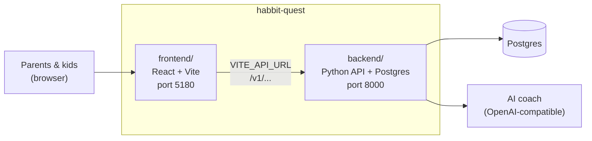
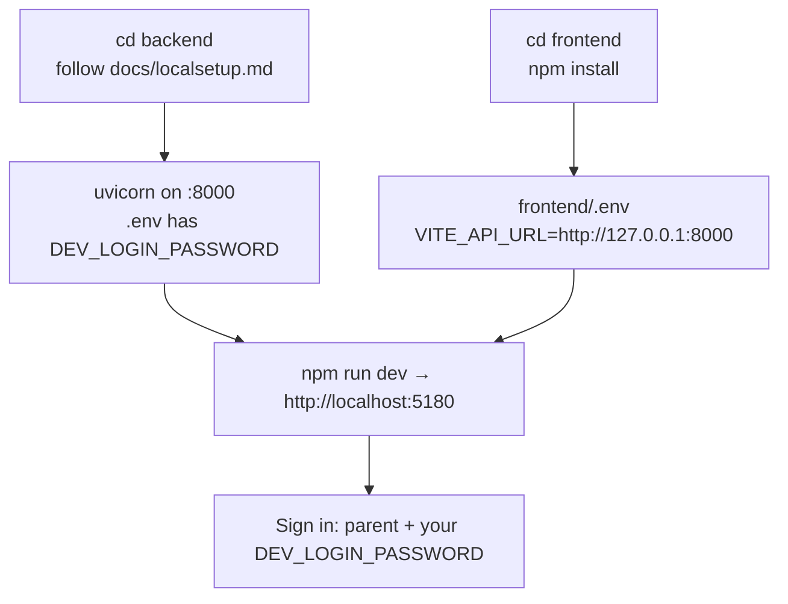

# HabitQuest

Habit quests for kids, with an AI habit coach. One repo, two apps:



| Folder | What it is | Start here |
|---|---|---|
| [frontend/](frontend/) | The web app families use | [frontend/README.md](frontend/README.md) |
| [backend/](backend/) | The API, database and AI coach | [backend/README.md](backend/README.md), [backend/docs/localsetup.md](backend/docs/localsetup.md) |

## Run both locally

From the repository root, `npm run dev`, `npm run build` and `npm test` run the frontend's scripts.



## Where things run

- **CI**: [.github/workflows/test.yml](.github/workflows/test.yml) runs the backend checks when `backend/` changes.
- **Render**: [render.yaml](render.yaml) deploys the API from `backend/` (`rootDir: backend`).

## Backend upstream

`backend/` was brought in with `git subtree` from [rahulwarekar20/habitquest-backend](https://github.com/rahulwarekar20/habitquest-backend)
(a fork of [nagv/habitquest-backend](https://github.com/nagv/habitquest-backend)). To pull their later changes:

```bash
git subtree pull --prefix=backend https://github.com/nagv/habitquest-backend.git main
```
