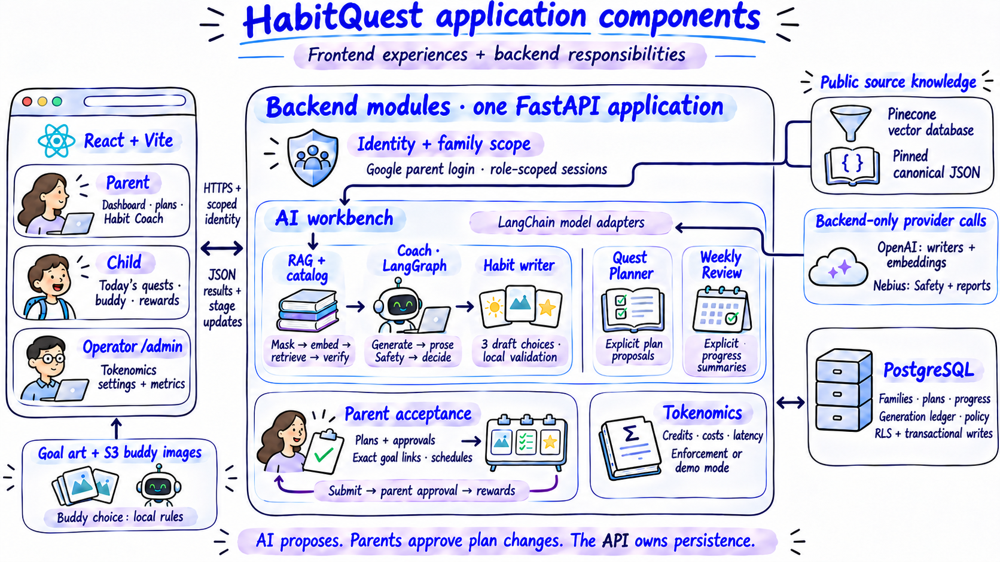
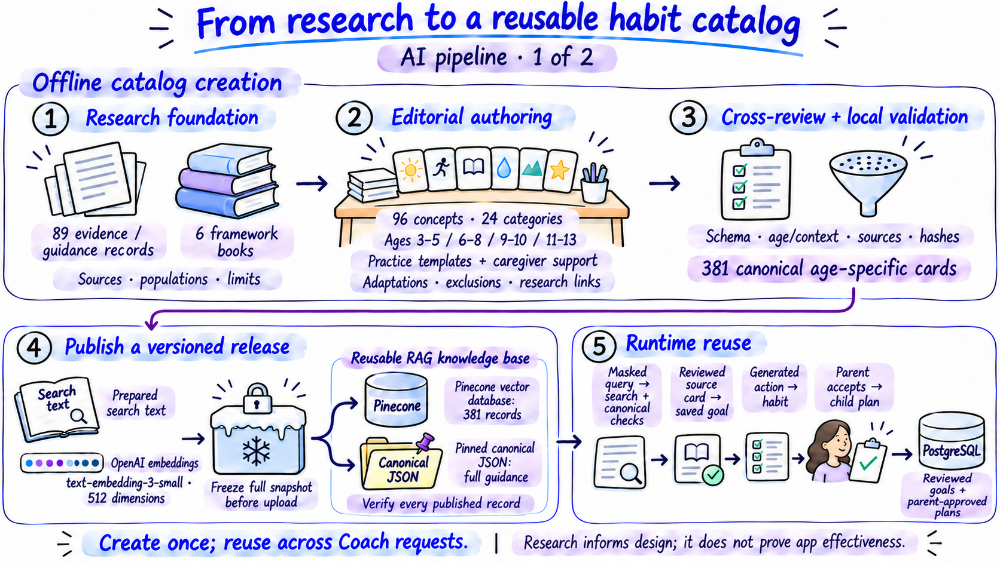
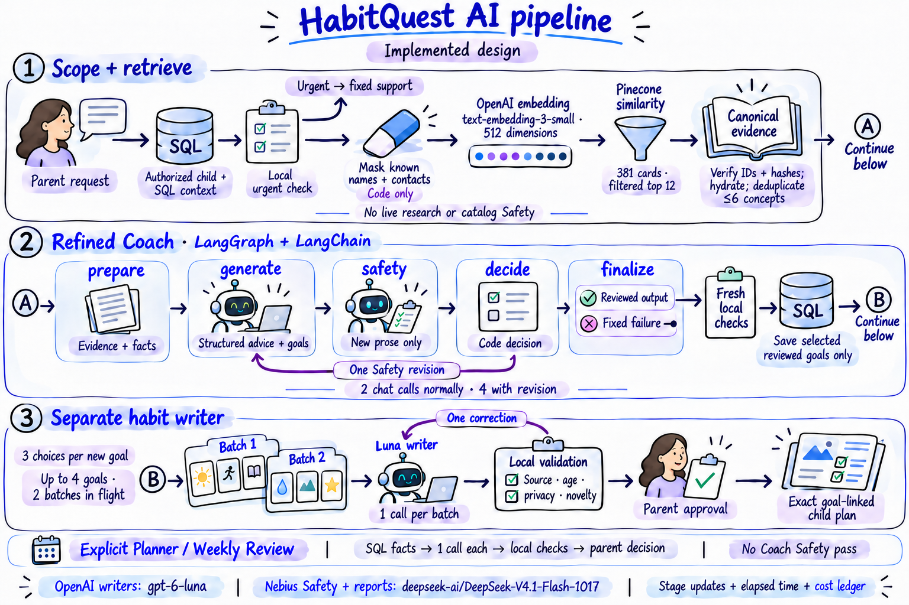
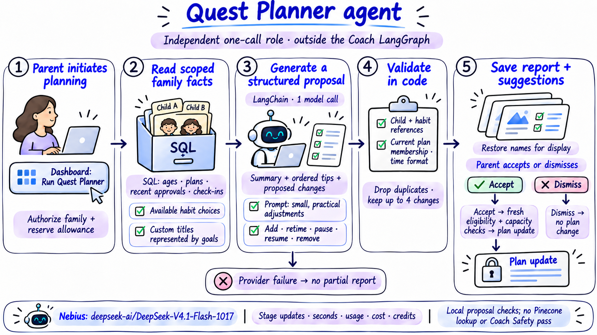
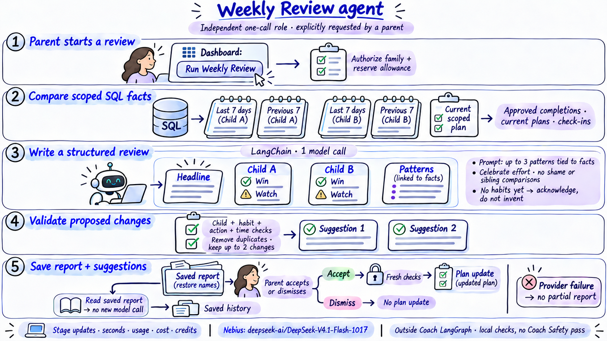
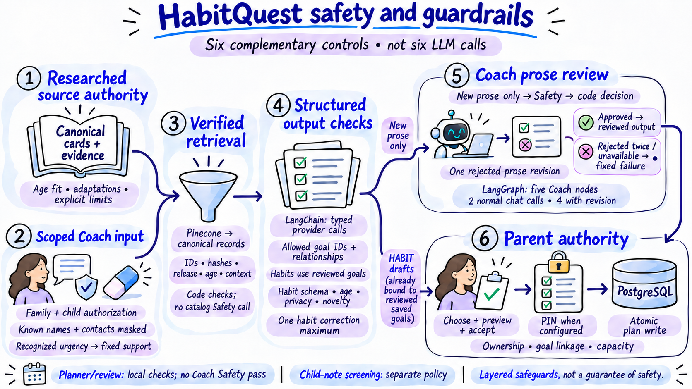
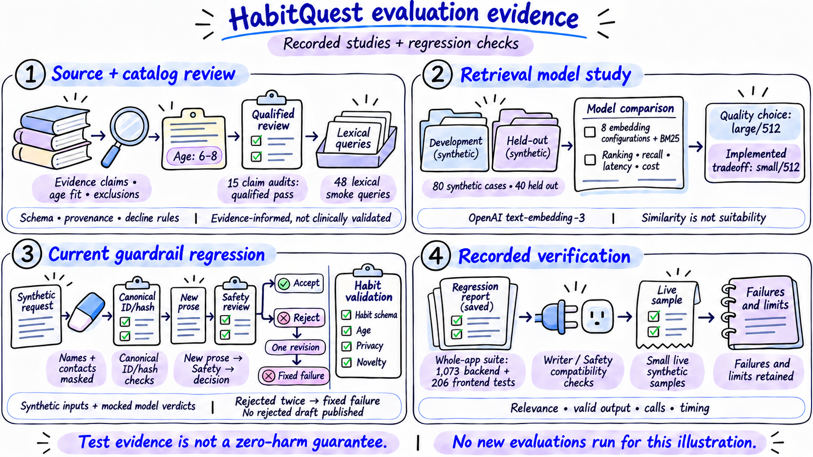
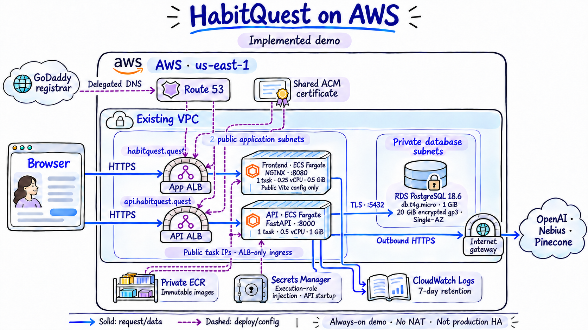
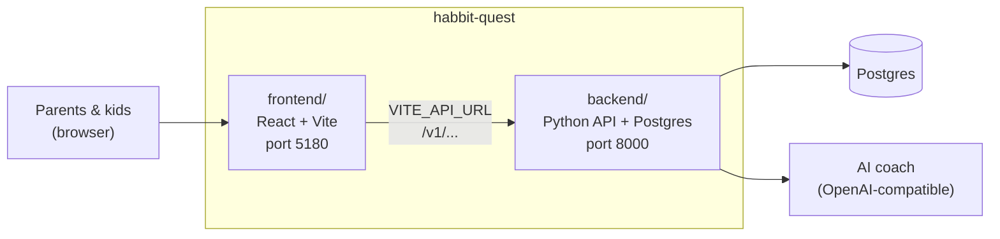
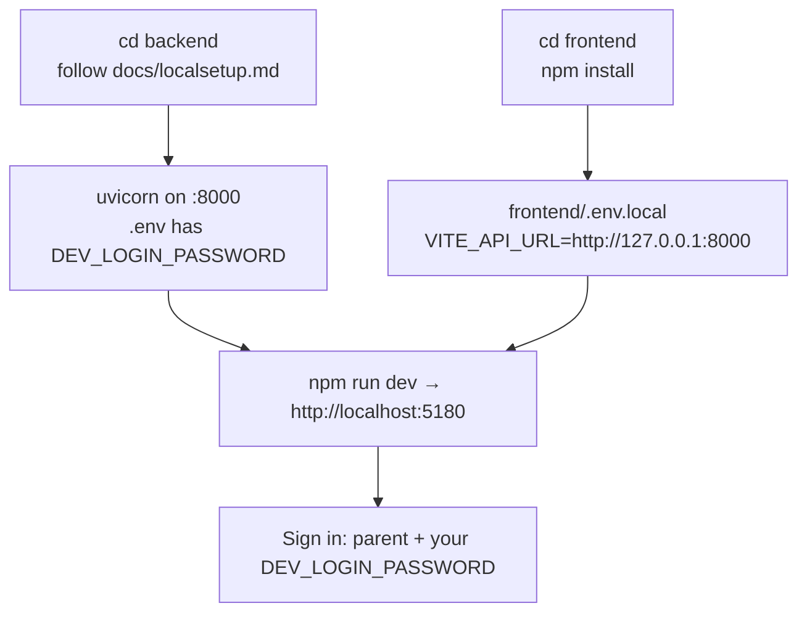

# HabitQuest

HabitQuest helps families turn researched goals into small, achievable habits and daily quests. Parents choose and adapt a child's plan, children follow picture-based quests with an adventure buddy, and parent-approved effort becomes progress and rewards. Optional AI helpers support goal discovery, habit choices, plan adjustments and weekly reflection, while parents stay in control of what is accepted.

## HabitQuest site

Visit the live app: [https://habitquest.quest](https://habitquest.quest/)

## Product overview video

[Watch the product overview (2 min 35 sec)](https://habbit-quest-assets.s3.us-east-1.amazonaws.com/videos/habitquest-journey/46f25482681172e1/habitquest-product-overview-1080p.mp4)

<a href="https://habbit-quest-assets.s3.us-east-1.amazonaws.com/videos/habitquest-journey/46f25482681172e1/habitquest-product-overview-1080p.mp4">
  
</a>

---

## System overview and architecture

The following sections walk through HabitQuest's overall system design, showing how the frontend, backend, data and AI capabilities work together. The illustrations trace the journey from the research-based habit catalog through retrieval, generation and the separate Coach, Planner and Review workflows, then explain safety guardrails, tokenomics, evaluation and AWS deployment. Together, they describe the architecture behind the family experience and the design decisions that shape it.

- **[Detailed system design docs](docs-design/README.md)**: Explore the full technical design, with chapters covering the frontend, backend, database, AI workflows, models, safety and deployment.
- **[Design history and supporting research](docs-detailed/README.md)**: Review earlier investigations, benchmarks and implementation decisions.

<a id="system"></a>

## 01 Application components

[](docs-product/illustrations/01b-system-components.png)

The frontend presents parent, child and operator experiences. One modular FastAPI backend owns authorization, retrieval, bounded AI calls, exact goal links, plans, approval rules and accounting. LangGraph belongs to the Coach module; these responsibilities are not separate microservices.


<a id="catalog"></a>

## 02 AI pipeline · 1 of 2: research and catalog

[](docs-product/illustrations/04-research-catalog.png)

Offline research, editorial authoring and cross-review create reusable age-specific practice cards. Prepared search text is embedded, frozen and published to Pinecone; full guidance remains in pinned canonical JSON. Live requests reuse the release. Reviewed source cards become goals, while personalized habit choices are generated later.


<a id="runtime"></a>

## 03 AI pipeline · 2 of 2: runtime and agents

[](docs-product/illustrations/02b-ai-runtime-agents.png)

RAG supplies verified context to the five-node Coach graph. New prose receives model Safety; separate writer batches prepare habit choices. Quest Planner and Weekly Review are independent, explicitly triggered agent roles outside that graph. Each helper is a structured model call plus local checks, not an autonomous multi-agent loop.


<a id="coach-detail"></a>

## 04 Habit Coach: detailed runtime pipeline

[](docs-product/illustrations/02-ai-pipeline.png)

Preserved original runtime illustration: it explains the API request-to-result pipeline without offline catalog creation. Follow A from verified retrieval into the Coach graph and B from reviewed saved goals into separate habit batches. Planner and Review retain their own dedicated slides.


<a id="planner"></a>

## 05 Quest Planner agent

[](docs-product/illustrations/08-quest-planner.png)

Quest Planner focuses on practical adjustments to the family plan. One structured call uses scoped SQL facts; code checks references and retains up to four suggestions. The parent decides, with fresh eligibility and capacity checks before changes are applied. It runs outside the Coach graph.


<a id="review"></a>

## 06 Weekly Review agent

[](docs-product/illustrations/09-weekly-review.png)

Weekly Review interprets recent progress rather than creating a schedule automatically. It compares two seven-day SQL windows, produces a parent-facing report and at most two locally checked suggestions. Parents decide on changes; reading the saved report makes no new model call.


<a id="safety"></a>

## 07 Safety guardrails

[](docs-product/illustrations/07-safety-guardrails.png)

Six complementary controls cover researched source authority, scoped Coach input, verified retrieval, structured output checks, Coach prose review and parent authority. They are not six LLM calls. Trusted catalog lookup and bounded habit checks do not receive an extra whole-content Safety pass.


<a id="tokenomics"></a>

## 08 Tokenomics and monitoring

[](docs-product/illustrations/05-tokenomics.png)

Every provider attempt retains usage, timing and estimated cost, including embeddings, search, retries and failures. Useful results settle family credits once; failed work releases credit holds without erasing provider cost. Admin can enforce allowance and exposure gates or track demo overage. Enforcement requires verified tariffs and bounded exposure.


<a id="evaluations"></a>

## 09 Evaluation evidence

[](docs-product/illustrations/06-evaluations.png)

Recorded source audits, a synthetic embedding study, mocked guardrail regressions and small live-provider samples answer different questions. They support content, model and control-flow decisions. They do not establish a zero-harm guarantee, clinical effectiveness or a new production latency benchmark.


<a id="aws"></a>

## 10 AWS deployment

[](docs-product/illustrations/03-aws-deployment.png)

The browser independently reaches the app and API through two public ALBs. Public-subnet Fargate tasks use restricted ALB-only ingress and internet-gateway egress; RDS stays private. ECR supplies both services, API secrets arrive at startup and CloudWatch retains logs. This always-on demo uses no NAT and is not production HA.


---

## Repository setup and change history

The earlier README content is preserved below, including local setup instructions and the audit trail of changes. Historical entries describe the design at the time; the illustrated sections above summarize the current system.

Habit quests for kids, with an AI habit coach. One repo, two apps:

The [current system design](docs-design/README.md) consolidates the implemented
frontend, backend, AI workflows, research, models, data and AWS deployment as of
November 6, 2026. Its [documentation plan](docs-design/00-documentation-plan.md)
records coverage and verification. Earlier investigations and change proposals
are preserved in [docs-detailed](docs-detailed/README.md); some describe superseded designs.



| Folder or file | What it is | Start here |
|---|---|---|
| [docs-design/](docs-design/README.md) | Consolidated current design, capability workflows and design decisions | [system overview](docs-design/01-system-overview.md), [AI orchestration](docs-design/05-ai-orchestration.md), [AWS deployment](docs-design/13-aws-deployment.md) |
| [docs-detailed/](docs-detailed/README.md) | Preserved investigations, detailed change records and historical proposals | [earlier system design](docs-detailed/system-design.md), [AI deep dive](docs-detailed/ai-system-deep-dive.md), [coach investigation](docs-detailed/habitcoach-investigation.md) |
| [ARCHITECTURE.md](ARCHITECTURE.md) | How the parts fit together, with diagrams | start here |
| [frontend/](frontend/) | The web app families use | [frontend/README.md](frontend/README.md) (pages, game rules, code layout, tests) |
| [backend/](backend/) | The API, database and AI coach | [backend/README.md](backend/README.md), [backend/docs/localsetup.md](backend/docs/localsetup.md) |
| [docs/product/](docs/product/) | Executive brief, product tour with screenshots, AI deep dive, engineering & quality | [docs/product/PRODUCT-TOUR.md](docs/product/PRODUCT-TOUR.md), [docs/product/README.md](docs/product/README.md) |

The backend's [docs/](backend/docs/) folder also holds the API contract for the frontend
([frontend-integration.md](backend/docs/frontend-integration.md)), the database tables
([schema.md](backend/docs/schema.md)), the habit coach crew ([coach-crew.md](backend/docs/coach-crew.md)) and what is
done and left to do ([status.md](backend/docs/status.md)).

### Recent changes

The [Quest Library views](docs-detailed/sys-design-update/quest-library-views.md) keep **Quests** as the default
and add **By goal**, with illustrated goal summaries above their exact linked quests and shared schedule controls.

The [more-choice controls](docs-detailed/sys-design-update/more-goals-and-habit-choices.md) add **Get more goals** beside the chat controls and replace the habit slider with **More habit choices**. Each action preserves earlier choices and uses the existing generation limits.

The [Coach conversation layout](docs-detailed/sys-design-update/coach-conversation-layout.md) keeps chat and compact location controls together above recommendations, with a clear divider before the existing plan. A saved goal recommended again stays with the latest response without duplicating its card.

Latest local follow-up: [goal linking and saved recommendations](docs-detailed/sys-design-update/goal-linking-and-saved-recommendations.md)
documents exact habit-to-goal links, goal-focused plans, saved/recommended separation and larger
cards/dialogs. [Compact cards and dashboard plans](docs-detailed/sys-design-update/compact-cards-dashboard.md)
documents four-column goal cards, popup details, original sharper artwork and each child's complete
assigned plan on the dashboard. [Goal/plan reliability](docs-detailed/sys-design-update/goal-plan-reliability.md)
documents full-plan recovery, goal/habit add/remove/restore, visible research, automatic habit choices
under new recommendations, and integrated verification.

| When | What changed |
|---|---|
| 2026-11-02 | Frontend and backend moved into one repository. The habit coach became a crew of small agents ([coach-crew.md](backend/docs/coach-crew.md)). The Quest library shows the whole catalog by age group, and families can make their own habits. The parent PIN became optional, and kids can sign in on their own device with the family code. |
| 2026-11-03 | Calmer, more compact pages: one type scale, a violet hero band on every parent page, Family settings on a page of its own. Coach safety: a model risk check on every parent message and a safety reviewer that fails closed (PR #2). Ten defects fixed after a full code review, and frontend checks added to CI (PR #3). The large files split into one module per area (PR #4). Comments in every file, and [ARCHITECTURE.md](ARCHITECTURE.md) (PR #5). Screen tests and Playwright browser tests for the frontend, run in CI. |

### Run both locally

From the repository root, `npm run dev`, `npm run build`, `npm test` and `npm run e2e` run the frontend's scripts.

The local environment files belong to each app: `backend/.env` contains the database URLs, signing secret,
development password and AI-provider settings; `frontend/.env.local` contains only the public API URL, Google
client ID and development-login flag. The frontend uses `http://127.0.0.1:8000`; open it at
http://localhost:5180 so the browser origin matches the backend's CORS settings.

On this workstation, PostgreSQL runs on port 5432 with separate `habitquest` and `habitquest_test` databases.
The existing family data and login secrets are reused. The local AI settings use `AI_MODE=openai`,
`COACH_ENGINE=refined`, `COACH_PROVIDER=planning`, `RETRIEVAL_MODE=pinecone` and
`HABIT_GENERATION_ENABLED=true`. Coach and habit writing use the imported Luna configuration;
Coach text Safety retains the existing main provider. Refined Coach has no remote input-risk call;
bounded habit drafts use local checks and parent approval. `COACH_TIMEOUT_SECONDS=65` remains the outer
deadline; frontend AI requests allow 75 seconds. See the [AI operations guide](docs-detailed/sys-design-update/refined-ai-operations.md)
for model routing, the commented environment template, catalog setup and current verification limits.

Start the API from `backend/` in one terminal:

```bash
cd backend
.venv/bin/python -m uvicorn habitquest_backend.main:app --host 127.0.0.1 --port 8000
```

In another terminal, run `npm run dev` from the repository root. Sign in as `parent`, or `parent:<label>` for a
separate development parent, with `DEV_LOGIN_PASSWORD` from `backend/.env`. Restart the relevant app after
changing its environment file. Provider keys, database credentials and JWT secrets belong only in `backend/.env`.



### Where things run

- **CI** runs on every push and pull request, for the half of the repo that changed:

  ```mermaid
  flowchart LR
      PR["push or pull request"] -- "backend/ changed" --> B["backend-checks (test.yml)<br/>ruff, format, mypy,<br/>pytest at 100% coverage on PostgreSQL 17"]
      PR -- "frontend/ changed" --> F["frontend-checks (frontend.yml)<br/>logic + screen tests, tsc, build"]
      PR -- "either changed" --> E["e2e (e2e.yml)<br/>Playwright browser tests,<br/>real API + database"]
  ```

- **Render**: [render.yaml](render.yaml) deploys the API from `backend/` (`rootDir: backend`).

### Backend upstream

`backend/` was brought in with `git subtree` from [rahulwarekar20/habitquest-backend](https://github.com/rahulwarekar20/habitquest-backend)
(a fork of [nagv/habitquest-backend](https://github.com/nagv/habitquest-backend)). To pull their later changes:

```bash
git subtree pull --prefix=backend https://github.com/nagv/habitquest-backend.git main
```


The November 4 [catalog presentation and live progress update](docs-detailed/sys-design-update/catalog-presentation-and-progress.md)
adds illustrated goals, step-by-step habits and actual generation-stage timings.
Restart the API to enable optional progress streams; no new environment settings
or schema migrations are required.

November 5 generation/plan repairs: [compact cards, child visibility, timing history and budget settings](docs-detailed/sys-design-update/generation-ui-repair.md).
