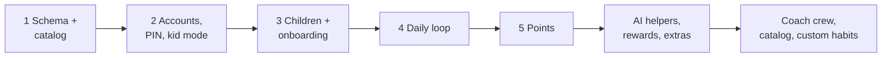
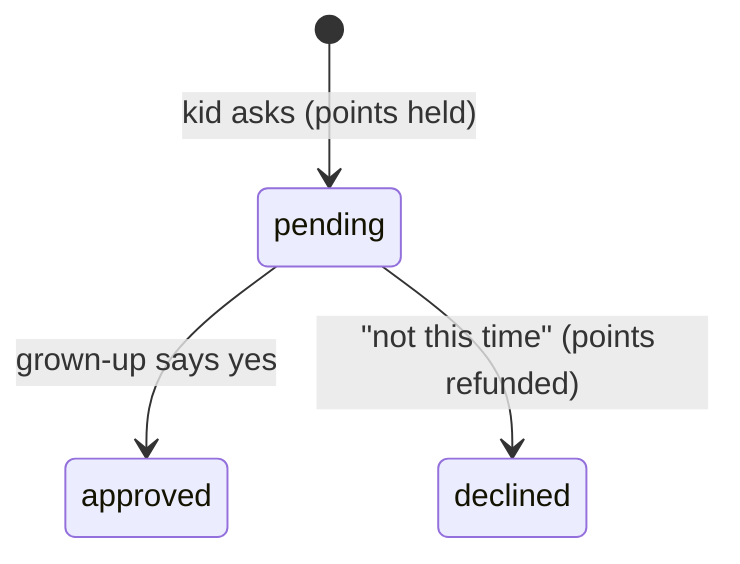

# HabitQuest backend

The service behind the HabitQuest app. Families register one or more caregivers and their children, describe a
child's pain points, and pick habits from a pre-approved catalog. Kids submit completions, caregivers approve
them, and children earn **Sparks** (progress that is never spent) and **points** (spent on rewards the
caregiver records).

The refined AI workflow and Pinecone source-goal integration are documented in
[refined AI operations](../docs-detailed/sys-design-update/refined-ai-operations.md). It covers the three-call Coach,
explicit generated-habit drafts, parent acceptance, provider configuration and local verification.

The local `/admin` console, linked below Developer login on the sign-in page, uses
separate backend-only credentials for Tokenomics policy, model/rate configuration
and sanitized cost/latency metrics. Generation history includes reported input/output
token totals with measured, partial, unavailable or not-applicable coverage.
Generation, embeddings and Pinecone attempts share durable accounting. Family
Settings retains seconds/history and shows daily credits; operator-cap editing has
moved to admin. Tracking-only mode is the prototype default. See
[Tokenomics operations](../docs-detailed/design-update/tokenomics/06-operations.md).

Weekly Review and Quest Planner use `AI_HELPER_REASONING_EFFORT=auto`: non-thinking
output for Nebius DeepSeek V4 report calls, provider defaults for other models.
This keeps the existing model and token ceiling while avoiding reports truncated
by internal reasoning. See [helper reliability](../docs-detailed/sys-design-update/ai-helper-report-reliability.md).

The approved buddy catalog adds 24 characters from release `0.1.0` while preserving
Fox, Owl, Bear and Bunny. Every child keeps a buddy. New setup selects a deterministic
age-based default; saved choices are never changed by recommendations. Public
character details appear in the chooser as names, brief characteristics and suggested
ages. All 24 support ages 3–13; suggested bands only affect local ordering. Choice,
preview and catalog event copy use local code and metadata, with no AI or retrieval
call. See the [API contract](docs/frontend-integration.md#buddy-selection-november-5-2026)
and [implementation and rollout record](../docs-detailed/design-update/buddies/execution.md).

The MVP is being built in steps (see [docs/mvp-plan.md](docs/mvp-plan.md); current status and what is left in [docs/status.md](docs/status.md); connecting the frontend in
[docs/frontend-integration.md](docs/frontend-integration.md)). Done so far: the lean schema,
the seeded catalog and catalog endpoints (step 1); accounts (step 2): Google sign-in, families with one or
more caregivers, invite codes, the family PIN and kid mode; children and AI onboarding (step 3); and the daily
loop (step 4): kids submit, caregivers approve, children earn Sparks and points; and spending points (step 5).
Since then: the AI helpers (habit coach crew, quest planner, weekly review, buddy lines), the reward shop with kid
requests, boosts, check-ins, surprises, kid extras (worlds found, chest, wardrobe, time limit), family settings,
export and deletion, rate limits, the whole catalog by age, and custom habits.



## Stack

Python 3.12, uv, FastAPI and Pydantic, PostgreSQL with row-level security, psycopg, PyJWT.

## Accounts and kid mode

1. **Sign in.** The frontend shows Google's sign-in button (client id `GOOGLE_CLIENT_ID`) and posts the ID
   token it returns to `POST /v1/auth/google`. The backend checks Google's signature (keys fetched from
   `https://www.googleapis.com/oauth2/v3/certs` and cached), the audience, the issuer and that the email is
   verified, creates or refreshes the user, and returns our own bearer token, valid for 8 hours.
2. **Family.** `GET /v1/me` lists the user's families. With none, the user creates one (`POST /v1/families`:
   family name, time zone, an optional four-digit PIN, and their own display name and role) or joins one with its invite
   code (`POST /v1/families/join`). Roles: `father`, `mother`, `guardian`, `other`. Any caregiver can rename
   the family, change its time zone or PIN (replacing a PIN needs the current one), and replace the invite code.
   Without a PIN, the actions it guards (approvals, rewards, accepting AI suggestions, leaving kid mode) need none.
3. **Kid mode.** On a shared device a caregiver calls `POST /v1/children/{id}/kid-session` and gets a kid token
   for that child (8 hours). Kid tokens work only on `/v1/kid/*` endpoints and run as the `hq_kid` database
   role, which sees only that child. Leaving kid mode is guarded by the frontend with
   `POST /v1/families/{id}/pin/verify`.
4. **A child's own device.** The family has a family code (shown as a QR code in Family settings). Without any
   token, `GET /v1/kid-login/{code}` lists the family's children and `POST /v1/kid-login/{code}` with the child's
   kid PIN returns a kid token for that child.

## Children and onboarding

1. **Children.** `POST /v1/families/{id}/children` with `name`, `age` (3-13), optional
   `buddy_selection` and `routine_times` per part of the day (`morning`, `midday`, `after_school`,
   `evening`, `bedtime`). Old requests retain the `buddy` field and Fox default. New clients save explicit
   original or pinned catalog choices through `buddy_selection`; later changes require `expected_revision`.
2. **Describe a problem.** `POST /v1/children/{id}/pain-points` with the parent's own words. The backend
   offers the AI the active goals and, per goal, the habits that suit the child's age and unlocked tier; the AI
   picks one to three goals with a one-sentence reason and recommends up to two habits per goal. Its answer is
   checked against that list, so it cannot invent a goal or habit. The goals are saved as `suggested`.
   - Only the child's age and the parent's text go to the AI provider.
   - A local safety screen runs first, and the AI can also flag risk: if the text suggests a child may be at
     risk, nothing is saved and the response carries guidance (emergency number, doctor, helpline).
   - If the AI fails or times out (`AI_TIMEOUT_SECONDS`, default 30), keyword matching on `goals.keywords`
     suggests the goals instead, without recommendations (`mapped_by: keywords`). If nothing matches,
     `mapped_by` is `manual` and the parent picks goals from `GET /v1/goals`.
3. **Pick habits.** `GET /v1/children/{id}/plan` shows each suggested or active goal with its habit `options`
   (recommended ones flagged). `PUT /v1/children/{id}/plan` sets the goals and up to six habits in one step;
   each habit must belong to a listed goal and suit the child's age and unlocked tier. Times default to the
   child's routine time for that part of the day; days default to every day. Use the same call to change the
   plan later: unlisted habits are removed and kept as history.
4. **Adjust one habit.** `PATCH /v1/child-habits/{id}` changes its time or days, pauses it or removes it.
5. **Browse or make habits.** `GET /v1/catalog` lists every pre-approved habit with its age range. A family can
   also make its own habits (`POST /v1/families/{id}/habits`) under one of the catalog's goals: they suit every
   age, open at tier 1, pay 10 points, and are visible only to that family. Their text is never sent to the AI
   provider: the coach and reviews call them "a family habit for <goal>", and buddy lines leave them out.

The plan also reports the child's `progress`: Sparks, the world and level they have reached (Starter Camp 0, Mosswood
Forest 30, Sky Islands 90, Coral Cove 180, Crystal Caves 300, Star Harbour 450), and the highest habit tier unlocked
(tier 2 in Mosswood Forest, tier 3 in Sky Islands, or the parent's `tier_override`).

## AI helpers

- **Habit coach**: by default (`COACH_ENGINE=crew`) a crew of small agents in a fixed LangGraph workflow (`crew.py`):
  triage, research and progress side by side, then a planner, a fit check and a safety review that fails closed. See
  [docs/coach-crew.md](docs/coach-crew.md) for its diagram. `COACH_ENGINE=agent` uses the older single agent
  (`coach.py`, `coach_tools.py`). Either way, every parent message first passes word lists and a model risk check;
  a message showing a child at risk gets crisis guidance and is neither stored nor sent on. Children's names become
  labels before any model call, tools work on an in-memory snapshot and cannot change anything, and any failure
  falls back to keyword matching. Conversations are kept for 90 days.
- **Quest planner and weekly review** (`insights.py`): one structured call each, on facts computed in code.
- **Buddy lines**: original buddies retain the optional small-call/safety-check path and built-in fallback.
  Catalog mode uses shared deterministic lines and skips the animal-only prompt. Selecting a buddy never
  makes a provider call or changes a habit, points or Sparks.
- **Suggestions**: nothing applies until a caregiver accepts with the family PIN, and the plan rules are checked again.
- **Coach traces** (`tracing.py`): off unless `TRACE_COACH=true` with `LANGSMITH_API_KEY`. Family names, emails, phone
  numbers, addresses and links are removed on the server. Failed, retried and no-match turns keep redacted text, as do
  `TRACE_SAMPLE` of the rest; other turns send structure only. LangChain's own `LANGSMITH_TRACING` is forced off.
- **Limits**: `AI_DAILY_LIMIT` model-backed requests per family per day, `COACH_TIMEOUT_SECONDS` per coach turn.

## The daily loop

1. **Today.** `GET /v1/kid/today` (kid token) or `GET /v1/children/{id}/today` (caregiver) lists the child's
   active habits scheduled for today, with "today" taken in the family's time zone, and each habit's status:
   `todo`, `submitted`, `approved` or `rejected`. It also shows Sparks, level and spendable points.
2. **"I did it!"** `POST /v1/kid/completions` with a `child_habit_id` from today's list. Tapping again changes
   nothing; a rejected habit can be submitted again.
3. **Approve.** `GET /v1/families/{id}/approvals` lists everything waiting, oldest first, across all children.
   `POST /v1/completions/{id}/approve` gives Sparks equal to the habit's tier (at most 6 a day) and the habit's points (a ledger entry, exactly once);
   `.../reject` means "not yet". The response carries the new progress, so the frontend can celebrate a
   level-up.

The database enforces the kid's side too: a kid token can only add or resubmit its own child's completions,
only for today, only as `submitted`, and cannot touch points.

## Spending points

A caregiver records what points were used for: `POST /v1/children/{id}/redemptions` with `points` and a `note`
("30 minutes of tablet"). The points are deducted from the balance; asking for more than the child has is
refused (422), and a database trigger also refuses any entry that would take the balance below zero, with
concurrent redemptions checked one after the other. Sparks are never spent.

`GET /v1/children/{id}/points` (caregiver) and `GET /v1/kid/points` (kid) show the balance, lifetime `earned`
and `spent`, and the newest entries: each approved habit with its day, and each redemption with its note.
Caregivers also see who made each entry.

**Reward shop.** Each family has a shop (`/v1/families/{id}/rewards`; new families get a default set). With a kid
token, `POST /v1/kid/reward-requests` spends points on a reward: they are held until a caregiver approves
(`POST /v1/reward-requests/{id}/approve`, with the PIN if set) or declines and they come back. A mystery box picks a
prize when asked; a jackpot pays straight away.



**Boosts.** The day's golden quest, a streak from the third quest day in a row, a parent's double day and a welcome
back day each add 1x to a quest's points, up to 3x (`daily.py`).

Browsers may call the API from the origins in `CORS_ORIGINS` (comma-separated; the frontend's dev server
`http://localhost:5180` by default).

## Data model

The `hq` schema ([db/migrations](db/migrations)) preserves the original core tables and adds bounded reference,
generation and accounting records. The core eleven
are below; [docs/schema.md](docs/schema.md) has diagrams and a guide to all of them, including rewards, kid extras,
check-ins, surprises, family settings and the AI tables.

| Table | Purpose |
|---|---|
| `users` | A signed-in person; `id` is the subject of our access tokens, `google_sub` links a Google account |
| `families` | The family: name, time zone, parent PIN hash, invite code for further caregivers |
| `caregivers` | Who cares for the family's children, with their `role` (`father`, `mother`, `guardian`, `other`) |
| `children` | Name, age (3-13), retained original buddy, explicit selection mode/catalog ID/version/revision, the world reached, a parent's quest tier override and routine times per anchor |
| `goals` | Pre-approved goals ("Calmer bedtimes") with keywords for matching pain points |
| `habits` | Pre-approved habits, one goal each: parent and kid wording, icon, routine anchor, ages, tier (1-3), points. A family's custom habits live here too, with its `family_id` and an id starting `my-` |
| `pain_points` | A parent's description of a problem, and how it was mapped to goals (`ai`, `keywords`, `manual`) |
| `child_goals` | Goals suggested for or chosen for a child, with the reason and recommended habits |
| `child_habits` | The child's plan: chosen habits with cue time and days; removed rows keep the history |
| `completions` | One per habit per day: the kid submits, a caregiver approves or rejects |
| `points_ledger` | Append-only points: `+` per approved completion, `-` per redemption with a note of what it was for |

Sparks are summed from approved completions (each quest's tier, at most 6 a day). A child's world, level and unlocked
habit tier follow from Sparks. `journey.py` holds the worlds and their landmarks.
Points are the sum of the ledger.

**Access.** Caregiver requests run as the `hq_api` database role with the caller's user id; row-level
security limits every family table to the families the caller is a caregiver in. Kid requests run as `hq_kid`
with the child's id and see only that child. The API has no general catalog write privilege. Reviewed Coach
selection uses a restricted function to create only a matching pinned source goal for an owned, eligible child.
The points ledger can
only be added to. Creating a Google user, creating a family and joining one go through `SECURITY DEFINER`
functions, because the caller cannot yet see the rows involved.

**Catalog.** [db/seed.sql](db/seed.sql) holds 8 goals and 41 habits taken from the frontend's quest library.
It is applied on every start and upserts by id, so editing a row and redeploying updates it. To stop offering a
goal or habit, set `is_active = false`; rows are never deleted because plans and history refer to them.
The Pinecone reference catalog is bundled separately; it is not bulk-seeded into local goals. Only reviewed
selected goals are materialized, with canonical provenance, before parents generate habits beneath them.

**Buddy references and compatibility.** The additive
[`202611050005_buddy_catalog.sql`](db/migrations/202611050005_buddy_catalog.sql) migration
adds `hq.buddy_catalog` with 24 immutable app-readable ID/version/age/availability references.
Existing children remain in `legacy` mode at revision 0 with their current buddy, wardrobe,
assignments and progress. Catalog identity lives beside the original four-value `buddy`, which remains
its visual fallback. A deliberate choice advances the revision; later unrevisioned flat `buddy` fields
are ignored while unrelated profile edits still save. Parent writes lock the child and validate one merged
update; kid writes use a narrow session-derived security-definer function, with direct child-table updates
still denied. All eight accessories and equipped values remain, using separate portrait/full-body anchors
for catalog art. Final visual QA and local rollout status are tracked in the
[execution record](../docs-detailed/design-update/buddies/execution.md).

`BUDDY_CATALOG_ENABLED=true` is the backend default. Setting it to `false` rejects new catalog
choices with 409 while keeping reads, unrelated edits and explicit original-buddy choices available.
`VITE_BUDDY_CATALOG_ENABLED=false` is the frontend template default until the migration and rollout
checks pass; set it to `true` to show the expanded chooser. Disabling it again preserves saved identities
and selection-aware reads. Keep the additive columns/reference data when rolling back presentation.

## Run it locally

Prerequisites: uv, Python 3.12 and PostgreSQL (its `bin` folder on PATH).

```bash
uv sync --locked
uv run python scripts/bootstrap_local.py
uv run python -m uvicorn habitquest_backend.main:app --reload --host 127.0.0.1 --no-proxy-headers
```

The bootstrap creates a loopback-only cluster under `.local/postgres` (port 55433), the `habitquest` and
`habitquest_test` databases, and a git-ignored `.env` with a signing secret and a development login password.
It keeps an existing `.env`. Stop the cluster with `pg_ctl -D .local/postgres -w stop`.

To use another PostgreSQL instead, set `DATABASE_URL` and run `uv run python scripts/setup_db.py`.

Open http://127.0.0.1:8000/docs, click **Authorize**, and in the **OAuth2PasswordBearer** form enter username
`parent` and the `DEV_LOGIN_PASSWORD` from `.env` (leave `client_id` and `client_secret` empty). `parent:<any
label>` logs in as a separate parent, e.g. to check that families are isolated.

## Connect a frontend

The frontend uses public settings in its `.env.local` or on its host. No API key, Nebius key or database
setting belongs there: the frontend only signs in and calls this API.

| Setting | Value |
|---|---|
| `VITE_API_URL` | The API's address (see below) |
| `VITE_GOOGLE_CLIENT_ID` | The same Google client id as `GOOGLE_CLIENT_ID` here. Public |
| `VITE_DEV_LOGIN` | `true` shows the test login, which works only while this API has `DEV_LOGIN=true` |
| `VITE_BUDDY_CATALOG_ENABLED` | Template default `false`; enable the expanded chooser after the buddy migration and rollout checks |

### Local backend with a local frontend

Use this to change the backend, or to test without touching hosted data.

1. Start the API as in [Run it locally](#run-it-locally). Check `.env` has `DATABASE_URL` for the local cluster,
   `JWT_SECRET` and `GOOGLE_CLIENT_ID`, plus `DEV_LOGIN` and `DEV_LOGIN_PASSWORD` for the test login. The bootstrap keeps
   an older `.env` as it is, so these may need updating.
2. For real AI, add these to `.env` (Groq shown; `.env.example` also lists Nebius); without them, AI features use
   the `fake` stand-in:

   ```text
   AI_MODE=openai
   OPENAI_BASE_URL=https://api.groq.com/openai/v1
   OPENAI_MODEL=openai/gpt-oss-120b
   OPENAI_SMALL_MODEL=openai/gpt-oss-20b
   OPENAI_SAFETY_MODEL=openai/gpt-oss-safeguard-20b
   OPENAI_API_KEY=<your key>
   COACH_ENGINE=crew
   ```

3. In `../frontend`, set `.env.local`:

   ```text
   VITE_API_URL=http://127.0.0.1:8000
   VITE_GOOGLE_CLIENT_ID=<the client id>
   VITE_DEV_LOGIN=true
   ```

4. Run `npm install` and `npm run dev`, then open http://localhost:5180. Restart the frontend after changing
   `.env.local`, because Vite reads it only at startup.

The frontend must run on port 5180: that is the origin `CORS_ORIGINS` allows by default and the one the Google client
lists. Open it as `localhost`, not `127.0.0.1`, or Google sign-in and CORS refuse it.

### Local frontend with the hosted backend

Change one line in the frontend's `.env.local`, and restart it:

```text
VITE_API_URL=https://habitquest-api-qmt1.onrender.com
```

Nothing changes on the backend. The free instance sleeps, so the first request can take about a minute. Data goes to
the hosted database, so use made-up details while testing. Real AI needs the `OPENAI_*` settings on Render.

### Hosted frontend with the hosted backend

1. Set the three settings above on the frontend host, with `VITE_DEV_LOGIN=false`.
2. Add the frontend's exact address, such as `https://app.example.com`, to `CORS_ORIGINS` on Render, comma-separated
   and keeping `http://localhost:5180` for local work.
3. Add the same address to the Google client's **Authorized JavaScript origins**.
4. Publish the Google consent screen before real families use it; in Testing, only listed test users can sign in.

## API documentation

| Page | Local | Hosted |
|---|---|---|
| Swagger UI, to try requests | http://127.0.0.1:8000/docs | https://habitquest-api-qmt1.onrender.com/docs |
| ReDoc, to read | http://127.0.0.1:8000/redoc | https://habitquest-api-qmt1.onrender.com/redoc |
| OpenAPI contract, for tools | http://127.0.0.1:8000/openapi.json | https://habitquest-api-qmt1.onrender.com/openapi.json |

**Try an endpoint in Swagger:** this needs `DEV_LOGIN=true` on the server you are using.

1. Click **Authorize**. In the **OAuth2PasswordBearer** form, enter username `parent` and the `DEV_LOGIN_PASSWORD`, and
   leave `client_id` and `client_secret` empty. The token lasts one hour.
2. Open `POST /v1/families`, click **Try it out**, and create a family. Copy its `id`.
3. Add a child with `POST /v1/families/{family_id}/children`, and copy its `id`.
4. Message the coach with `POST /v1/children/{child_id}/coach/messages`, then read the cards with
   `GET /v1/families/{family_id}/suggestions`.
5. Accept a card with `POST /v1/suggestions/{suggestion_id}/accept` and the family `pin`.

Use `parent:<any label>`, such as `parent:test2`, to log in as a separate parent and check that families stay isolated.

In refined source-goal mode, **Get more goals** sends `more_goals: true` with the
setting and a follow-up message. It keeps the original concern for retrieval,
excludes previously shown and active saved goals, and appends up to four reviewed
goals. `response_goal_ids` identifies this response's goals so the browser prepares
habits only for those additions. Earlier cards survive reload and empty or failed
responses. **More habit choices** uses the existing draft endpoint with `count: 3`;
existing choices remain available. Both actions retain the current budget and
review limits. See the [frontend contract](docs/frontend-integration.md).

**Try kid endpoints:** `/v1/kid/*` refuses a caregiver token. Get a kid token from
`POST /v1/children/{child_id}/kid-session`, then click **Authorize**, log out, and paste it into the **HTTPBearer** box.

**From the command line:**

```bash
API=https://habitquest-api-qmt1.onrender.com
TOKEN=$(curl -s "$API/v1/auth/token" -d "username=parent" --data-urlencode "password=$DEV_LOGIN_PASSWORD" | jq -r .access_token)
curl -H "Authorization: Bearer $TOKEN" "$API/v1/me"
```

**Status codes:** 401 means sign in again, 403 a wrong PIN, 404 a missing record or one from another family, 409 a
conflict such as a decision already made, 422 invalid input, and 429 a rate limit. Errors carry a readable `detail`.

Hosted data is real to the app: endpoints that delete or spend change it for good, so use test families.

## Tests

Tests need a dedicated database whose name ends in `_test`; fixtures delete its data.

```bash
uv run python -m pytest
uv run ruff check src tests scripts
uv run ruff format --check src tests scripts
uv run python -m mypy src
```

Coverage of `src/habitquest_backend` must be 100% (statements and branches). CI
([../.github/workflows/test.yml](../.github/workflows/test.yml)) runs the same checks against PostgreSQL 17 whenever
`backend/` changes. On Windows, set `PYTHONUTF8=1` before running the tests.

`scripts/eval_coach.py` scores the coach against realistic parent messages with real models. It is not part of CI,
because it calls a paid API.

## Deploying to Render

`render.yaml` is a Blueprint for one free web service plus Render Postgres in `virginia`.

- Build: `uv export` of the lockfile, installed with `pip`.
- Start: `scripts/render_start.sh` applies pending migrations and the catalog seed (idempotent and
  advisory-locked), then starts uvicorn on `$PORT`.
- Health check: `/health/ready`.

| Variable | Value |
|---|---|
| `JWT_SECRET`, `JWT_ISSUER` | Sign and check our access tokens |
| `GOOGLE_CLIENT_ID` | The Google OAuth web client id the frontend's sign-in button uses. Not a secret. Without it, `POST /v1/auth/google` returns 503 |
| `CORS_ORIGINS` | Comma-separated browser origins allowed to call the API, e.g. the hosted frontend's address |
| `AI_MODE` | `fake` (default: deterministic keyword stand-in) or `openai`: any OpenAI-compatible chat endpoint such as Nebius, with `OPENAI_BASE_URL`, `OPENAI_MODEL` and `OPENAI_API_KEY` (a secret; set it in the dashboard). The model must support JSON output (`response_format: json_object`); if it rejects the request, the logs show the status code and onboarding falls back to keywords |
| `DEV_LOGIN`, `DEV_LOGIN_PASSWORD` | `true` and a shared tester password of 12+ characters (set it in the dashboard). Setting `DEV_LOGIN=true` without a valid password stops the service from starting |

The first migration replaces the earlier versioned schema: it drops the old `hq` and `hq_checkpoint` schemas and
their data. The migrations create the `hq_api` and `hq_kid` roles, so the database user needs `CREATEROLE`.
