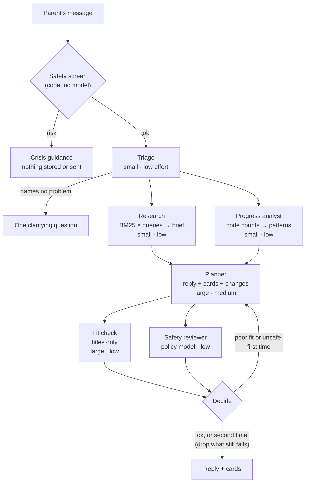
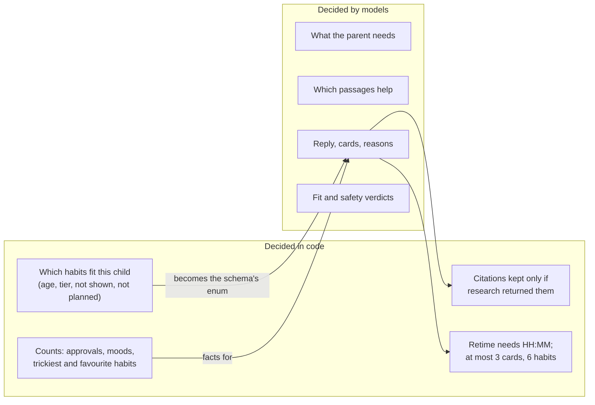
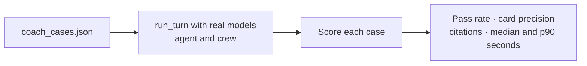

# The coach crew

The habit coach can run as one of two engines, chosen with `COACH_ENGINE`:

| Engine | How a turn runs | Code |
|---|---|---|
| `agent` | One model calls tools in a loop (research, recommend, progress, plan changes), then a fit check | `coach.py`, `coach_tools.py` |
| `crew` | A fixed workflow of small agents, with two pairs running side by side | `crew.py` |

Both share everything around the turn in `coach.run_turn`: the safety screen, swapping names for labels, the
deadline, citation filtering, tracing and the keyword fallback. The API and its response are the same.

## One turn



Agents on the same row run at the same time, so a turn costs four model round-trips in a row: triage, research
and progress, planner, review.

## What keeps it accurate



- **Strict schemas.** Every model answers in JSON that the provider's decoder enforces. The planner's `habit_id` is
  an enum of the habits this child can take on, and the brief's `ref` an enum of the passages found, so neither can
  be invented.
- **Code counts, models interpret.** Models miscount, so `progress_facts` counts and the analyst only describes.
- **Several searches.** Triage rewrites the problem into a few queries ("iPad fights" → "screen time ending",
  "transition warnings"); research takes each query's results in turn.
- **An independent fit check.** It sees habit titles and their goal, never the planner's reasons.
- **One revision.** A poor fit or an unsafe reply sends the planner back once, with what was wrong. Whatever still
  fails is dropped, and an unsafe reply becomes a plain one.

## When a step fails

| Step | On failure |
|---|---|
| Triage | Treats the message as a new problem and searches with its words |
| Research brief | Passes the top passages on unchanged |
| Progress analyst | Passes the counts on without patterns |
| Planner | The whole turn falls back to keyword matching (`mapped_by: keywords`) |
| Fit check | Drops the cards (tips only) |
| Safety reviewer | Keeps the reply: it talks to parents and the planner's prompt carries the same rules |

## Configuration

```text
AI_MODE=openai
OPENAI_BASE_URL=https://api.groq.com/openai/v1      # any OpenAI-compatible provider
OPENAI_MODEL=openai/gpt-oss-120b                    # "large"
OPENAI_SMALL_MODEL=openai/gpt-oss-20b               # "small"
OPENAI_SAFETY_MODEL=openai/gpt-oss-safeguard-20b    # "safety" (optional; else small)
OPENAI_API_KEY=<secret>
COACH_ENGINE=crew
CREW_ROLES=planner:large:low                        # optional per-agent overrides
```

Switching provider means changing only the `OPENAI_*` lines; `.env.example` has Groq and Nebius presets. Defaults for
each agent are in `crew.ROLES`; `CREW_ROLES` overrides them as `role:size:effort` without a code change.

**Groq's free tier** allows 8,000 tokens a minute per model (2,000 for the safeguard model). A crew turn sends the
planner about 3,000, so expect about two turns a minute: enough for development, not for families.

## Measuring it

```bash
uv run python scripts/eval_coach.py                         # both engines, every case
uv run python scripts/eval_coach.py --engines crew --only lying,picky-eater
uv run python scripts/eval_coach.py --workers 1 --pause 35  # paced for a free tier
```

`evals/coach_cases.json` holds realistic parent messages, each with what a good answer looks like: the goals its
cards may come from, no cards when no habit fits, a question when the message is vague, an expected plan change,
or a word the reply must mention. The script scores both engines on pass rate, card precision, citations and
seconds per turn, and writes each answer to `.local/eval/<engine>.json`.



Tests (`tests/test_crew.py`) never reach a model: they answer each agent by its schema's name, since agents running
side by side call in any order.
