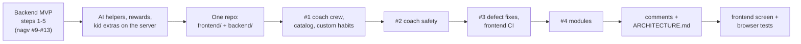

# HabitQuest: status and what's left

As of 2026-11-03. One repository, [rahulwarekar20/habbit-quest](https://github.com/rahulwarekar20/habbit-quest), with
the app in `frontend/` and this service in `backend/`. The API is live at https://habitquest-api-qmt1.onrender.com
(`/docs` for the interactive API). The frontend runs locally against either the local or the hosted API; it is not
hosted yet.

## Done

### Backend MVP (in `nagv/habitquest-backend`, before the merge)

| PR | Step | What it delivered |
|---|---|---|
| #9 | Reset | 11-table schema with row-level security (each family sees only its own data), no version columns. Seed catalog taken from the frontend's quests. Catalog endpoints. |
| #10 | Accounts | Google sign-in (`POST /v1/auth/google`), families with one or more caregivers, invite codes, the family PIN, kid tokens for kid mode, CORS for `localhost:5180`. |
| #11 | Onboarding | Children (age 3-13, buddy, routine times). Pain points: a safety screen, then AI maps the text to 1-3 goals, falling back to keyword matching. Plan: up to 6 habits by age and unlocked tier. |
| #12 | Daily loop | Today's habits in the family's time zone, kid "I did it!", caregiver approve or "not yet", Sparks and points per approval, tiers unlocking with progress. |
| #13 | Points | Caregivers record what points were spent on; the balance can never go below zero (API and database). |

### Since then

- **AI helpers:** the habit coach, quest planner, weekly review and buddy lines, all on the server. Suggestions wait
  for a grown-up to accept them. Per-family daily AI limits.
- **Everything the browser used to keep, now on the server:** the reward shop and kid requests (points held until
  approved), boosts (golden quest, streaks, double days, welcome back), check-ins with safety screening, surprises,
  worlds and landmarks found, the treasure chest, the buddy wardrobe and the kid-mode time limit.
- **Accounts:** the parent PIN is optional (replacing one needs the current one); kids can sign in on their own
  device with the family code and a kid PIN; a grown-up can leave a family; children can be deleted; family export
  and deletion; rate limits on sign-in, PINs and AI.
- **One repository** (2026-11-02): the frontend moved into `frontend/`, this service into `backend/` with
  `git subtree`. CI and Render point at `backend/`.
- **PR #1 (2026-11-03): coach crew, whole catalog, custom habits.** The coach became a crew of small agents
  (`COACH_ENGINE=crew`, [coach-crew.md](coach-crew.md)), scored against the old agent with `scripts/eval_coach.py`,
  on Groq's gpt-oss models. `GET /v1/catalog` lists every habit by age; families can make their own habits
  (`/v1/families/{id}/habits`, `/v1/habits/{id}`; migration `202611030002_custom_habits.sql`). Calmer, more compact
  pages throughout the frontend.
- **PR #2: coach safety.** Every parent message gets a model risk check after the word lists; the crew's safety
  reviewer fails closed.
- **PR #3: ten defects fixed** after a full code review, and frontend checks (vitest, tsc, build) added to CI.
- **PR #4: modules.** The frontend's stylesheet, API client, kid page and AI helpers split into one module per area.
- **Comments and guides:** every file and export explained in the code, plus [../../ARCHITECTURE.md](../../ARCHITECTURE.md).
- **Tests:** 383 backend tests at 100% coverage on PostgreSQL 17. Frontend logic and screen tests (vitest, with a fake
  API) and Playwright browser tests against the real API and database. All run in CI.

## Settings to finish

| Item | Why | Where |
|---|---|---|
| Upgrade or replace the database **before 2026-11-28** | The free Render Postgres expires and its data is lost | Render → `habitquest-db` |
| `AI_MODE=openai` plus `OPENAI_BASE_URL`, `OPENAI_MODEL`, `OPENAI_SMALL_MODEL`, optional `OPENAI_SAFETY_MODEL`, `OPENAI_API_KEY` and `COACH_ENGINE=crew` | Every AI feature; until then they use keyword matching or built-in lines. Groq's free tier allows about two coach turns a minute | Render → habitquest-api → Environment |
| `CORS_ORIGINS` | Needed once the frontend is hosted (comma-separated; keep `http://localhost:5180` for local work) | Render → Environment |
| Paid always-on instance | The free instance sleeps; the first request can take about a minute | Render → habitquest-api |
| Turn off `DEV_LOGIN` | Before real families use it: anyone with the password can act as a test parent | Render → Environment |
| Publish the Google consent screen | While it is in Testing, only listed test users can sign in | Google Cloud → Google Auth Platform → Audience |
| Remove leftover variables `MODEL_MODE`, `RUN_WORKER_IN_API` | Ignored by the code; tidy-up only | Render → Environment |

## Left to do

- **Host the frontend** (for example a Render static site), then add its address to `CORS_ORIGINS` and to the
  Google client's Authorized JavaScript origins.
- **Account management:** removing another grown-up from a family, and signing out everywhere (kid and caregiver
  tokens stay valid until they expire: 8 hours).
- **AI quality:** red-team checks of the coach and a model judge for its answers; a second provider for when Groq is
  busy.

Known limits:
- Editing a child's age does not re-check habits already in their plan.
- A habit's points are fixed at the moment of approval.

## Keeping the two halves in step

Any change to an endpoint's shape: update the backend tests, [frontend-integration.md](frontend-integration.md) and
the frontend's `src/lib/api/` together. The API's machine-readable contract is `/openapi.json`.
