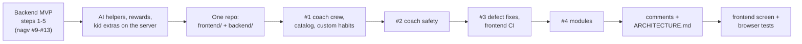

# HabitQuest: status and what's left

November 5 buddy catalog implementation: the approved pinned release adds 24 characters
while preserving all four original buddies, earned/equipped accessories, plans, points
and Sparks. Every child keeps a buddy. New setup follows a deterministic age default
until a deliberate choice; chooser details show character names, brief characteristics
and suggested ages, with all 24 available for ages 3–13. Public metadata is packaged
locally for selection and never used to infer a child profile or make AI calls.

Additive identity fields retain the legacy fallback, pinned catalog ID/version and
an explicit selection revision. Parent writes validate the locked merged profile;
kid extras use a narrow session-derived function with no direct child-table updates.
Stale explicit choices return 409; old flat writes cannot undo a revisioned choice.
Selection-aware projections and browser reconciliation cover login, avatars, Today,
extras and export. Catalog event copy stays local; legacy optional AI behavior remains.
The eight worn SVG accessories use separate portrait/full-body catalog anchors.

Verification: 1,051 backend tests at 100% statement/branch coverage, 202 frontend
tests, TypeScript/build, Ruff/format and mypy passed. Three final actual-API browser
scenarios cover desktop, 390px mobile and delayed direct-journal boot, plus a
reduced-motion mobile check; all 384
catalog outfit/view combinations were reviewed. A fresh disposable migration
preserved a synthetic Owl, crown, assignments, completion and points. The local
application database was backed up and migrated; all existing rows/old columns
across 35 tables stayed identical and existing children retained legacy revision 0.
API readiness and the enabled Vite chooser flag were verified. No paid calls or S3
changes. The existing mobile Developer login pointer overlap is documented; these
checks use Enter for that form and real clicks for buddy controls. See the
[approved plan](../../docs-detailed/design-update/buddies/implementation-plan.md),
[execution record](../../docs-detailed/design-update/buddies/execution.md) and
[API contract](frontend-integration.md#buddy-selection-november-5-2026).

November 5 admin-entry/token-history follow-up: Admin login is linked below Developer
login on the sign-in page. Generation history exposes input/output tokens and
measurement completeness from each operation's recorded attempts, including retries
and embeddings, with no duplicate cache/reasoning or child-operation totals.
Verification: 1,024 backend tests at 100% statement/branch coverage, Ruff/mypy,
157 frontend tests, build and six synthetic browser flows passed. Restarted local
API; all 13 existing history records returned measured counters, and anonymous
access remained denied. No paid calls or schema changes. See the
[evidence](../../docs-detailed/evidence/2026-11-05/admin-entry-tokens/README.md).

November 5 helper reliability fix: Weekly Review and Quest Planner exhausted the
configured DeepSeek model's 4,000-token output limit on internal reasoning, then
reported a generic busy error. Their scoped `AI_HELPER_REASONING_EFFORT=auto` now
disables thinking for Nebius DeepSeek V4 models. Truncation has a specific error;
the dashboard starts a fresh request after a confirmed failure and preserves the
request ID after ambiguous interruptions. Model routing and safety remain unchanged.
Verification: 1,015 backend tests at 100% statement/branch coverage, Ruff/mypy,
154 frontend tests and build passed. The local API was restarted and health and
effective-model settings verified. No paid checks were made. See the
[failure analysis and verification](../../docs-detailed/sys-design-update/ai-helper-report-reliability.md).

November 5 Tokenomics rollout: `/admin` now has separate operator credentials,
versioned credit/pricing policy and sanitized cost/latency metrics. Generation,
embedding and Pinecone HTTP attempts are metered durably. Families start at 100
credits/day; enforcement and caregiver USD visibility are off for the prototype.
Family Settings keeps optional seconds/history; shared-cap authority moved to admin.
Prior reservations and family data were preserved after backup and additive migration.
Verification: 1,004 backend tests at 100% statement/branch coverage, Ruff/mypy,
144 frontend tests, build, four mocked browser flows and local HTTP isolation checks.
No paid calls were made. See the [execution record](../../docs-detailed/design-update/tokenomics/05-implementation-progress.md)
and [operations guide](../../docs-detailed/design-update/tokenomics/06-operations.md).

Earlier November 5 budget controls described below are historical and superseded.

November 5 follow-up: Coach now supports `more_goals: true` to append up to four
additional reviewed goals while preserving earlier cards and their order. It
excludes previously shown and active saved goals during retrieval and returns
`response_goal_ids` so habit preparation targets only the current response.
The frontend replaces the count slider with **More habit choices**, requesting
another batch of three. No schema, provider, review-policy or budget change is needed.
Verification: 839 backend tests at 100% statement/branch coverage, Ruff and mypy;
128 frontend tests, build, and two synthetic desktop/mobile browser flows passed.
See [more-choice behavior and evidence](../../docs-detailed/sys-design-update/more-goals-and-habit-choices.md).

As of 2026-11-03. One repository, [rahulwarekar20/habbit-quest](https://github.com/rahulwarekar20/habbit-quest), with
the app in `frontend/` and this service in `backend/`. The API is live at https://habitquest-api-qmt1.onrender.com
(`/docs` for the interactive API). The frontend runs locally against either the local or the hosted API; it is not
hosted yet.

## Done

### November 5: generation cards, child plans and Settings

**Later goal-linking audit:** [Goal links and saved recommendations](../../docs-detailed/sys-design-update/goal-linking-and-saved-recommendations.md)
confirms that existing assignment, generated detail, batch and canonical-source IDs agree. No
backend implementation or real-data repair was needed. The frontend now exposes exact goal links,
and a regression journey verifies multiple goals/children through approval, reset and restoration.

**Later reliability fix:** [goal/plan reliability](../../docs-detailed/sys-design-update/goal-plan-reliability.md)
addresses full six-habit plans, restored assignments, device-parking completion validation,
saved-goal persistence and approved details after chat reset. Goal cards now show source research
and inline habit choices. New explicit Coach sends target three/four relevant goals and prepare
three choices per goal through a queue of at most two requests. Capacity remains six plan habits;
draft choices do not consume slots. No migration or change to real family assignments was needed.

The [generation repair record](../../docs-detailed/sys-design-update/generation-ui-repair.md) documents
compact goal/habit grids with larger artwork, three habits on explicit first goal interaction,
an append-only choice slider, distinct persisted Fluent icons, visible child steps and goal images,
and active habits scheduled for other days. Acceptance verifies the saved plan and refreshes Today.

Settings now exposes optional generation seconds, persistent browser-local timing history and the
app owner's editable cumulative planning budget. Live stage status remains active when seconds are hidden.
The approved local cap is $5 with prior $0.9830207 reservations preserved. Two additive budget migrations
were applied after backup; fresh-database schema and budget checks passed. No paid model checks were run
for this repair. The November 4 counts and presentation notes below are historical.

### November 4 follow-up: catalog presentation and generation progress

The [presentation/progress guide](../../docs-detailed/sys-design-update/catalog-presentation-and-progress.md)
records the richer goal/habit cards, ordered Coach guidance, Fluent location icons
with local defaults, and optional SSE stages on Coach, habit generation, planner
and weekly review. Default JSON contracts remain available. No new migrations,
environment variables, model calls or changes to review policy were introduced.

Verification covers 793 backend cases across the suite and corrected focused
recheck, with 100% statement/branch coverage; Ruff check/format and mypy pass.
The frontend has 100 passing tests, a passing build, and two synthetic desktop/mobile
browser checks. The restarted API passed a no-provider HTTP smoke. Later saved
habit batches took 7.5–8.4 seconds, almost entirely in the writer. The user's
20–30-second Coach experience still needs actual stage evidence; the earlier
small live sample below is not representative of every request.

### November 4: refined AI and source-backed habits

Execution and verification are tracked in [implementation progress](../../docs-detailed/sys-design-update/implementation-progress.md).
The [operations guide](../../docs-detailed/sys-design-update/refined-ai-operations.md) describes the new `refined` LangGraph,
trusted context reuse, generated-text Safety, canonical Pinecone goals saved only after selection, and one-call
habit drafts with local validation and parent acceptance. The legacy crew remains available as a routing rollback.
Final checks pass: 788 backend tests at 100% statement/branch coverage, 81 frontend tests and build. The approved
live sequence returned useful results in 4.0–4.6 seconds after the initial 6.7-second Coach request; these few
ASGI measurements do not establish a consistent five-second browser-response guarantee.

### Backend MVP (in `nagv/habitquest-backend`, before the merge)

| PR | Step | What it delivered |
|---|---|---|
| #9 | Reset | 11-table schema with row-level security (each family sees only its own data), no version columns. Seed catalog taken from the frontend's quests. Catalog endpoints. |
| #10 | Accounts | Google sign-in (`POST /v1/auth/google`), families with one or more caregivers, invite codes, the family PIN, kid tokens for kid mode, CORS for `localhost:5180`. |
| #11 | Onboarding | Children (age 3-13, buddy, routine times). Pain points: a safety screen, then AI maps the text to 1-3 goals, falling back to keyword matching. Plan: up to 6 habits by age and unlocked tier. |
| #12 | Daily loop | Today's habits in the family's time zone, kid "I did it!", caregiver approve or "not yet", Sparks and points per approval, tiers unlocking with progress. |
| #13 | Points | Caregivers record what points were spent on; the balance can never go below zero (API and database). |

### Since then

- **AI helpers:** the habit coach, quest planner, weekly review and buddy lines, all on the server. Suggestions wait
  for a grown-up to accept them. Per-family daily AI limits.
- **Everything the browser used to keep, now on the server:** the reward shop and kid requests (points held until
  approved), boosts (golden quest, streaks, double days, welcome back), check-ins with safety screening, surprises,
  worlds and landmarks found, the treasure chest, the buddy wardrobe and the kid-mode time limit.
- **Accounts:** the parent PIN is optional (replacing one needs the current one); kids can sign in on their own
  device with the family code and a kid PIN; a grown-up can leave a family; children can be deleted; family export
  and deletion; rate limits on sign-in, PINs and AI.
- **One repository** (2026-11-02): the frontend moved into `frontend/`, this service into `backend/` with
  `git subtree`. CI and Render point at `backend/`.
- **PR #1 (2026-11-03): coach crew, whole catalog, custom habits.** The coach became a crew of small agents
  (`COACH_ENGINE=crew`, [coach-crew.md](coach-crew.md)), scored against the old agent with `scripts/eval_coach.py`,
  on Groq's gpt-oss models. `GET /v1/catalog` lists every habit by age; families can make their own habits
  (`/v1/families/{id}/habits`, `/v1/habits/{id}`; migration `202611030002_custom_habits.sql`). Calmer, more compact
  pages throughout the frontend.
- **PR #2: coach safety.** Every parent message gets a model risk check after the word lists; the crew's safety
  reviewer fails closed.
- **PR #3: ten defects fixed** after a full code review, and frontend checks (vitest, tsc, build) added to CI.
- **PR #4: modules.** The frontend's stylesheet, API client, kid page and AI helpers split into one module per area.
- **Comments and guides:** every file and export explained in the code, plus [../../ARCHITECTURE.md](../../ARCHITECTURE.md).
- **Tests:** 383 backend tests at 100% coverage on PostgreSQL 17. Frontend logic and screen tests (vitest, with a fake
  API) and Playwright browser tests against the real API and database. All run in CI.

## Settings to finish

| Item | Why | Where |
|---|---|---|
| Upgrade or replace the database **before 2026-11-28** | The free Render Postgres expires and its data is lost | Render → `habitquest-db` |
| `AI_MODE=openai` plus `OPENAI_BASE_URL`, `OPENAI_MODEL`, `OPENAI_SMALL_MODEL`, optional `OPENAI_SAFETY_MODEL`, `OPENAI_API_KEY` and `COACH_ENGINE=crew` | Every AI feature; until then they use keyword matching or built-in lines. Groq's free tier allows about two coach turns a minute | Render → habitquest-api → Environment |
| `CORS_ORIGINS` | Needed once the frontend is hosted (comma-separated; keep `http://localhost:5180` for local work) | Render → Environment |
| Paid always-on instance | The free instance sleeps; the first request can take about a minute | Render → habitquest-api |
| Turn off `DEV_LOGIN` | Before real families use it: anyone with the password can act as a test parent | Render → Environment |
| Publish the Google consent screen | While it is in Testing, only listed test users can sign in | Google Cloud → Google Auth Platform → Audience |
| Remove leftover variables `MODEL_MODE`, `RUN_WORKER_IN_API` | Ignored by the code; tidy-up only | Render → Environment |

## Left to do

- **Host the frontend** (for example a Render static site), then add its address to `CORS_ORIGINS` and to the
  Google client's Authorized JavaScript origins.
- **Account management:** removing another grown-up from a family, and signing out everywhere (kid and caregiver
  tokens stay valid until they expire: 8 hours).
- **AI quality:** red-team checks of the coach and a model judge for its answers; a second provider for when Groq is
  busy.

Known limits:
- Editing a child's age does not re-check habits already in their plan.
- A habit's points are fixed at the moment of approval.

## Keeping the two halves in step

Any change to an endpoint's shape: update the backend tests, [frontend-integration.md](frontend-integration.md) and
the frontend's `src/lib/api/` together. The API's machine-readable contract is `/openapi.json`.
