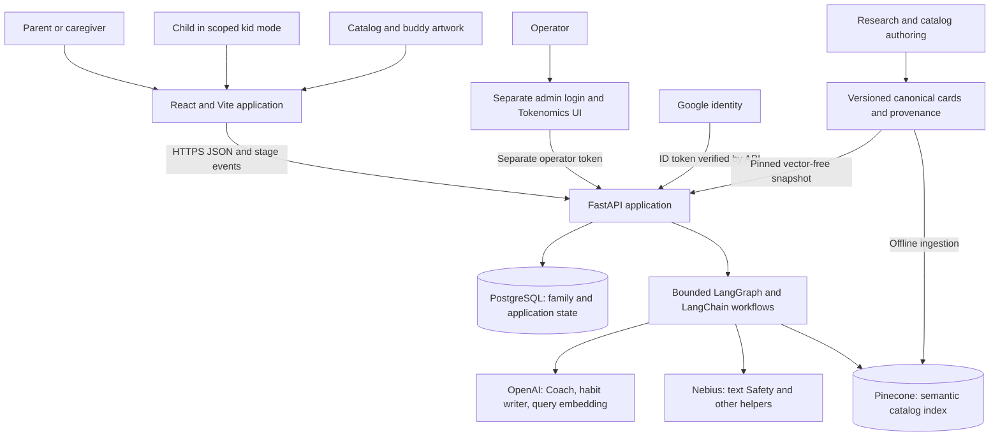

# System overview

HabitQuest helps parents turn a concern into a researched goal, choose small
habits for a child, and reinforce completion through a daily quest experience.
AI proposes guidance and choices. Parents decide what enters the plan; the
database controls ownership, schedules, approvals and rewards.

This is the implemented November 6, 2026 design. It combines the current
`habbit-quest` application with research/catalog assets and the recorded AWS
release. The original standalone backend and multi-agent crew documents describe
earlier stages, not the default deployed request path.

## System context

The browser communicates directly with the public API origin. Serving the SPA
from a frontend container does not make that container an API proxy. CORS,
API tokens and database authorization remain necessary. The deployed network is
described in [AWS deployment](13-aws-deployment.md).

## Components and ownership

| Component | Responsibility | Does not own |
| --- | --- | --- |
| React frontend | Parent/kid/admin navigation, local display state, progress, choice/approval controls | Provider credentials, authoritative rewards or credit settlement |
| FastAPI backend | Identity, family/child authorization, business rules, AI invocation and result persistence | A continuously running autonomous planner |
| PostgreSQL | Accounts, plans, immutable approved instructions, completion, reward ledgers, AI operations and policy | Vector similarity ranking |
| Canonical catalog snapshot | Stable source IDs, age/context metadata, research provenance and integrity | A family's current plan |
| Pinecone | Find relevant canonical source cards from a masked query embedding | Family conversations, assignments or generated habit ownership |
| Chat providers | Produce bounded structured guidance/actions/reports and review eligible new text | Direct database writes or automatic assignment to children |
| Artwork catalog | Goal reference images, fluent icons, buddy illustrations and attachment anchors | Model-based personality inference |
| AWS deployment workspace | Infrastructure templates, builds, public configuration, secret references, execution evidence | Application secrets embedded in Markdown or browser bundles |

## The domain vocabulary

| Term | Meaning |
| --- | --- |
| Research source | Evidence or reference with applicability and limitations |
| Canonical card | Versioned age/context source record; Pinecone returns its search projection and the full record is hydrated from packaged canonical JSON |
| Goal | Main-app representation of that canonical card; imported when selected by reviewed generation |
| Draft habit | Generated action beneath an exact goal, scoped to a child and awaiting acceptance |
| Approved habit | Persisted instructions accepted by a caregiver; later generation cannot silently rewrite them |
| Assignment / quest | That habit scheduled in the child's plan, with days, cue time and status; setting belongs to the source/draft generation context |
| Suggestion | A proposed addition or plan change, still waiting for caregiver action |
| Sparks / points | Separate progress and reward systems derived from approved completions |
| Coaching credits | Family AI allowance units; distinct from reward points and actual provider dollars |

The legacy seeded catalog coexists with imported researched goals and generated
habits. The system does not bulk-import every Pinecone card into family plans.
See the [database design](04-database-and-domain-model.md).

## End-to-end family workflow

```mermaid
flowchart LR
    SignIn["Caregiver signs in"] --> Family["Create or join family"]
    Family --> Kid["Add child and local default buddy"]
    Kid --> Coach["Describe a concern to Coach"]
    Coach --> Goals["Reviewed advice and relevant goals"]
    Goals --> Choices["Prepare three habit choices per new goal"]
    Choices --> Accept["Caregiver chooses and approves"]
    Accept --> Plan["Goal-linked scheduled assignments"]
    Plan --> Today["Child sees today's quests"]
    Today --> Submit["Child submits completion"]
    Submit --> Approve["Caregiver approves"]
    Approve --> Rewards["Sparks, points, worlds and rewards"]
    Approve --> History["History available to explicit review or planner"]
    History --> Proposal["New suggestion"]
    Proposal --> Accept
```

The current plan allows six non-removed assignments per child; paused entries
still occupy a slot. Removing a habit releases capacity while preserving history.
Goals may exist without an assigned habit. Displaying a generated card does not
mean it was accepted. Dashboard, quest library and goal detail views resolve the
same saved assignment and exact goal relation.

## Frontend and backend workflow boundaries

| Activity | Frontend responsibility | Backend responsibility |
| --- | --- | --- |
| Sign-in | Google identity UI or development-only login; hold the appropriate session | Verify identity and issue scoped application token |
| Child setup | Capture age/routine and present local buddy recommendations | Validate family ownership and persist child/buddy revisions |
| Coach | Send explicit request, show stages and recommended cards, queue at most two habit batches | Mask names, retrieve, generate/review prose, validate source IDs and persist result |
| Habit preparation | Request three choices, retain earlier choices, show small cards and detail modal | Produce a bounded batch, validate it locally, save child-bound drafts |
| Plan changes | Ask for caregiver confirmation/PIN where configured; refresh affected views | Enforce capacity, source/child ownership, status and transactional linking |
| Kid completion | Show child-facing instructions and submit completion | Enforce child/day/state scope; caregiver approval applies rewards |
| Review/planner | Explicit dashboard action; show proposed changes | Summarize history or produce plan proposals without applying them automatically |
| Administration | Separate login, costs/usage and policy editing | Separate operator identity, restricted grants, audited revision-checked configuration |

## What agentic design means here

The main app uses a finite LangGraph to coordinate named stages and LangChain
adapters for structured model calls. Most work is deterministic code: ownership
checks, context collection, catalog integrity, plan eligibility, serialization,
validation, accounting and persistence.

Normal refined Coach uses one central generation and one review of new prose.
It does not run the old triage/research/progress/planner/fit crew on each turn.
Retrieval itself uses an embedding and Pinecone search, without a chat-model
research or Safety call. Habit writing, Quest Planner and Weekly Review are
separate operations. See [AI orchestration](05-ai-orchestration.md) and
[the capability inventory](07-planner-review-and-other-ai.md).

## Design process

1. Research established practical habit concepts, age-specific cards and evidence limits.
2. Embedding experiments measured retrieval quality/cost tradeoffs before fixing the index contract.
3. The catalog/planning prototype demonstrated retrieval plus generated actions and richer visual cards.
4. Main-app integration mapped canonical cards to goals and actions to habits, preserving the daily quest loop.
5. Workflow review reduced serial model work, retained generated-text review and separated explicit planning.
6. UI and database audits corrected plan visibility, source links, capacity handling and child-facing detail.
7. Tokenomics added durable usage/cost accounting, credits, stage timings and operator controls.
8. Container, database and network rehearsals preceded the two-ALB AWS HTTPS deployment.

This process produced tradeoffs, not universal guarantees. The selected embedding
model was cheaper, not the winner on every retrieval metric. Five-second responses
remain a goal, not a measured production p95. Current validation and remaining
limits are in [design decisions](14-validation-and-design-decisions.md).

## Sources and next reading

- [Frontend entry and routing](../frontend/src/App.tsx), [state synchronization](../frontend/src/lib/sync.ts)
- [API factory](../backend/src/habitquest_backend/main.py), [database transactions](../backend/src/habitquest_backend/db.py)
- [Coach](../backend/src/habitquest_backend/coach.py), [refined graph](../backend/src/habitquest_backend/refined.py)
- [Habit generation](../backend/src/habitquest_backend/generated_habits.py), [daily loop](../backend/src/habitquest_backend/daily.py)
- [Research and Pinecone](10-habit-research-and-pinecone-catalog.md), [deployment record](../../hq-deployment/docs/30-coach-credits-and-automatic-habits.md)
