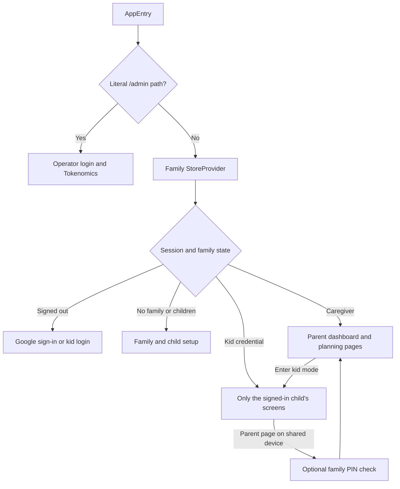
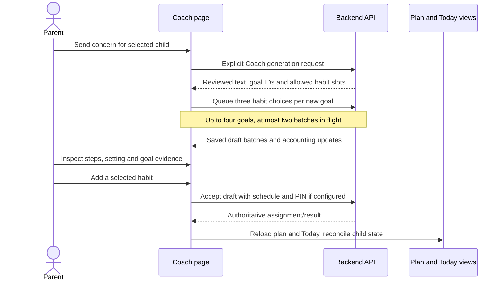

# Frontend experience and application workflows

This document describes the implemented React/Vite app as of November 6, 2026.
The browser is a presentation and interaction layer over the backend. It does
not independently award points, decide ownership, or turn an AI suggestion into
a child's assignment.

## Application shell and audiences

The family application uses hash routes. The literal `/admin` path mounts a
separate operator application before the family store is created. Parent and kid
screens share visual primitives, but use different API credentials and different
server projections.

| Surface | Route | Main responsibility |
| --- | --- | --- |
| Landing, privacy and login | `#/`, `#/privacy`, `#/login` | Explain the product, authenticate and link to operator login |
| Family joining and onboarding | `#/join/:code`, `#/welcome` | Distinguish grown-up invite access from kid code/PIN access; create a family and its first child |
| Dashboard | `#/parent` | Approvals, each child's complete assigned plan, progress, check-ins, rewards and AI helpers |
| Child details | `#/setup`, `#/setup/:child` | Profile, age, routine times, buddy and relevant child settings |
| Habit Coach | `#/coach`, `#/coach/:child` | Conversational advice, recommended goals, habit choices and explicit acceptance |
| Quest Library | `#/quests/:child` | Manage the child's assignments in the default Quests view or By goal view |
| Exact goal view | `#/quests/:child/goal/:goalId` | Display only the goal and assignments with that exact saved goal ID |
| Family and rewards | `#/family`, `#/rewards` | Caregivers, codes/PINs, data controls, shop items and time limits |
| Child experience | `#/kid/:child`, `#/world/:child/:world`, `#/shop/:child`, `#/journal/:child` | Today's quests, worlds, rewards, wardrobe and field journal |
| Operator console | `/admin` | Separate authentication, Tokenomics policy, price inputs and sanitized generation metrics |

Sources: [app routing](../frontend/src/App.tsx), [operator entry boundary](../frontend/src/AppEntry.tsx),
[family state](../frontend/src/lib/store.tsx), [operator page](../frontend/src/pages/Admin.tsx).

## State ownership and synchronization

The server owns families, children, plans, completions, approvals, points and
saved generated habits. `StoreProvider` loads an account/family snapshot and
provides the browser view consumed by pages. `sync.ts` applies authoritative Today,
progress and extras responses to that view. A cached snapshot helps boot and
shared-device continuity; it is not a second writable database.

- Caregiver credentials and account snapshots use browser local storage.
- A caregiver handing over a device uses a per-tab kid session and kid-mode flag.
- A child's own code/PIN login has a separate stored kid identity.
- Optional generation timing preferences/history are browser-local and account
  scoped; durable generation accounting belongs to the backend.
- Coach history has an in-memory child/account cache. Saved messages and choices
  are fetched from the API; passive reads do not request new generations.
- Buddy selection revisions prevent a delayed Today/extras response from
  replacing a newer explicit selection.

The API client uses bearer authentication and separates normal request deadlines
from AI request deadlines. It can retry eligible reads while a server wakes, but
does not blindly replay writes after gateway/network failures: a write may already
have committed. Generation request IDs and saved operation results provide the
appropriate replay boundary instead.

Sources: [storage](../frontend/src/lib/storage.ts), [sync](../frontend/src/lib/sync.ts),
[API client](../frontend/src/lib/api/client.ts), [Coach cache](../frontend/src/lib/coachContext.ts),
[generation preferences](../frontend/src/lib/generationPreferences.ts).

## Parent planning journey

The app deliberately separates five things that may look related on screen:

1. **A recommended goal** is a source-backed suggestion from Coach.
2. **A saved goal** is a goal the caregiver has put in this child's plan.
3. **A habit choice** is a generated draft beneath that goal.
4. **An accepted habit** has immutable reviewed content and an owning child.
5. **An assignment** schedules that habit on chosen days and at a cue time.

Generating choices does not assign them. Saving a goal does not silently add
every habit under it. Details use the persisted goal ID, rather than guessing the
goal from a category or similar title.

Coach keeps the child selector, compact credit chip, chat, stage feedback and
small setting icons together. A new response's goals appear before earlier
recommendations and the saved-plan section. A saved goal recommended again is
shown once with its saved status. Goal cards use compact habit rows, with larger
dialogs for steps, grown-up guidance and research. “Get more goals” appends goals;
“More habit choices” requests another bounded batch without deleting prior choices.

The current Coach hides inline per-response/prepared-habit credit copy. Its compact
daily meter remains. The November 6 credit correction also preserves automatic
habit slots for successful refined responses. See
[Coach and generation design](06-habit-coach-and-habit-generation.md) and
[Tokenomics](11-tokenomics-latency-and-observability.md).

Sources: [Coach](../frontend/src/components/Coach.tsx),
[goal cards and preparation queue](../frontend/src/components/GoalRecommendations.tsx),
[accepted habit details](../frontend/src/components/GeneratedHabitDetails.tsx),
[setting inference](../frontend/src/lib/habitSetting.ts).

## Dashboard and Quest Library

The dashboard fetches **both Plan and Today** for each child. Today is a scheduled
daily projection; it cannot stand in for the full plan. This distinction fixes the
earlier appearance that newly assigned habits had vanished on non-scheduled days.
Habit rows precede the Goals summary. The dashboard refreshes after mutations,
on focus/visibility and on a 30-second visible-page polling interval.

Quest Library has two views of the same data:

- **Quests** is the default list with schedule, pause/resume, removal and details.
- **By goal** groups the same assignment rows beneath an illustrated goal summary.
  It reuses assignment controls; changing the view creates no new plan records.
- Direct goal links filter by exact `goal_id`, and source-goal details validate
  that the requested goal belongs to the child's accessible plan.

The current limit is six non-removed assignments per child; paused habits still
occupy capacity. Draft choices do not. A full plan offers a removal path and keeps
generated choices available. Removing a habit retains its history; restoration
uses existing approved content instead of spending on another generation.

Sources: [dashboard](../frontend/src/pages/ParentDashboard.tsx),
[Quest Library](../frontend/src/pages/QuestLibrary.tsx),
[goal details](../frontend/src/components/PlanGoalDetails.tsx),
[plan capacity and restoration](../backend/src/habitquest_backend/onboarding.py).

## Child loop, progress and rewards

The child sees picture quests and simple instructions. Generated-habit details
include steps, materials, cue, help and a recognizable goal image. Grown-up
preparation, conversation content and parent guidance are excluded from the kid
API projection.

1. The child submits “I did it!” for an assigned quest.
2. It becomes pending, not immediately approved or rewarded.
3. A caregiver approves or sends it back. Rejected submissions can be retried.
4. The backend returns the new points and journey progress; the UI celebrates
   those returned values.
5. Spendable points support the reward shop and requests. Sparks drive worlds
   and are not spent on shop items.

The journey includes six worlds, landmarks, quest stars, treasure chests and eight
wardrobe accessories. Check-ins, caregiver surprises and the daily app-time limit
are separate features. Buddies are persistent identities with local artwork and
deterministic selection, described in [buddies and assets](12-buddies-artwork-and-assets.md).

Sources: [kid screen](../frontend/src/pages/Kid.tsx),
[quest steps](../frontend/src/components/QuestCard.tsx),
[daily rules](../backend/src/habitquest_backend/daily.py),
[journey](../backend/src/habitquest_backend/journey.py),
[rewards](../backend/src/habitquest_backend/rewards.py).

## Design process and verification boundaries

The interface evolved from broad text cards into goal-led, illustrated choices
with compact previews and focused detail dialogs. The important corrections were
data-flow corrections as well as styling: exact goal links, Plan-versus-Today
separation, explicit assignment, child-safe detail projections and stale-response
guards. Regression journeys cover two children, multiple goals, approval, chat
reset and restoration.

Screen tests use a fake API; browser journeys use isolated synthetic databases.
Those checks establish UI and persistence behavior, not live-model quality or a
latency guarantee. Production uses built static assets and does not hot-reload
already-open tabs as local Vite does. A browser refresh loads a new deployed build.

Further evidence: [planning screen tests](../frontend/src/pages/Planning.screen.test.tsx),
[goal-link tests](../frontend/src/pages/QuestLibraryGoalLinks.screen.test.tsx),
[library view tests](../frontend/src/pages/QuestLibraryViews.screen.test.tsx),
[kid-mode tests](../frontend/src/pages/KidMode.screen.test.tsx),
[historical UI decisions](../docs-detailed/sys-design-update/goal-plan-reliability.md).
