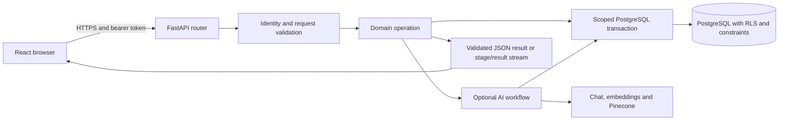
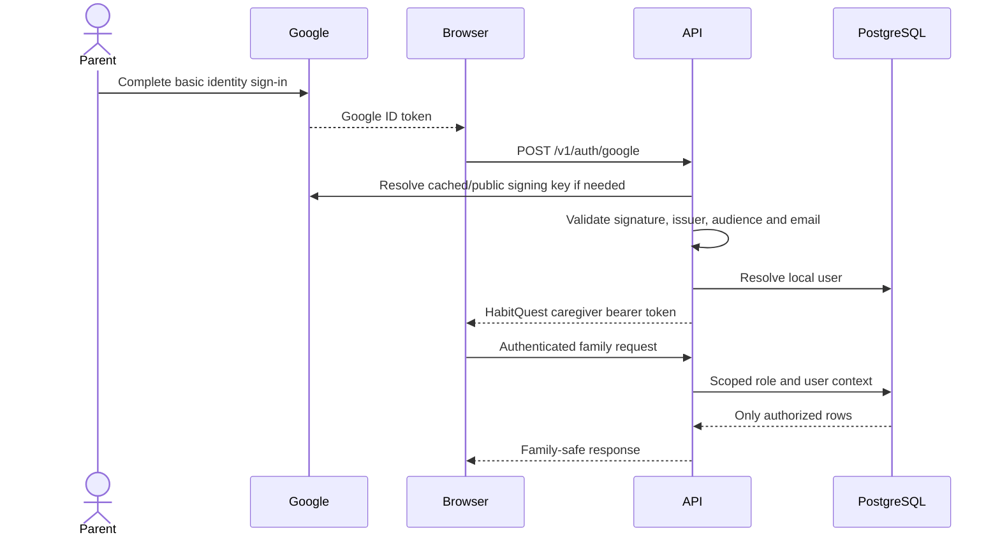

# Backend API, authentication and access boundaries

HabitQuest's implemented backend is one FastAPI application with domain-focused
Python modules, PostgreSQL transactions and LangChain/LangGraph AI workflows.
It is not a set of independently deployed microservices. This is the November 6,
2026 design; the AWS runtime is described in [deployment](13-aws-deployment.md).

## Request structure

`create_app` loads validated settings, configures allowed browser origins, installs
health endpoints and registers feature routers. Pydantic request models validate
input shapes; protected endpoints obtain caregiver, kid or operator identity
through explicit dependencies.

| Module group | Responsibility |
| --- | --- |
| `accounts`, `auth`, `limits` | Google/token exchange, families, caregivers, codes, PINs, kid identities and attempt limits |
| `onboarding`, `habits` | Children, routine times, source/catalog access, goals, assignments and custom habits |
| `daily`, `journey` | Today, submissions, approvals, points multipliers, Sparks, worlds and quest stars |
| `rewards`, `extras`, `checkins` | Reward shop/requests, wardrobe/chests, family settings, surprises, check-ins and safety alerts |
| `coach`, `refined`, `generated_habits` | Coach conversations, reviewed goal suggestions, drafts and explicit acceptance |
| `planning_catalog`, `retrieval` | Pinned canonical source binding and semantic retrieval |
| `insights`, `ai`, `safety` | Separate planner/review, onboarding mapping, optional buddy lines and child-text screening |
| `generation_progress`, `generation_metering`, `tokenomics*` | Stage transport, durable generation admission, usage/costs and family credit views |
| `admin` | Operator-only configuration and sanitized metrics |

Source: [application factory](../backend/src/habitquest_backend/main.py),
[configuration model](../backend/src/habitquest_backend/config.py).

## Three identities, three application boundaries

### Caregivers

Google Identity Services gives the browser a Google ID token. The browser sends
that credential to `POST /v1/auth/google`. The backend verifies the RS256 signature
against cached Google public keys, issuer, expiration, configured client-ID audience
and verified-email claim. It resolves the local user and returns HabitQuest's own
HS256 bearer token.

The real Google sign-in endpoint issues an **eight-hour** session, as do kid
session/login endpoints. The generic token helper's default is 15 minutes; it is
not the duration used by those endpoints. A user can be a caregiver in more than
one family through `caregivers`. Invite codes join grown-ups to a family.

This flow does not use a Google client secret at runtime. The browser receives
only the public client ID. Development username/password login is a separately
gated feature and is disabled in the deployed public app.

### Kids

A caregiver can request a token for one child when handing over a device. A child
can alternatively use the family login code and their own PIN on another device.
The token's role is `kid`, and its subject is that child's ID. Kid endpoints derive
the child from the token; they do not trust a user-supplied sibling ID.

Caregiver and kid credentials are rejected on each other's endpoint families.
Frontend route guards improve the experience, but backend identity checks and
database policies enforce the boundary. The optional family PIN provides an
additional grown-up confirmation for relevant actions and shared-device exit.
It is distinct from the child's own sign-in PIN and from operator credentials.

### Operators

`/admin` is an independent browser entry and `/v1/admin` is an independent API
boundary. Operator tokens have a separate signing secret, audience, issuer suffix,
role and revocation version. Their configured default lifetime is 30 minutes.
The browser keeps the admin token in memory. An operator is not added to a family
and does not inherit the caregiver API's data access.

Sources: [authentication](../backend/src/habitquest_backend/auth.py),
[account/session endpoints](../backend/src/habitquest_backend/accounts.py),
[operator authentication](../backend/src/habitquest_backend/admin.py),
[browser admin entry](../frontend/src/AppEntry.tsx).

## Database authorization and atomicity

Ordinary domain operations connect with psycopg, begin a transaction, set the
local database role and set transaction-local identity variables. A successful
context commits; an exception rolls back. The shared helper sets a three-second
connect timeout and ten-second statement timeout.

| Database role | Scope |
| --- | --- |
| `hq_api` | Caregiver domain operations scoped by `app.user_id` and family membership |
| `hq_kid` | Narrow reads/writes for `app.child_id`; no general child-profile or parent-content access |
| `hq_meter` | Internal operation/attempt accounting and validated family/child scope lookup |
| `hq_admin` | Tokenomics policy, pricing and sanitized accounting views; not general family content |

The deployed runtime login is a restricted `NOINHERIT` role allowed to enter the
needed roles explicitly. It is not the RDS master or migration operator. RLS
provides defense against missing family predicates, while SQL constraints,
triggers, row locks and narrow security-definer functions protect cross-row
invariants. Public reference data is intentionally different from private
family tables; “every database row is private” would be an inaccurate description.

Examples of invariants include:

- Another family's inaccessible record returns 404 without confirming it exists.
- A generated habit has a durable owning child; it cannot become a sibling's
  ordinary custom habit if a draft/detail row disappears.
- Accepted generated instructions cannot be edited through custom-habit routes.
- A kid receives only the child-facing projection of a generated habit.
- Draft acceptance locks the relevant child/batch and rechecks PIN, age, reset
  fence, expiry, provenance and plan capacity before the atomic write.
- Buddy selection validates the final age and expected revision while holding
  the child lock, preventing a parent/kid race from silently overwriting a choice.

Sources: [transaction helper](../backend/src/habitquest_backend/db.py),
[generated habit ownership migration](../backend/db/migrations/202611040004_generated_habit_ownership.sql),
[draft acceptance](../backend/src/habitquest_backend/generated_habits.py),
[buddy validation](../backend/src/habitquest_backend/buddies.py),
[Tokenomics grants](../backend/db/migrations/202611050003_tokenomics.sql).

## Transport, retries and operational boundaries

- `/health/live` establishes process liveness; `/health/ready` performs a small
  database read. Neither performs a paid model request.
- Optional SSE sends fixed stage identifiers, elapsed time and the final JSON
  result. It does not expose unreviewed model drafts. Provider work already
  dispatched or a database write already committed cannot be undone by closing
  the browser connection.
- The browser does not automatically replay failed writes. Explicit generation
  IDs, fingerprints and persisted results bound retries and accounting.
- CORS permits the configured frontend origin. CORS is not authentication; the
  API independently verifies bearer tokens and database access.
- Sign-in and PIN rate limiting is currently process-local. It resets on restart
  and is not a distributed abuse-control service.
- Behind the ALB, the API trusts only the last ALB-appended address when the
  actual socket peer is in the configured proxy subnets. Uvicorn runs with
  `--no-proxy-headers`; arbitrary caller headers are not accepted as identity.
- Startup does not run migrations or seed the deployed database. Those are
  deliberate operator activities with a named target and preserved migration ledger.

Sources: [progress transport](../backend/src/habitquest_backend/generation_progress.py),
[API client retry boundary](../frontend/src/lib/api/client.ts),
[address and attempt limits](../backend/src/habitquest_backend/limits.py),
[deployment runtime](13-aws-deployment.md).

## Security design process and validation

The design combines visible parent decisions with backend authority and database
constraints. Later source-goal, generated-habit, Tokenomics and buddy capabilities
were additive; they retain existing family ownership, accepted content and
progress. Each extension has tests for wrong-role access, cross-family/child
access, stale requests and replay, rather than relying on UI filtering alone.

These are implemented boundaries, not a claim of a completed independent security
audit. Current limitations include browser-stored family bearer tokens, in-memory
attempt limits and a single prototype runtime deployment. Any scaling or identity
redesign must preserve or strengthen the existing contracts.

Test evidence: [accounts](../backend/tests/test_accounts.py),
[admin](../backend/tests/test_admin.py), [proxy trust](../backend/tests/test_proxy_address.py),
[generated habits](../backend/tests/test_generated_habits.py),
[habit audience contract](../backend/tests/test_habit_audience_contract.py),
[buddy authorization/races](../backend/tests/test_buddies.py).
