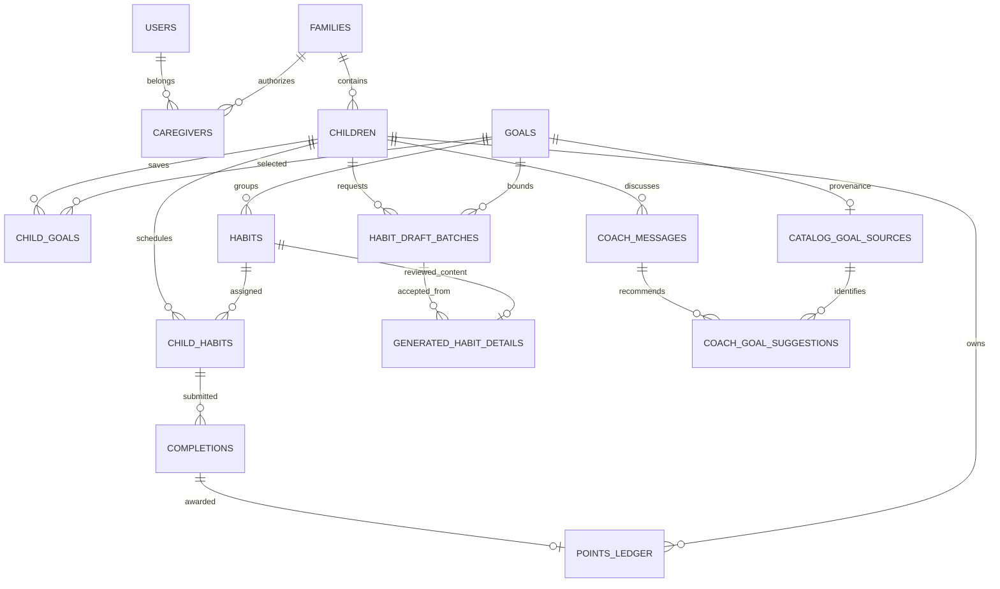

# Database and domain model

PostgreSQL is the authoritative store for HabitQuest accounts, child plans,
accepted habits, daily progress and generation accounting. Pinecone is a semantic
retrieval index over the researched public catalog, not the family database.
This document reflects the 22 SQL migrations present on November 6, 2026: they
define 36 tables in `hq`, plus the separate `public.hq_migrations` ledger.

## Storage boundaries

| Store | What belongs there | What it does not decide |
| --- | --- | --- |
| PostgreSQL `hq` | Family ownership, profiles, plans, accepted content, completions, points, reports and accounting | Semantic similarity ranking by itself |
| Packaged canonical catalog | Pinned source IDs, cards, hashes and provenance used to validate retrieved hits | Which goals are already saved for a child |
| Pinecone | Searchable catalog vectors and metadata | Child assignments, family data or points |
| Frontend presentation manifests/assets | Public goal/category art and buddy metadata | Whether a goal exists in the application database or is assigned |
| Browser storage/cache | Session context, UI preferences, snapshots and optional local timing history | Authoritative approvals, balances or assignment ownership |

The app can package presentation for 381 source cards without importing all of
them into PostgreSQL. A source card becomes an `hq.goals` row only through the
validated generation/materialization path. Browsing source detail and rendering
an image are read-only activities.

Sources: [catalog repository](../backend/src/habitquest_backend/planning_catalog.py),
[lazy materialization migration](../backend/db/migrations/202611040005_lazy_catalog_goals.sql),
[retrieval](../backend/src/habitquest_backend/retrieval.py),
[presentation component](../frontend/src/components/CatalogVisual.tsx).

## Core entities and relationships

The diagram shows important foreign-key relationships, not every column or table.
The base [schema reference](../backend/docs/schema.md) remains useful for original
tables, but the migration files and this design include later source-goal,
generated-habit, Tokenomics and buddy additions.

## Goal, habit, draft and assignment are distinct

| Concept | Main record | Meaning and lifetime |
| --- | --- | --- |
| Goal | `goals` | Desired skill/outcome; global catalog identity |
| Canonical binding | `catalog_goal_sources` | Source card/concept/category/version/hash/snapshot tied to a materialized goal |
| Child goal | `child_goals` | This child's suggested, active, done or dropped goal |
| Coach recommendation | `coach_goal_suggestions` | Ordered, pending/dismissed source-goal suggestion owned by the child's conversation |
| Draft batch | `habit_draft_batches` | Private child/goal-bound generation, request identity, source snapshot and choices; default expiry 24 hours |
| Habit | `habits` | Reusable catalog/custom content or an accepted private generated action beneath exactly one goal |
| Accepted generated detail | `generated_habit_details` | Reviewed structured instructions, source, batch/draft identity and content digest |
| Assignment | `child_habits` | A child's schedule for a habit: cue time, days, active/paused/removed status and dates |

For imported planning content, **the researched habit card maps to a goal**, and
**the generated action maps to an app habit**. Category similarity is never a
substitute for the `goal_id` foreign key. `my-ai-` generated habits retain
`generated_child_id`; the database enforces that they cannot be assigned to a
sibling or rewritten through ordinary custom-habit updates.

Source materialization checks the caller's child and final age, permitted setting,
eligible intent class, language, release version and canonical SHA-256. A pinned
allowlist and advisory lock prevent untrusted source insertion and conflicting
concurrent materialization. An existing incompatible binding fails rather than
silently rewriting the catalog identity.

The plan limit counts six non-removed assignments, including paused ones. Drafts
do not consume capacity. Explicit acceptance checks room under a child lock;
removal preserves assignment/completion history and makes capacity available.
Restoration reuses approved content. Chat reset cancels/invalidates conversation
work while preserving accepted plan content and its identity.

Sources: [catalog binding migration](../backend/db/migrations/202611040001_catalog_goals.sql),
[draft/detail schema](../backend/db/migrations/202611040002_generated_habits.sql),
[ownership protection](../backend/db/migrations/202611040004_generated_habit_ownership.sql),
[plan operations](../backend/src/habitquest_backend/onboarding.py),
[draft lifecycle](../backend/src/habitquest_backend/generated_habits.py).

## Daily completions and two different reward measures

`completions` has one row per assignment and day. Submission, approval and rejection
are explicit states. The child's Today endpoint calculates the day in the family's
timezone and projects only relevant scheduled assignments. The full Plan endpoint
returns the broader assignment set, including habits scheduled on another day.

Points are the sum of `points_ledger`, with a unique completion reference for an
earned award. Approval and ledger updates are transactional; duplicate approval
does not create another payment. Redemption/reward operations record negative
ledger entries and enforce the available balance. Reward requests also represent
their pending/decided state, including reserved spending behavior.

Sparks are separate progress. Current journey code sums approved habit tiers per
day, capped at six daily completion Sparks, and adds stored journey bonuses.
Pending Sparks are calculated separately. World thresholds are 0, 30, 90, 180,
300 and 450; quest stars use approved-completion thresholds of 5, 15 and 30.
The old base-migration comment saying simply “count of approved completions” is
historical and does not describe the final journey calculation.

Sources: [daily loop](../backend/src/habitquest_backend/daily.py),
[journey calculations](../backend/src/habitquest_backend/journey.py),
[points/rewards](../backend/src/habitquest_backend/rewards.py),
[daily-loop schema](../backend/db/migrations/202610310003_daily_loop.sql).

## Table inventory by capability

| Area | Tables |
| --- | --- |
| Identity and profiles | `users`, `families`, `caregivers`, `children`, `family_settings` |
| Catalog and plans | `goals`, `habits`, `pain_points`, `child_goals`, `child_habits`, `catalog_goal_sources` |
| Conversations and generation | `coach_messages`, `ai_suggestions`, `coach_goal_suggestions`, `ai_usage`, `ai_reports`, `habit_draft_batches`, `generated_habit_details` |
| Daily loop and family features | `completions`, `points_ledger`, `rewards`, `reward_requests`, `checkins`, `surprises`, `surprise_reveals`, `child_extras` |
| Public buddy reference | `buddy_catalog`; selection mode/ID/version/revision are additive columns on `children` |
| Current Tokenomics | `tokenomics_policy`, `tokenomics_policy_audit`, `ai_price_versions`, `tokenomics_exposure`, `family_ai_windows`, `ai_operations`, `ai_provider_attempts` |
| Preserved earlier budget records | `planning_budget`, `planning_reservations`; historical carryover, not current app admission authority |
| Migration integrity | `public.hq_migrations`, outside the `hq` schema |

Tokenomics stores policy/price snapshots, invocation/attempt usage, timings,
estimated cost and reservation exposure independently from displayed family
credits. Parent/child operation links bind automatic habit slots to the Coach
request. It preserves prior exposure across the accounting cutover. See
[Tokenomics design](11-tokenomics-latency-and-observability.md).

## Concurrency, access and replay

- RLS scopes family tables to caregiver membership or the authenticated child.
  Public reference reads and internal metering/admin roles have separate policies.
- `(child_id, request_id)` makes draft requests idempotent; the input digest rejects
  a reused key with changed input.
- Draft completion/acceptance rechecks child age, reset marker, expiry and source.
  A late result cannot resurrect choices after reset or an incompatible age edit.
- `(batch_id, draft_id)` binds one accepted detail record to a reviewed choice.
- A partial unique assignment index prevents duplicate non-removed assignments
  for the same child and habit.
- `(child_habit_id, day)` and the unique points completion reference protect the
  daily loop against duplicate submissions/awards.
- Buddy selection uses an expected revision and row lock; ordinary old-client
  profile writes cannot overwrite a deliberate newer selection.
- AI operation request keys, fingerprints and bound goal slots prevent duplicate
  metering and unbounded automatic preparation.

These constraints complement API validation. They are not delegated to the LLM.
See [API and access boundaries](03-backend-api-and-security.md).

## Migrations, development and recovery

`scripts/setup_db.py` explicitly selects `DATABASE_URL`, obtains an advisory lock,
applies migrations in filename order and records each file's SHA-256. A changed
already-applied file raises an error. The catalog seed runs only when that operator
script is invoked; the current AWS container does not automatically migrate or seed
on startup.

The earliest migration contains a historical destructive schema reset. Therefore
an imported database must retain its migration ledger: restoring rows without
their ledger and replaying every migration is not a valid deployment approach.
New changes require new migrations and a tested backup/restore plan. Tests that
empty tables use disposable databases ending in `_test`, never the real app DB.

AWS uses always-on PostgreSQL RDS for this demo; the local app keeps its separate
local PostgreSQL. The deployment record contains the existing backup/import and
connection procedures. This documentation review performs no live schema/data
changes and does not claim a fresh production table audit.

Sources: [migration runner](../backend/scripts/setup_db.py),
[migration files](../backend/db/migrations/), [schema tests](../backend/tests/test_schema.py),
[plan-management tests](../backend/tests/test_plan_management.py),
[cross-surface planning journey](../backend/tests/test_planning_journey.py),
[RDS import record](../../hq-deployment/docs/13-import-execution.md).
