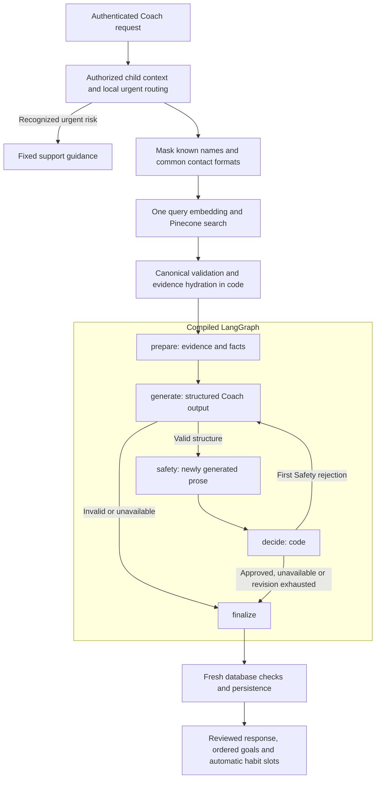

# AI orchestration and safety boundaries

Current implementation reviewed November 6, 2026. This describes the deployed
`COACH_ENGINE=refined` path. The earlier single tool-calling agent and crew remain
in source as selectable alternatives; their diagrams are not the active design.

## Design in one paragraph

HabitQuest uses LangChain for provider clients and typed model output, and
LangGraph for a small, explicit Coach state machine. Code retrieves source cards,
computes progress facts and enforces authority. A central generator writes advice
and selects allowed goals. A separate model reviews the newly generated prose.
There is one possible revision, followed by a final decision in code. Habit
writing, weekly review and Quest Planner are separate operations, rather than
hidden agents invoked by every chat message.

## What “agentic” means here

There are **five nodes in the active Coach graph and two model-backed roles**.
Five graph nodes do not mean five LLM calls. Retrieval is prepared before the
graph invocation and is not a generative “research agent.”

| Active graph node | Responsibility | Chat-model calls |
| --- | --- | --- |
| `prepare` | Assemble bounded evidence, age, conversation, plan and deterministic progress facts; construct allowed choices | 0 |
| `generate` | Produce structured advice, goal selections and proposed changes from the evidence | 1 per pass |
| `safety` | Review newly generated conversational text, questions and explanations | 1 per pass |
| `decide` | Permit a single revision only after a Safety rejection | 0 |
| `finalize` | Publish reviewed output or a fixed failure response with an explicit outcome | 0 |

The graph is compiled once. Per-request runtime context supplies the authorized
snapshot, settings and result accumulator; requests do not share mutable family
state through the graph definition.

Preparation failure also goes directly to `finalize`. Graph nodes check the same
monotonic deadline before starting more work or publishing late output.

## Call budget by operation

“Logical call” means one application invocation of a model. An SDK retry is a
separate HTTP attempt, even if it belongs to that same logical call.

| Operation | Normal logical chat calls | Allowed additional work |
| --- | ---: | --- |
| Refined Coach | 2: generator + output Safety | One rejected-text revision: another generator + Safety, 4 total |
| Query retrieval | 0 | One embedding request and one Pinecone Documents search; no chat summarizer or model safety |
| Habit batch | 1 writer | One correction for failed local validation, 2 total |
| Quest Planner | 1 | SDK retry policy only; no Coach graph or retrieval |
| Weekly review | 1 | SDK retry policy only; no Coach graph or retrieval |
| Legacy buddy line | Up to 2 | One generator and one child-facing screen, with fixed fallback |
| Catalog buddy line | 0 | Fixed event copy |
| Child-written note screen | Up to 1 | Local checks run first |
| Onboarding goal mapping | Up to 1 | Local risk routing and keyword/manual fallback |

A Send returning four new goals can subsequently trigger four separate writer
batches. Its normal total is therefore **six chat calls across five operations**,
plus the embedding and search, even though the Coach graph itself needs two.
Those writer requests are explicit preparation authorized by the Send action,
limited to two in flight. There is no automatic assignment to a child's plan.

See [Coach and habit generation](06-habit-coach-and-habit-generation.md) for that
parent interaction and [other AI capabilities](07-planner-review-and-other-ai.md)
for the independent report and child-text workflows.

## Safety and authority are different checks

| Boundary | Implemented protection | What it does not claim |
| --- | --- | --- |
| Before external retrieval | Fast code masks known child/caregiver names and common email/phone formats | Comprehensive PII recognition or a model-based input review |
| Local urgent routing | Recognized risk phrases return fixed support guidance before inference | Clinical assessment or exhaustive understanding of unusual wording |
| Pinecone results | Pinned release, source IDs, metadata/hash, age/context and concept checks | Another safety review of the already curated catalog |
| Coach structured output | Dynamic allowed-ID schema, relationship/eligibility bounds and local validation | That model-selected relevance has been independently proven |
| Coach prose | Separate generated-text Safety verdict; any problems reject approval | Review of every canonical source field as if newly authored |
| Habit drafts | Local schema, source, age, wording, duration, privacy and action-novelty checks; parent preview | A separate model safety verdict on the entire habit |
| Acceptance | Current authorization, optional parent PIN, ownership, goal linkage, eligibility and plan-capacity checks | Permission for AI to apply changes on its own |

The `selected_goal_context` supplied to Safety helps interpret the generated
explanations. The catalog is trusted context, not new text being approved or
rewritten. The old remote `ParentRisk` step is not called by refined Coach or
habit writing. Legacy engines and child-text screening retain their own rules.

## Deterministic work replacing the former crew

- **Triage:** the explicit UI operation and central Coach interpret the request;
  there is no separate triage model.
- **Research:** retrieval returns curated, versioned source records. Their research
  support and limitations are already attached; no live browsing or research
  summary model runs during a chat.
- **Patterns:** SQL/context code supplies counts and plan facts. Weekly review is
  the separate, parent-initiated place for narrative interpretation of progress.
- **Fit:** code constrains allowed IDs, relationships, age, context and capacity;
  the generator must ground its explanation in the candidate. There is no remote
  Fit model or fit-driven revision loop in refined mode.
- **Decision:** code decides whether to revise, publish or return a fixed failure.

The original [planning-service prototype](../../hq-ai-services/planning-agent/README.md)
uses an actual Deep Agents harness with bounded tools and checkpoints. HabitQuest
adapted its catalog, retrieval and action-generation capability into backend
modules. It does **not** make a nested HTTP call to that prototype or run its
multi-invocation harness inside the active Coach graph.

## Failure, concurrency and observability

Provider failure, malformed output, timeout or exhausted Safety revision returns
a named outcome and retains earlier usable recommendations. A retrieval failure
is not presented as proof that no matching catalog card exists. Raw unreviewed
model text is not streamed to the browser; progress events report actual stages,
followed by the final validated result.

The configured Coach outer deadline is 65 seconds. It prevents subsequent
dispatch and late persistence but cannot retract an HTTP request already accepted
by a provider. Habit writing has its own 45-second deadline. These are failure
bounds, not expected response-time promises.

The endpoint metering layer tracks operation identity, reservations, attempts,
tokens, cost estimates and settlement separately from graph state. Since the
November 6 fix, reviewed final outcomes such as `recommendations` and `advice`
are recognized as successful instead of being misclassified as zero-credit
failures. That also preserves automatic habit slots. See
[Tokenomics and latency](11-tokenomics-latency-and-observability.md).

## Source of truth and verification

- [Refined graph and prompts](../backend/src/habitquest_backend/refined.py)
- [Request orchestration, privacy, retrieval and persistence](../backend/src/habitquest_backend/coach.py)
- [Context cache and authoritative fingerprints](../backend/src/habitquest_backend/coach_context.py)
- [Provider adapter, deadlines and attempt counting](../backend/src/habitquest_backend/llm.py)
- [Outcome settlement](../backend/src/habitquest_backend/generation_metering.py)
- [Graph regression tests](../backend/tests/test_refined.py) and
  [Coach integration tests](../backend/tests/test_coach_goals.py)
- Historical reasoning: [refinement operations](../docs-detailed/sys-design-update/refined-ai-operations.md)
  and [integration execution](../docs-detailed/sys-design-update/implementation-progress.md)

The dated execution records contain live samples; mocked regression tests prove
contracts and failure boundaries, not provider relevance or a production p95.
The final design retains the five-second useful-response goal without claiming
that every first response, revision or multi-goal preparation meets it.
