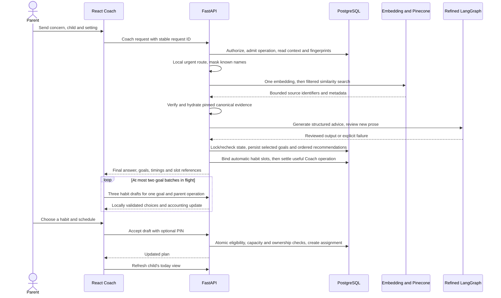
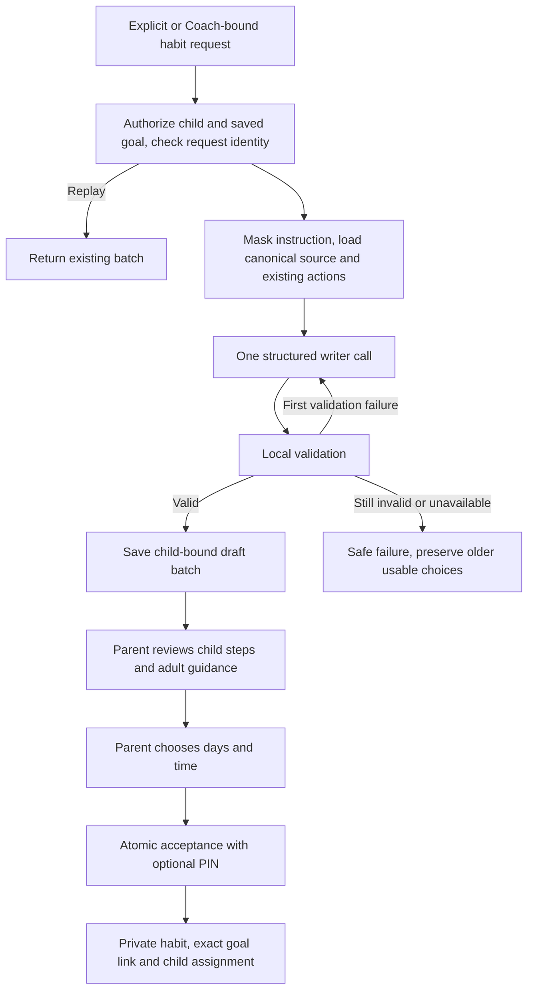

# Habit Coach, source goals and generated habits

Current design reviewed November 6, 2026. A canonical catalog **habit card becomes
a HabitQuest goal**; a generated concrete action becomes a **habit beneath that
goal**. This translation preserves the existing app's daily quests, scheduling,
parent approvals, Sparks and points.

## The parent experience

Coach is a child-scoped conversation. A compact child selector shows age, and
the daily credit chip sits with New chat. Small location icons share the composer
area. Code suggests a location from the concern or source context; the parent can
override it. Location selection makes no model call.

The reviewed answer is displayed as brief guidance with ordered steps. New goals
appear first, with clear separation from earlier recommendations and saved goals
already in the plan. Cards use catalog artwork, age/context information and
research summaries. Modal readers hold the fuller source and habit details.

- A new Send aims for three or four relevant goals, with a hard maximum of four;
  it does not fabricate goals merely to fill the screen.
- Three habit choices are automatically requested for each permitted new goal,
  with no more than two batches running at once.
- Existing usable saved batches are reused. Passive page loads and saved-draft
  reads do not spend or launch generation.
- **Get more goals** appends additional relevant goals while preserving prior
  choices. **More habit choices** explicitly requests another bounded batch of
  three; it does not discard the existing batch.
- Generated choices remain proposals. The parent selects the habit, schedule
  and optional PIN confirmation before it joins the child's plan.

The current Coach does not render inline “credits used,” preparation accounting
or per-batch price copy beneath its answers/cards. The compact daily meter remains.
Generation stages and optional seconds remain independent display features. An
already-open production tab needs a reload after deployment; local Vite refreshes
changed development code automatically.

## End-to-end request and persistence

The browser renders stage events while work is in progress. It waits for reviewed
Coach output before showing generated prose. Habit batches continue separately
after the goals arrive, so “time to Coach answer” and “time until every goal has
three choices” are different measurements.

## Retrieval: what “deep search” does

The active source-goal path performs one masked query embedding using the pinned
512-dimensional embedding model and one Pinecone Documents similarity search.
Hard filters include age, selected context and catalog release; previously shown
concepts can be excluded for more-goals requests. The search asks for at most 12
matches and hydrates at most six distinct eligible concepts for the generator.

The API checks returned identity and metadata against its packaged catalog,
including source provenance and embedding compatibility. It then uses the local
canonical content for the model and source reader. Search result text is not
allowed to override the canonical record. Retrieval neither writes to Pinecone
nor creates all catalog goals in PostgreSQL.

Follow-up resolution is deterministic: a short refinement retains the recent
explicit objective, while an identified topic change establishes a new objective.
This is a bounded heuristic rather than a universal intent classifier. The full
parent feedback still reaches the Coach generator.

The historical `G1`-style guidance citations belong to the older local-guidance
mode. The current source-goal path uses the catalog's research references,
support statements and limitations. It performs no live research browsing and
does not assert that each generated action has independently demonstrated efficacy.
See [research and Pinecone catalog](10-habit-research-and-pinecone-catalog.md).

## Lazy goal materialization

A stable `hqg-...` identifier maps a specific canonical source record, including
its age variant, to an application goal. Only goals selected by reviewed Coach
generation are materialized with their source provenance. Reading a source card,
retrieving candidates or obtaining a failed/rejected response creates no goal.

Ordering and lineage are explicit: recommendation order survives reload;
canonical lock ordering prevents conflicting writes without reordering the UI.
A saved goal recommended again appears with the latest response and a saved
label, rather than becoming a duplicate goal. A habit links to its exact source
goal; category similarity is not used to infer or repair that relationship.

## The separate habit writer

`POST /v1/children/{child_id}/goals/{goal_id}/habit-drafts` accepts a count from
one to three; the current UI explicitly requests three. The goal must already be
materialized and authorized. The writer consumes its canonical evidence, child
age, setting, parent instruction and previously generated actions. It does not
repeat retrieval or invoke Quest Planner.

The output separates short child instructions from adult preparation, explanation
and coaching guidance. The schema includes readable steps, completion criteria,
materials, a cue, optional help, an action-appropriate Fluent icon and a duration
estimate. The estimate is not a deadline imposed on the child.

Validation checks exact count, shape, source grounding constraints, age-related
wording, allowed duration, privacy leakage and novelty against previous actions.
Only a local validation failure permits one correction call. No independent
whole-habit Safety model is added. These checks plus parent approval are a bounded
validation strategy, not a claim of exhaustive semantic safety review.

## Data and lifecycle safeguards

| Concern | Current rule |
| --- | --- |
| Duplicate generation | A stable request ID and input digest return the existing batch or reject incompatible reuse |
| Child/family isolation | Requests, drafts, provenance and accepted habits are authorized and child-bound |
| Reset or age change | Conversation/reset and age checks prevent accepting stale drafts |
| Plan capacity | Acceptance rechecks the six-active-habit limit under the child lock; removing a habit makes room |
| Goal linkage | Accepted `my-ai-...` habits retain the exact materialized source goal and lineage |
| Parent control | No automatic assignment; schedule and optional PIN are checked on acceptance |
| Existing accepted content | Approved generated instructions remain immutable through the ordinary editor |
| Child display | Kid APIs project child-facing fields; parent setup and adult coaching copy stay caregiver-only |
| Rewards | Existing tier-1/custom-habit 10-point policy applies; catalog-card reward rules are not imported |
| More choices | Append bounded batches, keep earlier choices and avoid automatic retry loops |

Daily recurrence uses all seven days; weekly recurrence uses selected days.
Interval/as-needed schedules are not silently translated into supported schedules.
An API plan update refreshes the dashboard/today projection so newly accepted
habits appear for the correct child, including habits scheduled for other days.

## Credits and response timing

Coach and each habit batch have separate operation records. The usual configured
weights are two credits for a useful Coach response and one for a useful batch;
the Coach operation includes its embedding/search costs. Automatic batches carry
the parent operation ID so reservations and totals remain connected. Provider
retries and user request replays are not treated as new user operations.

The November 6 correction recognizes final successful graph outcomes
`recommendations`, `advice`, `clarification`, `no_direct_fit` and `out_of_scope`.
Previously the metering wrapper only recognized the older `reviewed` state and
could zero the debit and cancel automatic slots after a successful response.
The corrected success classification preserves preparation slots and refreshes
the toolbar meter after Coach and each batch. Historical zero-credit operations
are not backfilled or automatically replayed.

## Implementation references

- [Coach frontend](../frontend/src/components/Coach.tsx),
  [goal cards and bounded queue](../frontend/src/components/GoalRecommendations.tsx),
  [rich habit reader](../frontend/src/components/GeneratedHabitDetails.tsx)
- [Coach API](../backend/src/habitquest_backend/coach.py),
  [retrieval](../backend/src/habitquest_backend/retrieval.py),
  [canonical repository](../backend/src/habitquest_backend/planning_catalog.py)
- [Draft generation and acceptance](../backend/src/habitquest_backend/generated_habits.py),
  [action quality](../backend/src/habitquest_backend/action_quality.py),
  [safe validation diagnostics](../backend/src/habitquest_backend/generation_validation.py)
- [Frontend queue/credit regression](../frontend/src/pages/Planning.screen.test.tsx),
  [API/source-goal regression](../backend/tests/test_coach_goals.py),
  [draft regression](../backend/tests/test_generated_habits.py)
- [Deployed correction and browser refresh investigation](../../hq-deployment/docs/30-coach-credits-and-automatic-habits.md)

Related design: [AI orchestration](05-ai-orchestration.md),
[database](04-database-and-domain-model.md),
[Tokenomics and latency](11-tokenomics-latency-and-observability.md).
