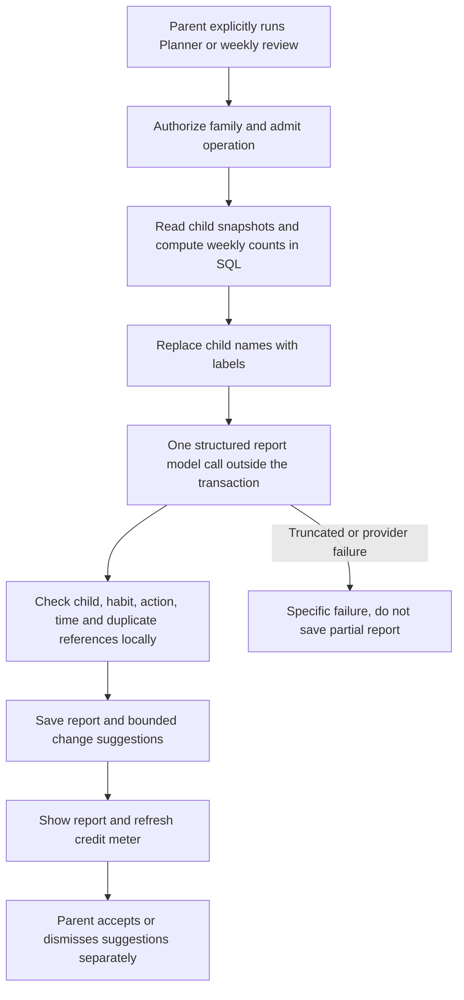
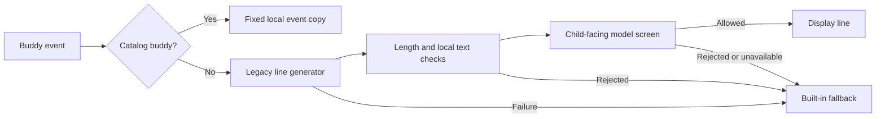

# Quest Planner, weekly review and other AI capabilities

Current implementation reviewed November 6, 2026. These features are separate
from the refined Habit Coach graph. No background scheduler periodically invokes
them: the parent explicitly runs Planner or review, while child events invoke
only their relevant text capability.

## Capability map

| Capability | Trigger and scope | Input | Model work | Stored/displayed result |
| --- | --- | --- | --- | --- |
| Quest Planner | Parent dashboard; family | Each child's age, plan, recent approvals and check-in facts | One structured report call | Summary, practical tips and at most four checked change suggestions |
| Weekly review | Parent dashboard; family | Current seven days versus preceding seven days | One structured report call | Headline, per-child wins/watch points, patterns and at most two checked changes |
| Onboarding mapping | Parent describes a child's concern | Age, parent text and eligible catalog candidates | Up to one JSON mapping call | One to three suggested catalog goals and existing habit recommendations |
| Catalog buddy copy | Greet/submitted/celebrate for a child using a catalog buddy | Event | No model | Fixed event line |
| Legacy buddy copy | Greet/submitted/celebrate for a legacy buddy | Age, event and allowed quest titles | Generator plus child-facing screen | Short line or built-in fallback |
| Child note screening | Child submits a nonempty check-in note | Note and `kid-writes` audience | Local checks, then up to one classifier call | Save, friendly rejection, or risk flag visible to caregiver |
| Parent surprise text | Parent writes a message for the child | Message | Local checks only | Allowed message or rejection |

“Quest Planner” schedules and adjusts the existing family plan. It is distinct
from the earlier **HQ AI services planning agent**, whose source-card retrieval
and action-writing capability informed the Coach integration. Neither name means
that ordinary chat silently runs the dashboard Planner.

## Report workflow shared by Planner and review

The model sees `Child A`, `Child B` and similar labels. The application restores
names for display after generation. Context includes approved completion counts,
plan information and structured check-in facts; it does not ask the model to
count raw events. Custom habits are represented by their goal in the AI-facing
snapshot instead of sending arbitrary private custom titles.

The provider call runs outside a database transaction. The later persistence
transaction saves the report and valid proposals. Suggestions are not applied
to the plan automatically; acceptance rechecks current plan rules through the
existing suggestion workflow.

### Quest Planner

Endpoint: `POST /v1/families/{family_id}/plan-suggestions`.

The prompt asks for a realistic daily plan and modest adjustments, such as a
15–30 minute time change. It favors at most one new habit per child and a brief
summary with two or three actionable tips. The code caps persisted proposals at
four. Supported actions are add, retime, pause, resume and remove.

Code checks that the child label exists, an add refers to an available catalog
habit outside that child's plan, other actions refer to the child's plan, retime
values match the accepted time format, and duplicate child/habit pairs are
discarded. Current eligibility and capacity are checked again on acceptance.
Prompt constraints should not be confused with exhaustive formal validation of
every narrative claim.

### Weekly review

Endpoint: `POST /v1/families/{family_id}/reviews`.

SQL supplies counts for the most recent seven days and the seven before them.
The prompt asks for one win and one thing to watch per child, up to three
evidence-based patterns and at most two proposed changes. Reports avoid sibling
comparisons, shame and removal of earned rewards. A child with no habits should
receive a short acknowledgement rather than invented progress.

`GET /v1/families/{family_id}/reports` reads the newest saved report of each kind
without generating again. The frontend supports actual stage events and optional
timing details for both operations.

## Report reliability and current review boundary

These report helpers use one structured model call plus local validation. **They
do not invoke the Coach's separate generated-prose Safety model.** Their safety
constraints are in the report prompts and the existing plan/acceptance rules.
This is an implemented boundary, not an assertion that all AI output has the
same independent review process.

An earlier “AI helpers are busy” failure was traced to output truncation: the
configured reasoning model could use almost the entire 4,000-token allowance on
reasoning before emitting its report. The current shared resolver applies
`reasoning_effort=none` to Planner/review when `AI_HELPER_REASONING_EFFORT=auto`
and the endpoint/model match the known Nebius DeepSeek V4 family. Other routes
retain their provider default unless explicitly configured.

A truncated report now receives a specific 502 explanation; other provider
failures retain the 503 response. No partial report or suggestion is saved.
Provider attempts can incur cost even when the user operation fails. A confirmed
failure lets the next explicit click use a fresh request ID; an interrupted or
still-running request keeps its existing identity to prevent duplicate work.
There is no automatic new-generation retry loop.

## Onboarding is the older catalog-mapping path

`POST /v1/children/{child_id}/pain-points` uses the existing application catalog,
age and unlocked tier. It is not the Pinecone source-goal workflow. Local urgent
risk phrases short-circuit generation; the model can also return an at-risk
result. Structured mapping is checked against supplied goal/habit candidates.
If inference fails, deterministic keyword matching or manual selection remains.

This path sends the parent-entered text with the child's age and candidates. It
does not currently call the refined Coach's known-name masking helper. Therefore
the refined path's stronger masking description must not be advertised as a
universal property of every historical AI endpoint. No profile name field is
added by this mapper, but a name typed in the parent's free text is still part
of that text. This is a documented boundary for future privacy review.

## Buddy behavior and child-text checks

Catalog buddy selection, age-based recommendation, artwork, characteristics,
outfit badges and event lines are local deterministic features. They do not
need LLMs, embeddings or Pinecone. See
[buddies, artwork and assets](12-buddies-artwork-and-assets.md).

The retained legacy buddy path asks the configured small/main model for a short
line, normalizes it and rejects empty or overly long output. It then screens
that line for `kid-reads`. Failure at any stage returns a built-in event line.

Child-note screening uses different failure semantics:

- Local patterns run first, with risk signals evaluated before ordinary blocking
  categories. A locally classified note needs no model call.
- If local checks pass, the configured child-screen model evaluates the note.
- Ordinary disallowed content returns a friendly correction message.
- Risk-bearing disclosures are retained and flagged for the caregiver rather
  than silently discarded.
- If the classifier is unavailable, `kid-writes` falls back to the local result
  so a child can still send a note. `kid-reads` fails closed and uses fixed copy.

The local patterns and model classifier are product safeguards, not a clinical
assessment or guaranteed detection of every concerning message.

## Source and verification links

- [Reports, buddy routes and prompts](../backend/src/habitquest_backend/insights.py)
- [Model-routing resolver](../backend/src/habitquest_backend/llm.py)
- [Onboarding endpoint](../backend/src/habitquest_backend/onboarding.py) and
  [mapping logic](../backend/src/habitquest_backend/ai.py)
- [Child text safety](../backend/src/habitquest_backend/safety.py) and
  [check-ins/surprises](../backend/src/habitquest_backend/checkins.py)
- [Dashboard helper UI](../frontend/src/components/AiHelpers.tsx)
- [Report regressions](../backend/tests/test_insights.py),
  [model adapter tests](../backend/tests/test_llm.py),
  [helper UI regressions](../frontend/src/components/AiHelpers.screen.test.tsx)
- Historical diagnosis and evidence:
  [report reliability repair](../docs-detailed/sys-design-update/ai-helper-report-reliability.md)

The report repair was verified with mocked provider responses and actual outgoing
configuration assertions. Its historical latency examples are not new live
benchmarks or evidence of a current production latency distribution.
