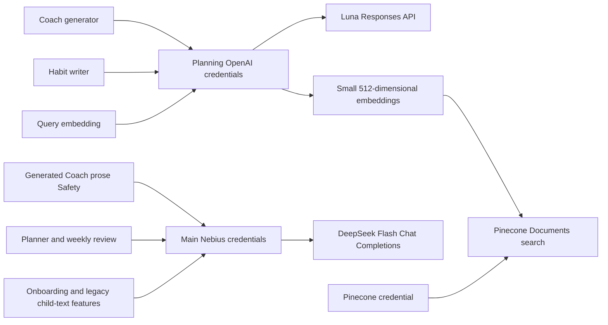

# Model selection and runtime routing

Current configuration reviewed November 6, 2026. This document records why the
roles were separated, the model IDs actually configured in the deployed app and
what evidence supports the choice. It is not a newly run provider comparison or
a claim that the selected models are universally optimal.

## The decision

The primary improvement was to remove unnecessary model stages before attempting
to make the old multi-call crew faster by swapping models. Retrieval, progress
counts, catalog authority and final decisions now use code. Coach has one central
generation plus one review of generated prose. Habit writing is its own bounded
operation, and Planner/review run only when requested.

The working HQ planning prototype supplied the generation and query-embedding
configuration. Its `gpt-6-luna` generation route was carried into Coach and habit
writing with separate credentials, Responses API mode and low reasoning effort.
The existing Nebius route was retained for output Safety and unrelated features
to avoid changing all behavior at once. The original Deep Agents tool loop was
not carried into the main Coach graph.

The literal model IDs below come from checked configuration and code. “Luna”
refers to that configured API model ID. The earlier handoff's “scotch model” was
interpreted as the Coach model, not a distinct API identifier.

## Current role-to-model map

Source: [deployed non-secret configuration](../../hq-deployment/environments/dev-application-oauth-configuration.json),
the [settings schema](../backend/src/habitquest_backend/config.py) and the
[same routing resolver used by invocation and admin metrics](../backend/src/habitquest_backend/llm.py).
The November 6 Coach release changed images, not this model configuration.

| Role | Exact configured model | Provider and API | Reasoning / normal work |
| --- | --- | --- | --- |
| Refined Coach generator | `gpt-6-luna` | OpenAI planning group; Responses API | `low`; one generation per pass |
| Habit writer | `gpt-6-luna` | OpenAI planning group; Responses API | `low`; one writer per batch |
| Generated Coach prose review | `deepseek-ai/DeepSeek-V4.1-Flash-1017` | Nebius main group; Chat Completions | `low`; separate output Safety call |
| Query embedding | `text-embedding-3-small` | OpenAI planning group; embeddings API | 512 dimensions; one masked query |
| Pinecone similarity lookup | `documents-search` accounting label | Pinecone Documents API `2026-07` | Vector search, not a text-generation model |
| Quest Planner | `deepseek-ai/DeepSeek-V4.1-Flash-1017` | Nebius main group; Chat Completions | `auto` resolves to `none` for this role/provider/model |
| Weekly review | `deepseek-ai/DeepSeek-V4.1-Flash-1017` | Nebius main group; Chat Completions | Same report-specific `none` resolution |
| Onboarding mapping | `deepseek-ai/DeepSeek-V4.1-Flash-1017` | Nebius main group; JSON-object output | Existing provider default reasoning behavior |
| Legacy buddy generator | `deepseek-ai/DeepSeek-V4.1-Flash-1017` | Nebius main group; Chat Completions | Small-model selector falls back to primary because its override is empty |
| Child-text screen | `deepseek-ai/DeepSeek-V4.1-Flash-1017` | Nebius main group; structured verdict | Same small-model fallback; not the dedicated output-Safety selector |
| ParentRisk | Same DeepSeek ID is configured | Main group; retained legacy capability | **Not called by refined Coach or the habit writer** |

Catalog buddies do not appear as a paid generation role because their current
selection and event copy use no model.

## Configuration boundaries and limits

| Concern | Effective setting or rule |
| --- | --- |
| Main provider | `OPENAI_BASE_URL=https://api.tokenfactory.us-north1.nebius.com/v1/`; `OPENAI_API_KEY` is private |
| Imported planning provider | `PLANNING_OPENAI_BASE_URL=https://api.openai.com/v1`; independent private `PLANNING_OPENAI_API_KEY` |
| Coach routing | `COACH_PROVIDER=planning`, `COACH_MODEL=gpt-6-luna`, `COACH_API_MODE=responses` |
| Coach output allowance | 1,600 tokens; 30-second per-request limit and 65-second outer turn deadline |
| Coach SDK retries | One retry per logical call; a Safety revision is counted separately |
| Writer output allowance | `max(2800, 800 + 1100 × count)`; three drafts permit 4,100 tokens |
| Writer deadline/retries | 45-second operation deadline, zero SDK retries; one local-validation correction remains allowed |
| Output Safety allowance | Main adapter's 4,000-token limit, up to 30 seconds per request, one SDK retry |
| Planner/review | Main adapter's 4,000-token limit and one SDK retry; role-specific reasoning resolver prevents default thinking from consuming short-report output |
| Query embedding | Small/512, 15-second request limit, zero SDK retries |
| Pinecone | 15-second request limit, no retry loop; pinned index, namespace, field, metric and catalog release |
| Provider storage | Planning Responses clients explicitly set `store=False` |
| Startup validation | Missing enabled-feature credentials/model names, invalid declared API modes, incompatible provider/engine selection or wrong pinned embedding/index settings fail configuration checks |

Transport limits are further bounded by the remaining operation deadline. A
timeout cannot recall a request that a provider already accepted. Tokens and
HTTP attempts therefore remain visible in accounting even if no useful final
result is delivered. Configuration validation does not establish that a newly
chosen provider/model supports every schema or parameter; that requires its own
compatibility checks.

Actual keys are never in these documents, the frontend, build arguments or image
layers. Local values belong in ignored backend `.env`; AWS injects secret fields
from Secrets Manager into the API task. The browser has no provider credentials.
Use [backend/.env.example](../backend/.env.example) for commented configuration
instructions and [AWS deployment](13-aws-deployment.md) for the delivery boundary.

The bundled canonical release requires small/512 compatibility. Changing the
query embedding model or dimensions without re-embedding the corpus and updating
the reviewed release is rejected. The evaluation and release decision are covered
in [embedding-model selection](09-embedding-model-selection.md).

## How the choice evolved

1. **Audit the actual calls.** The earlier crew separately called triage,
   research, progress, planning, fit and safety, with another planning pass after
   review. Investigations found that provider work and repeated generation could
   dominate the reported 45–50 second experience.
2. **Consider role-appropriate alternatives.** The November 3 Nebius analysis
   shortlisted a non-thinking Qwen model for routine work, GPT-OSS for structured
   planning/review and several challengers. It explicitly treated these as
   evaluation candidates, not measured winners.
3. **Simplify the architecture.** The refined design replaces routine analysis
   stages with bounded retrieval and code. A separate generated-prose review is
   retained; the deployed workflow is not literally one total model request.
4. **Reuse the tested planning capability deliberately.** Carry over the
   prototype's Luna/Responses writer configuration and small/512 embedding space,
   while retaining the main provider for other features. Adapt capability and
   canonical data, rather than nesting the prototype service or harness.
5. **Validate the actual schemas and failure modes.** Test structured output,
   source IDs, local correction feedback, Safety revision limits, privacy,
   idempotency and real provider compatibility with bounded synthetic checks.
6. **Tune the operation, not only the model name.** Reduce model-facing evidence
   to useful fields, keep substantive source limitations, request shorter copy
   and reuse HTTP connections. For Planner/review, fix reasoning controls that
   caused output-limit errors without changing models.

The historical shortlist remains useful design rationale. Its prices,
availability, crew-role assignments and local-BM25 description are dated evidence,
not the final deployed configuration or current vendor promises. No comparison
proved that Qwen/GPT-OSS should replace the configured models, and they were not
silently activated.

## What the measurements establish

The approved November 4 synthetic sequence recorded useful Coach responses at
**6.692 s initial**, **4.336 s follow-up** and **3.996 s after a topic switch**,
and a **4.612 s** single habit-generation request. These were API/provider/database
round trips with no revisions, not browser paint times, twelve-habit completion
times or a production latency distribution. Later saved writer requests were
reported at 7.5–8.4 seconds. A five-second target is therefore not a consistent
observed guarantee.

The November 5 report diagnosis found examples where reasoning consumed most or
all of a 4,000-token output allowance. The repair verified the exact outgoing
reasoning settings and truncation/retry behavior with mocked transports; it did
not run a new paid latency benchmark. The November 6 release likewise used
mocked generation tests and live infrastructure readiness checks, not new paid
model comparisons.

Any next model comparison should keep the canonical release and request set
fixed, change one role at a time, and measure:

- Useful-result rate, directly relevant goals and valid schema/source linkage.
- Child-wording, privacy, rejection and correction/revision behavior.
- Initial and warmed end-to-end p50/p95, with browser time separated from server
  and provider stages.
- Actual input/output/reasoning usage, retries, embedding/search cost and total
  cost per useful interaction, rather than token price alone.
- Failure and timeout rates, including incomplete or unusable output.

No paid comparison, model switch or rate refresh is implied by writing this design.

## Evidence and maintained references

- [Historical Nebius selection analysis](../docs-detailed/model-selection.md)
- [Configuration migration rationale](../docs-detailed/sys-design-update/ai-configuration-handoff.md)
- [Refinement execution and live samples](../docs-detailed/sys-design-update/implementation-progress.md)
- [Dated latency evidence](../docs-detailed/evidence/2026-11-04/refinement-latency-benchmark.json)
- [Planner/review failure analysis](../docs-detailed/sys-design-update/ai-helper-report-reliability.md)
- [Prototype configuration](../../hq-ai-services/planning-agent/CONFIGURATION.md)
- [Model adapter tests](../backend/tests/test_llm.py) and
  [configuration tests](../backend/tests/test_config.py)
- [Tokenomics and current measurement strategy](11-tokenomics-latency-and-observability.md)
