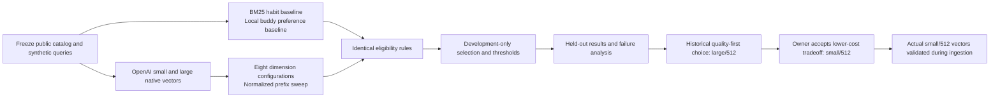

# Embedding model selection

Reviewed November 6, 2026 against the recorded experiment, ingestion receipts and
current application code. This document explains the completed selection; it
does not report a new benchmark or new provider-price check.

The implemented choice is **OpenAI `text-embedding-3-small`, 512 dimensions,
cosine similarity**. It retrieves canonical goal candidates from the habit
catalog. It does not write advice, generate habit instructions or select buddies.
Those responsibilities belong to [the AI workflows](05-ai-orchestration.md) and
[local buddy selection](12-buddies-artwork-and-assets.md).

## Where the research lives

The broader product and behavioral research is in
[`hq-research`](../../hq-research/README.md). The executable embedding study,
frozen cases, measured results and final model decision are in
[`hq-infra-setup/embedding-evaluation`](../../hq-infra-setup/embedding-evaluation/README.md).
Keeping those locations distinct matters: the child-development literature
informed the catalog; the retrieval experiment compared ways of finding its
cards. Neither experiment trained a custom model.

## The question we tested

Could a compact embedding retrieve useful age-appropriate cards from ordinary
parent wording, at a reasonable cost, compared with lexical search? A separate
exploratory question asked whether embeddings improved browsing a catalog of
only 24 buddies enough to justify a remote dependency.

The study used exact local cosine search, not eight separate Pinecone indexes.
This isolated the embedding comparison from cloud search behavior.

## Dataset and evaluation method

| Item | Recorded method |
| --- | --- |
| Corpus | 405 public documents: 381 age-specific habit cards and 24 buddies; candidate sets remained separate |
| Cases | 80 synthetic examples: 64 habit requests, 9 semantic buddy-browse requests, 6 buddy controls and 1 buddy choice-set case |
| Split | 40 development and 40 held-out cases; entire scenario families stayed in one split |
| Ages | Four editorial bands, represented by ages 4, 7, 9 and 12; boundary ages were not separately evaluated |
| Labels | Source-linked editorial relevance grades written before viewing rankings; no real-child data or paid model graders |
| Baselines | BM25 over the same habit corpus; deterministic explicit-preference buddy selector |
| Quality | nDCG@5 for useful-card ordering, Recall@5 for coverage of labeled useful cards, MRR for the first useful result |
| Other checks | Unsupported-query behavior, eligibility violations, age/task slices, vector storage, local latency and provider usage |
| Selection discipline | Model/threshold decisions used development cases; family-level bootstrap comparisons are retained in the result JSON |

Age, context, availability and child-card versus parent-guidance eligibility were
held constant across approaches. Relevance judgments never entered candidate
filters or query embeddings. The held-out habit set had **28 positive cases and
4 unsupported cases**. Its gold labels are incomplete editorial judgments, not
an exhaustive assessment of every possible useful card.

See [case methodology](../../hq-infra-setup/embedding-evaluation/case-methodology.md),
[frozen cases](../../hq-infra-setup/embedding-evaluation/fixtures/cases.json) and
[machine-readable comparisons](../../hq-infra-setup/embedding-evaluation/results/comparison.json).

## Results and the decision

These are the recorded November 1 results **after the experiment's
development-calibrated abstention step**. They are not live production metrics.

| Configuration | Held-out nDCG@5 | Recall@5 | MRR |
| --- | ---: | ---: | ---: |
| BM25 baseline | 0.738 | 0.579 | 0.929 |
| Small / 256 | 0.733 | 0.563 | 0.964 |
| **Small / 512 — implemented** | **0.727** | **0.571** | **0.964** |
| Small / 768 | 0.709 | 0.551 | 0.929 |
| Small / 1536 | 0.669 | 0.520 | 0.857 |
| Large / 256 | 0.760 | 0.587 | 0.955 |
| **Large / 512 — original benchmark selection** | **0.795** | **0.656** | **0.964** |
| Large / 1024 | 0.814 | 0.673 | 0.946 |
| Large / 3072 | 0.834 | 0.685 | 0.964 |

The frozen quality-first selection rule chose **large/512** on development data.
The owner subsequently chose **small/512** for implementation after reviewing the
quality, cost and uncertainty. The decision did not relabel the benchmark winner
or change its measurements.

The tradeoff was concrete:

- Small/512 and large/512 had the same first-useful-result MRR of 0.964.
- Large/512 had better top-five coverage and ordering. Small/512 also did not
  beat BM25 on those two aggregate metrics.
- At the rates recorded for the study, small cost $0.02 per million input tokens
  and large $0.13: about 85% lower embedding-token cost for small. These are dated
  study inputs, not a fresh pricing claim. Dimensions do not change that token rate.
- Both 512-dimensional choices have the same raw vector footprint. The deployed
  381 habit vectors occupy 780,288 bytes as float32, excluding metadata and index
  overhead. The study's 405-document figure was approximately 0.829 MB.
- The small synthetic set did not establish that paying for large would produce
  a reliable improvement for real families.

The complete [comparison report](../../hq-infra-setup/embedding-evaluation/comparison-report.md),
[recommendation](../../hq-infra-setup/embedding-evaluation/recommendation.md) and
[decision record](../../hq-infra-setup/embedding-evaluation/model-decision.json)
preserve this distinction.

## What latency and quality evidence do not establish

The dimension sweep shortened native API vectors to a prefix and normalized
them. Within that experiment, only the original **large/512** finalist received
dedicated actual-`dimensions=512` confirmation and repeated single-query API
latency probes. Its reported **261 ms median API latency cannot be assigned to
small/512**. Local scoring was approximately 16 ms for either 512-dimensional
configuration and excluded the embedding request.

The subsequent ingestion separately validated actual small/512 outputs for all
381 habit texts and four synthetic queries. That proved the implemented vector
shape and operational path; it did not rerun the held-out comparison or establish
matched small-versus-large API latency.

Every model and BM25 returned cards for one of the four unsupported held-out
requests. A similarity threshold is not a safety or suitability decision. The
main app therefore retains local urgent routing and its bounded Coach decision
and generated-prose review, while retrieval itself performs no model safety
call. The one valid query rejected by small/512's study threshold also shows why
ranking quality and abstention quality must be assessed separately. The runtime
does not simply copy this benchmark threshold into production.

Historical buddy controls included a no-buddy option. That is an experiment
record, not the present product contract: HabitQuest now always supplies a
default buddy and keeps age-based discovery and explicit choice local.

## Current runtime contract

| Setting or boundary | Implemented value |
| --- | --- |
| Embedding model | `OPENAI_EMBEDDING_MODEL=text-embedding-3-small` |
| Dimensions | `OPENAI_EMBEDDING_DIMENSIONS=512` |
| Credential/base URL family | `PLANNING_OPENAI_API_KEY` and `PLANNING_OPENAI_BASE_URL`; published deployment config uses `https://api.openai.com/v1` |
| Pinecone target | Index `hq-habits-v1`, namespace `habits-0-1-0`, catalog `0.1.0` |
| Dense search | Cosine; Documents API `2026-07`; field `embedding` |
| Normal retrieval | One name-masked query embedding and one filtered search, followed by local canonical checks |
| Result bounds | Ask Pinecone for at most 12 hits; keep at most 6 distinct canonical concepts for the Coach |
| Failure behavior | Report retrieval failure; do not silently substitute lexical results for a failed live search |

`Settings.validate_planning_features` rejects a model, dimension, index or
release mismatch. Equal vector length does not make embeddings from different
models compatible. The older hosted-Llama/1024 suggestion is superseded.

The main app has an explicitly selected BM25 fixture mode for offline checks.
Although the research recommendation retained lexical search as a possible
fallback, production does **not** automatically fall back to it. The current
contract is in [configuration](../backend/src/habitquest_backend/config.py),
[embedding client construction](../backend/src/habitquest_backend/llm.py),
[retrieval](../backend/src/habitquest_backend/retrieval.py) and the
[public deployment configuration](../../hq-deployment/environments/dev-application-oauth-configuration.json).

## Costs, reproducibility and future changes

The historical comparison used 33 successful embedding requests, 155,199 input
tokens and **$0.01449602** at its recorded standard rates. The later ingestion
used 46,066 tokens for 381 cards and 130 for four queries, totaling
**$0.00092392**. These are different runs with different scopes; neither total
includes Pinecone charges. Per-request embedding and search usage now enter the
application's [Tokenomics accounting](11-tokenomics-latency-and-observability.md).

Reproduction starts from the frozen corpus/case hashes, preserved pre-publication
inputs and the [runner guide](../../hq-infra-setup/embedding-evaluation/RUNNER.md).
The saved experiment passed 23 offline runner tests and 4,230 fixture checks.
The [ingestion results](../../hq-infra-setup/pinecone-data-updates/RESULTS.md)
record the later actual small/512 validation. No evaluation was rerun to write
this document.

A future model change needs a new explicit model/dimension decision, compatible
catalog and query vectors, a versioned index/release, and independent evaluation.
Preserve prior failures and ledgers. More diverse, consented and deidentified
parent queries would be needed for stronger product claims; retrieval scores
remain distinct from child outcomes.

Next: [research, catalog construction and Pinecone publishing](10-habit-research-and-pinecone-catalog.md).
