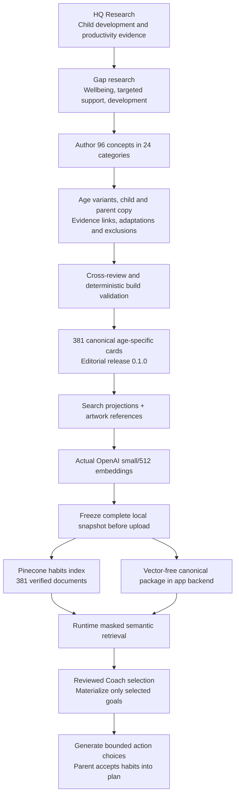
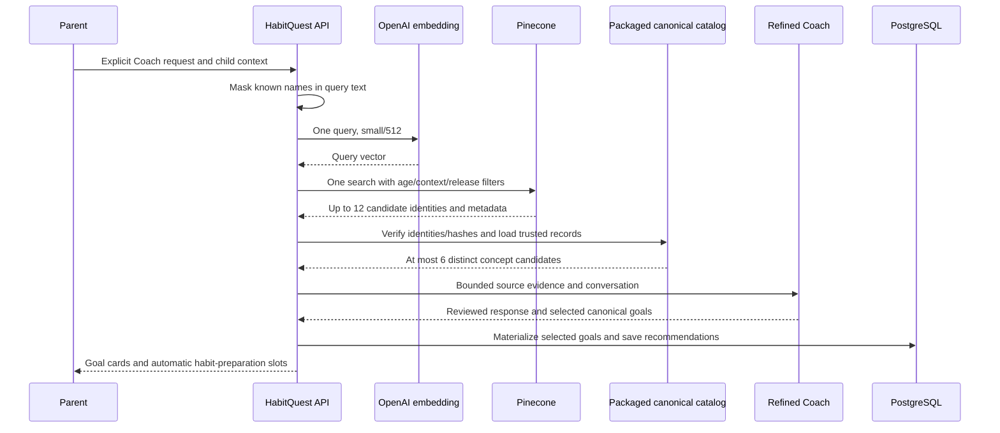

# Habit research, canonical catalog and Pinecone

Reviewed November 6, 2026. The system separates **research**, **editorial catalog
creation**, **search publication**, and **family-specific generation**. Research
and catalog publication happen outside a chat request. A runtime search finds
existing canonical cards; it does not research new papers or rebuild Pinecone.

The central mapping is **catalog habit card → HabitQuest goal**, then **generated
action → HabitQuest habit beneath that goal**. This preserves the researched
goal as a stable source while allowing a small, usable action for the child.

## From evidence to usable goals

## 1. Research foundation and selection process

[`hq-research`](../../hq-research/README.md) contains two connected reviews:
child development/behavior and habits/productivity/grit. The work was a
structured, purposive product-research review, not an exhaustive systematic
review, new meta-analysis or validation study of HabitQuest.

The review prioritized relevant systematic reviews, controlled studies,
longitudinal work, mechanism research and official guidance. Topic/author,
PubMed/PMC, ERIC-oriented, DOI/publisher and institutional searches provided
leads; claims were checked against available original or official sources.
Direct OpenAlex/Semantic Scholar API attempts and one Europe PMC route were
unavailable and remain recorded as unsuccessful access attempts. Research Scout
documents informed the discovery approach; its integrations were not a completed
automated research service for this project.

The retained [methodology](../../hq-research/methodology.md),
[source hub](../../hq-research/SOURCES.md),
[source index](../../hq-research/data/source-index.json) and
[search log](../../hq-research/data/search-log.json) distinguish full text,
manuscript, abstract and excerpt access. They record 58 paper/review records,
two guidelines and one published correction, plus six books kept separately.
The 78 logged search/access observations are not a screened-study denominator.
An independent agent audit checked 15 selected source claims; it was not human
clinical peer review or verification of every source.

Three subsequent authoring tracks filled catalog-specific gaps. The assembled
catalog library has the following provenance:

| Contribution | Records | Purpose |
| --- | ---: | --- |
| Earlier HQ Research library | 61 | Child behavior/development, motivation, habit/grit and critical evidence |
| Wellbeing gap review, W01–W15 | 15 | Care, feeding, sleep, movement, media and household participation |
| Targeted-support review, T01–T05 | 5 | Co-regulation, access needs, worry support and accessible directions |
| Development review, D01–D07 | 7 | Reading, play, learning, communication and safeguarding education |
| Planning synthesis, R01 | 1 | Bounded rationale for linking a cue to an action |
| **Evidence/guidance registry** | **89** | Source records, not 89 independent trials |
| Framework books | 6, separate | Design questions and analogies, not proof of a child intervention |

Reviews can reuse primary studies and each other’s populations. Counts must not
be added into a new participant total or used as an efficacy score. The evidence
supports particular practices or mechanisms in particular settings; it does not
establish the exact card, generated action, reward system or app’s effectiveness.
See [catalog evidence methodology](../../hq-habits-catalog/docs/evidence-and-methodology.md).

## 2. Editorial design of the catalog

Each of the three tracks contains eight categories and 32 concepts. Age-specific
expansion produces 381 records:

| Age band | Records | Editorial emphasis |
| --- | ---: | --- |
| 3–5 | 93 | Adult participation, modeling, familiar objects and shared play |
| 6–8 | 96 | Concrete actions and explicit scaffolding |
| 9–10 | 96 | Shared planning and useful feedback |
| 11–13 | 96 | Negotiated autonomy, privacy and continued support |

Three concepts deliberately omit a preschool variant: comparing a work example,
estimating/adjusting a plan, and suggesting a support adjustment. Age bands are
editorial groupings; they are not readiness tests or trial-derived deadlines.

The catalog distinguishes 239 general-wellbeing records, 138 targeted-support
records and four parent-coaching records. The app's child-goal search permits
the first two intent classes; parent-coaching records are not silently turned
into tasks for a child.

Authors asked what situation the action addresses, what the adult must provide,
what the child can observably choose or attempt, which evidence applies, when to
avoid or adapt it, and whether it duplicates another demand. Cross-reviews
corrected overlapping concepts, unclear adult/child roles, opt-out wording,
consent/access language and overstated research transfer. These decisions are
preserved in the [resolution record](../../hq-habits-catalog/research/cross-review-resolution.md).

The complete card carries more than a title and image:

| Card section | Design purpose |
| --- | --- |
| Identity and age | Stable source ID, concept/category, age range and readiness note |
| `kid` | Short title, instructions, help phrase and accessible delivery options |
| `parent` | Selection, setup, coaching, adaptations, review and things to avoid |
| `practice` | Observable action, support/adult role, easier version and time estimate |
| `safety` | Specific exclusions, unsupported uses and access boundaries |
| `research` | Source IDs/links, insight, evidence relationship and explicit limits |
| `stacking` | Context, cue, materials, effort and possible observed output events |
| `retrieval` | Prepared search text, phrases, language and availability |
| `presentation` | Editorial display information; artwork is a separate overlay |

Evidence entries retain `supports`, `does_not_establish` and `age_transfer`.
Relationships such as `intervention_component`, `mechanism_informed` and
`practice_guidance` explain why a source is relevant; they are not certainty
scores. A boundary citation may explain why clinical treatment findings must
**not** be applied to an ordinary action. Source detail views must retain that
qualification, rather than treating every citation as positive proof.

## 3. Canonical build and preservation

The editable sources are in
[`hq-habits-catalog/authoring`](../../hq-habits-catalog/authoring). The local
[`rebuild.py`](../../hq-habits-catalog/scripts/rebuild.py) runs catalog, stack,
schema and validation builders in dependency order without network or database
calls. It produces canonical JSON, category views, readable cards, schemas,
search projections and validation records together.

[`data/habits.json`](../../hq-habits-catalog/data/habits.json) is the complete
canonical delivery. Category files are alternate views of the same IDs, not
additional databases. Do not hand-edit one generated projection and leave the
others stale. The [validation report](../../hq-habits-catalog/validation/REPORT.md)
checks schema/reference consistency, age/context bounds, source links, both hash
types, projection parity and important conditional behaviors. Its 48 lexical
smoke queries are not a semantic retrieval benchmark or child usability study.

The source catalog also contains 14 stack templates, 56 age-specific resolved
recipes and 95 editorial relations. These are preserved supporting data, not
extra Pinecone documents or automatic app assignments. Similarity does not
establish sequence, readiness or whether a proposed event actually happened.
The app's Quest Planner must not be confused with these catalog stack recipes.

The catalog’s reward policies were not imported into HabitQuest. The adapter
removes reward/point fields from evidence exposed for generation, and the app
retains its existing points, Sparks and rewards. Catalog observations about
reward gates therefore must not be described as fully implemented app behavior.

## 4. What was published to Pinecone

The selected deployment is a managed Pinecone index on AWS `us-east-1`, using
externally generated OpenAI vectors. Pinecone does not run a hosted embedding
model for this index.

| Contract | Published value |
| --- | --- |
| Index / namespace | `hq-habits-v1` / `habits-0-1-0` |
| Catalog release | `0.1.0` |
| Documents | 381, one per age-specific source card |
| Embedding | `text-embedding-3-small`, actual API `dimensions=512` |
| Search interface | Documents API `2026-07`, dense field `embedding`, cosine |
| Identity | Source ID plus concept/category/release and canonical/search-text hashes |
| Metadata | Age/context/availability/language/intent, source references and artwork references |

The [setup configuration](../../hq-infra-setup/pinecone-setup/config.json) and
[ingestion approach](../../hq-infra-setup/pinecone-data-updates/INGESTION-AND-SEARCH-APPROACH.md)
define the payload. Prepared search cards are already small semantic units;
there is no arbitrary paper/PDF chunking service on this path.

Publication proceeded in this order:

1. Validate public canonical records and projections; pin input/configuration hashes.
2. Generate actual small/512 vectors for 381 search texts in six API batches.
3. Preserve and read back a complete frozen local snapshot **before** creating
   the index/namespace or uploading the payload.
4. Upload six batches of the exact archived documents.
5. Fetch and compare all 381 stored IDs, text, metadata, S3 references and vectors;
   verify namespace count and run bounded synthetic retrieval checks.

The snapshot ID is
`22cec20089fee49e76ee76861b01a199e05f765ec19a2f1911eddef1088828df`.
[`datasets/current.json`](../../hq-infra-setup/pinecone-data-updates/datasets/current.json)
points to its frozen directory. The archive includes complete canonical records,
embedding text and exact vectors, upload JSON/JSONL, plus supporting buddies,
stacks, categories, age definitions and artwork overlays. Those supporting
collections were not embedded or uploaded as habit-search records.

The [November 1 execution results](../../hq-infra-setup/pinecone-data-updates/RESULTS.md)
record successful full-fetch verification and four operational searches spanning
ages 4, 7, 10 and 12. Two negative filters returned no rows. Strict search-score
equality did **not** pass: maximum observed difference from local exact cosine
was 0.0003983 against the original 0.0002 diagnostic tolerance. Stored-vector
integrity and returned candidate sets passed; the numeric variation remains
explicit, without claiming its precise cause was established.

## 5. How the main application uses it

The backend bundles a **vector-free** canonical snapshot in
[`planning_catalog.json`](../backend/src/habitquest_backend/data/planning_catalog.json).
[`package_planning_catalog.py`](../backend/scripts/package_planning_catalog.py)
verifies the frozen source manifest and record/vector hashes before creating
this portable package. A deployed task needs neither a sibling checkout nor
cloud access to read complete source guidance.

[`CatalogRepository`](../backend/src/habitquest_backend/planning_catalog.py)
validates the package checksum, snapshot, model/release contract, original record
hashes and metadata. It creates an application goal ID as `hqg-` plus the first
24 hexadecimal characters of SHA-256 over the source ID. The source reference
keeps the original source/concept/category, release, full-record hash and snapshot.

[`CatalogRetriever`](../backend/src/habitquest_backend/retrieval.py) embeds the
already name-masked text, filters age, setting, availability, language, release
and allowed child intent, and excludes previously requested concepts when
appropriate. It verifies returned identities and metadata against local source
facts, then keeps at most six distinct concepts. It does not run a safety model,
web research, model-based reranker or database import during retrieval. The
refined Coach's output decision/prose review is a separate later step.

Only selected goals from a reviewed Coach recommendation are materialized in
PostgreSQL. Browsing source details and similarity search do not preload the
381 goals. The restricted materialization function verifies child ownership and
the pinned canonical payload; source collisions/changed records fail instead of
silently overwriting data. Habit generation requires that reviewed goal mapping.
An explicit owner import tool remains available for named goals, but is not the
normal startup/runtime flow.

Generated actions then become draft habits under that exact goal. The app
normally prepares three choices per newly returned goal, at most four goals and
two batches in flight. Parent acceptance is still required before assignment.
See [Coach and habit generation](06-habit-coach-and-habit-generation.md) and
[database design](04-database-and-domain-model.md).

## Storage responsibilities and design boundaries

| Store | Owns | Does not own |
| --- | --- | --- |
| Research/authoring folders | Evidence, editorial decisions, source data and build history | Live family plans |
| Frozen ingestion archive | Reproducible source release, vectors and exact upload payload | Mutable request history |
| Pinecone | Semantic retrieval over public habit source documents | Family/child records, habit assignments or source authority |
| Packaged canonical JSON | Complete verified instructions, research and source provenance | Mutable family state or remote query vectors |
| PostgreSQL | Selected goal mappings, recommendations, generated habits, plans and usage | A bulk copy of the vector index |
| Artwork manifests / S3 / packaged frontend assets | Independently versioned visual resources | Evidence of efficacy or embedding values |

The separate artwork overlay can supply real images even where frozen editorial
records still say `asset_status: not_generated`. The completed art manifest, not
that historical placeholder, determines asset availability. See
[buddies and assets](12-buddies-artwork-and-assets.md).

## Maintenance and remaining evidence limits

Changing search text, full source guidance, artwork or embedding space are
different operations. `embedding_text_sha256` identifies search-text changes;
`canonical_record_sha256` detects guidance/evidence changes even when search
text is unchanged; art versions/hashes track media separately. A future release
must create new preserved inputs and compatible query/index contracts rather
than overwrite frozen evidence or bypass application hash checks.

The older catalog and infrastructure READMEs contain milestone statements such
as “not ingested” or “service unimplemented.” Those describe their original
authoring stage. Later ingestion receipts and the present main-app implementation
supersede them for deployment status. The standalone planning-agent prototype is
the source of adapted retrieval/catalog/generation capabilities; it is not a
second runtime service called by the deployed HabitQuest Coach.

No new papers, embeddings, database writes or Pinecone calls were made for this
documentation review. Research remains selective and access-constrained; the
catalog and retrieval evaluations do not establish clinical approval, family
usability or product efficacy. The [embedding selection](09-embedding-model-selection.md)
document separates measured retrieval results from the accepted implementation
tradeoff, and [AWS deployment](13-aws-deployment.md) describes current hosting.
