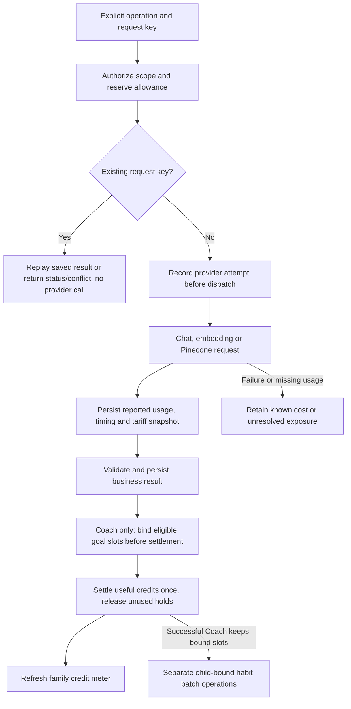

# Tokenomics, latency and observability

Tokenomics separates what a family experiences from what the operator pays.
Family credits describe useful completed activities. The provider ledger records
actual HTTP attempts, including embedding/search usage, retries and failures.
Progress stages and timers describe where elapsed time went. These are related
measurements, not interchangeable counters.

## Accounting model



[`generation_metering.py`](../backend/src/habitquest_backend/generation_metering.py)
wraps existing operations. [`tokenomics.py`](../backend/src/habitquest_backend/tokenomics.py)
owns admission, holds, replay and settlement. Business text stays in domain tables;
accounting stores IDs, statuses and numeric observations rather than copying family
messages or model bodies.

An operation represents a useful user activity. An invocation is a logical provider
call. An attempt is an actual HTTP dispatch; SDK retries are separate attempts.
The database records exposure before dispatch, outside the transaction for the
business result, so a later rollback does not erase provider usage.

## Family allowance and operator policy

The seeded policy below is the implemented starting configuration, not a claim
that an operator cannot edit it later.

| Activity or setting | Starting value | Behavior |
| --- | --- | --- |
| Daily allowance | 100 credits per family-local day | Shared across children; reset follows family timezone |
| Useful Coach response | 2 credits | Includes retrieval; not a separate fee per returned goal |
| Useful habit batch | 1 credit for up to three choices | Automatic and explicit batches have separate child operations |
| Quest Planner, Weekly Review, onboarding mapping | 2 credits each | Useful result settlement, not every HTTP attempt |
| Buddy / child-note screening | 0 family credits | Provider cost is still recorded |
| Enforce budgets | Off | Demo mode tracks usage and overage without blocking on allowance/cap |
| Show generation costs | Off | Family dollar fields and supported detailed UI are opt-in |
| Reference USD per credit | $0.0015 | Input to recommendations for activity weights, not a real-time currency balance |

Four fresh goals normally mean 2 Coach credits plus four one-credit batches,
or six credits. Retries may increase operator cost without multiplying useful
family debits. Safe local replies and failed results do not receive a useful-result
debit; incurred provider cost can still exist. Idempotent replay does not add one.

Policy edits are revision-checked and audited. Price changes create new tariff
versions; historical attempts keep their price snapshots. Enabling enforcement
uses existing exposure, including imported legacy reservations. It does not reset
the old cap or create a clean ledger. Unknown/unbounded exposure can block new
dispatches in enforcement mode. The old caregiver cap endpoints are retired.

## Embedding and similarity-search costs

For a single attempt, known cost combines applicable components:

```text
chat = uncached_input_tokens × input_rate
     + cached_input_tokens × cached_rate
     + cache_write_tokens × write_rate, where separately reported/applicable
     + output_tokens × output_rate
embedding = embedding_input_tokens × embedding_rate
search = returned_read_units × read_unit_rate
       + attributable_egress_bytes × egress_rate
operation estimate = sum of its own attempt estimates
recommended activity credits = max(1, ceiling(complete reference cost / USD per credit))
```

Rates use their stated denominators, usually one million tokens/read units or a
specified byte unit. Cached/reasoning counters must not be added again to provider
totals. Automatic habit operations are separate rows, so a Coach interaction total
must not add both those rows and an already aggregated interaction total.
If a complete reference cost is unavailable, the recommendation is unavailable;
it is not fabricated from only the known components. Policy weights for zero-credit
activities remain an explicit operator decision.

The November 5 analysis recorded list-rate inputs of $0.10 input / $0.50 output
per million Luna tokens, $0.30 / $1.20 for the configured DeepSeek model, and
$0.02 per million embedding input tokens. These are **dated analysis inputs**,
not a newly verified price quote or an invoice. See the
[original rate sources and assumptions](../docs-detailed/design-update/tokenomics/01-economics-baseline.md).

Pinecone is not free merely because its marginal cost is small. Its read units
and applicable egress are included. The seeded tariff uses a planning assumption;
the real account plan, minimums, storage charges and free allowances were not
verified by this implementation. Missing usage is unknown, not zero. See
[retrieval arithmetic](../docs-detailed/design-update/tokenomics/04-retrieval-cost-and-credits.md).

## Timing boundaries

| Measurement | Boundary | Interpretation |
| --- | --- | --- |
| Provider attempt | Actual HTTP request to response/error | Includes network/provider delay for that attempt |
| Generation stage | Server-reported named stage | Separates retrieval, writing, review and validation work |
| Server operation | Endpoint work and result handling | Does not include later independent habit batches |
| Browser response | Request initiation to usable final response | Includes transport and client processing |
| All choices ready | Coach interaction through queued habit batches | Longer than text latency; batches overlap at concurrency two |

[`generation_progress.py`](../backend/src/habitquest_backend/generation_progress.py)
emits fixed stage names and elapsed time over SSE, followed by the same final
authorized result. It does not expose unreviewed token-by-token model drafts.
Disconnecting a browser does not undo an already dispatched provider call.
[`generationPreferences.ts`](../frontend/src/lib/generationPreferences.ts) keeps
account-scoped local diagnostic history and the optional seconds display;
server operation records retain timings and browser observations separately.

Historical useful samples include an 11.727-second Coach HTTP request and two
three-choice batches around 10.35–10.71 seconds on November 5. Earlier narrower
November 4 samples were faster. Different output sizes and ASGI/HTTP boundaries
must not be pooled into a production mean or p95. No representative cloud
generation-latency benchmark was established by the November 6 health checks.

## Operator and user surfaces

- `/admin` has a separate operator login and token. It configures policy/prices
  and shows cohorts, operations, models, usage and cost status; it does not browse
  family conversation content.
- Generation history includes input/output tokens when reported, with
  **Measured**, **Partial**, **Not measured** and **Not applicable** distinctions.
  Embedding input is counted as tokens; Pinecone read units are not tokens.
- Dashboard and Coach retain the compact allowance chip, including demo/enforced
  mode and overage. Completion/failure events refresh the authoritative balance.
- The current Coach omits inline credit/prepared-habit messages and per-batch
  quotes. Dashboard report details follow the operator visibility flag. The shared
  accounting component used by some other views still has its own credit rendering;
  do not assume every surface has one universal visibility gate.
- The family seconds toggle is independent of operator cost visibility. Turning
  off a display does not stop metering or change budget enforcement.

The November 6 fix added refined successful outcomes to the settlement allowlist.
Previously valid recommendations were marked failed, settled at zero and had
automatic habit slots canceled. The corrected path records useful credits and
keeps those slots. It did not backfill old zero-credit history. An existing browser
tab can retain older UI code until refreshed; that was verified on the deployed app.
See the [release and follow-up investigation](../../hq-deployment/docs/30-coach-credits-and-automatic-habits.md).

## Operational limits and sources

Always distinguish actual measured usage, estimated dollars, conservative reserved
exposure and family credits. Readiness checks are not model entitlement or invoice
checks. Tracing, when enabled, must respect privacy; accounting itself excludes
prompts, response text, vectors and keys. Scaling beyond the present one-worker
demo also requires shared handling for in-memory throttles/caches.

- [Tokenomics operations](../docs-detailed/design-update/tokenomics/06-operations.md)
- [Attempt instrumentation](../backend/src/habitquest_backend/tokenomics_usage.py)
- [Family projections](../backend/src/habitquest_backend/tokenomics_routes.py), [operator API](../backend/src/habitquest_backend/admin.py)
- [Admin UI](../frontend/src/pages/Admin.tsx), [budget UI](../frontend/src/components/CoachingBudget.tsx)
- [Metrics migration](../backend/db/migrations/202611050004_tokenomics_metrics.sql)
