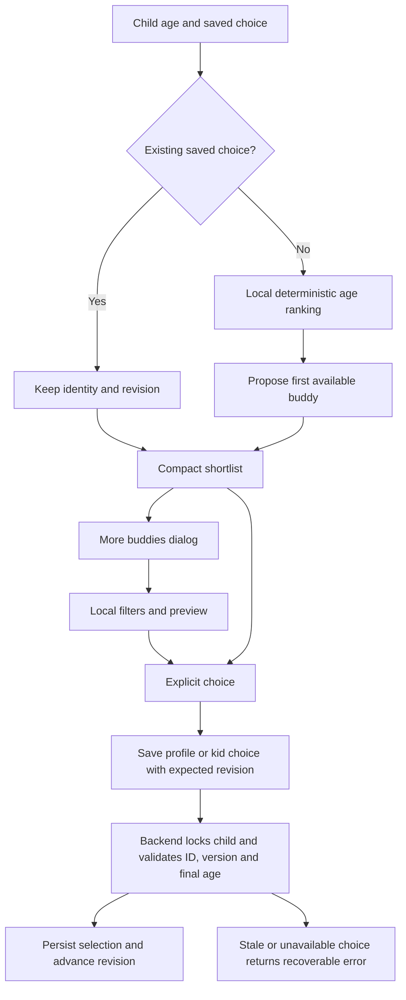

# Buddies, catalog artwork and asset delivery

The final presentation design uses the richer catalog's public artwork and
metadata while preserving HabitQuest's existing identity, wardrobe and reward
rules. No LLM, embedding or Pinecone request is needed to recommend or select a
buddy. This document describes the November 6, 2026 implementation.

## Asset families and where they live

| Asset family | Current representation | Runtime delivery |
| --- | --- | --- |
| Original buddies | Fox, Owl, Bear and Bunny SVG artwork | Bundled React/SVG code; local fallback remains available |
| Catalog buddies | 24 named characters in release `0.1.0`; 48 PNGs, one 128px portrait and one 768px full view each | Versioned, content-addressed public HTTPS S3 URLs in the packaged manifest |
| Goal and category artwork | Presentation metadata for 381 goals and 24 categories, with sharp originals and smaller variants | Copied into `frontend/public/catalog-art`; served with the frontend container |
| Generated habit icons | Persisted icon keys mapped to a bounded Fluent-style set | Packaged SVGs under `frontend/public/fluent-emoji` |
| Wardrobe accessories | Eight existing SVG accessory designs | Composed over original or catalog buddy artwork using local code |

The buddy image URLs use the public prefix
`https://habbit-quest-assets.s3.us-east-1.amazonaws.com/buddies/` followed by pinned
catalog/art versions and a content identifier. The browser does not list a bucket,
fetch AWS credentials, upload artwork or request presigned URLs. Anonymous-read
verification was recorded during the buddy rollout; this documentation work does
not make a new claim about every object or policy in that bucket.

The source catalogs remain in the surrounding workspace. Runtime manifests are
deliberate public projections, not a way to embed private research notes or family
data in the browser.

Sources: [buddy source catalog](../../hq-buddies-catalog/README.md),
[frontend buddy manifest](../frontend/src/data/buddyCatalog.json),
[catalog presentation](../frontend/src/data/catalogPresentation.json),
[catalog asset manifest](../frontend/public/catalog-art/manifest.json),
[recorded S3 checks](../docs-detailed/design-update/buddies/s3-access-check.json).

## Every child keeps a buddy

There is no “None” buddy option. Existing children preserve their saved original
buddy unless someone explicitly chooses another. New-child setup proposes a
deterministic age-based catalog default; age edits can update that provisional
default until the caregiver deliberately chooses a character. The submitted
profile confirms the selection.

All 24 current catalog characters support ages 3–13. Their primary age bands are
soft suggestions, not an exclusion rule or a developmental diagnosis. The chooser
explains that children may select any supported character.

The ranking implementation supports explicit interest/tone filters: three points
per matched interest, two for tone and one for the primary age band. Stable ID
ordering and group diversity make the shortlist repeatable; explicit exclusions
remain filters. In normal age-only setup, the score is a transparent local
presentation rule. The app does not infer a child's interests, personality or
behavioral profile from the buddy.

Sources: [ranking](../frontend/src/lib/buddyCatalog.ts),
[child form](../frontend/src/components/ChildForm.tsx),
[chooser](../frontend/src/components/BuddyPicker.tsx),
[backend selection checks](../backend/src/habitquest_backend/buddies.py).

## Efficient selection and metadata display

The new-child form shows three choices. Child Details can show six; the kid
chooser keeps the saved character plus two alternatives. The full dialog provides
the remaining catalog and original buddies, local theme/interest filters, a larger
preview, Cancel and an explicit Choose action. Browsing or previewing does not
persist a selection.

Name, concise characteristics and suggested ages are shown while choosing.
Detailed descriptive panels are not repeated throughout the dashboard or daily
quest screens. Those surfaces retain the saved avatar/name and neutral event
copy. The metadata is not passed to Coach, habit selection, scoring or rewards.

Portraits serve small controls; the selected larger preview requests the full
image. Grid images can lazy-load, and images decode asynchronously. The selected
image element changes with its URL so an old character does not remain painted
under a newly selected name. Accessible radio choices, keyboard movement and the
shared dialog keep selection usable without a pointer.

## Identity and backward compatibility

The existing `children.buddy` value remains one of `fox`, `owl`, `bear` or `bunny`.
Catalog support adds fields instead of replacing that contract:

| Field | Purpose |
| --- | --- |
| `buddy_selection_mode` | `legacy` or `catalog` |
| `catalog_buddy_id` | Public canonical character ID in catalog mode |
| `buddy_catalog_version` | Pinned metadata release |
| `buddy_selection_revision` | Advances on deliberate choice; guards conflicting saves |
| Existing `buddy` | Original visual/theme fallback |

Parent and kid writes validate the same saved identity and age. Kid writes use a
narrow database function rather than broad permission to edit child rows. The
frontend merges incoming buddy state only when its revision is current or newer.
Old unrevisioned profile writes cannot undo a newer explicit choice.

Missing metadata, an image error, disabled catalog selection or an empty filter
does not clear the child's identity. Rendering falls back to the original local
SVG while retaining the catalog ID/version/revision. Turning off the chooser is
a presentation rollback, not a data migration.

Sources: [identity adapter](../frontend/src/lib/buddyIdentity.ts),
[buddy renderer](../frontend/src/components/Buddy.tsx),
[additive migration](../backend/db/migrations/202611050005_buddy_catalog.sql).

## Outfits use real overlays

The final design preserves party hat, crown, shades, bow, wizard hat, flower,
headphones and halo. It does **not** replace catalog outfits with item badges.
The existing accessory SVGs are drawn over the generated bitmap using independent
portrait/full-body landmarks for each character: eyes, head top, width and, where
needed, ears and fitting offsets. The item determines the transform; special
fits handle shapes such as robot ear hardware.

The catalog bitmap itself is unchanged. Earned inventory and the equipped item
remain in `child_extras`; changing a buddy does not erase the wardrobe. “No
accessory” removes only the worn accessory, never the buddy. Local SVG fallback
also preserves the equipped item. The rollout reviewed 24 characters × eight
accessories × two views = 384 combinations, with the original SVG renderings
preserved.

Sources: [overlay composition](../frontend/src/components/Buddy.tsx),
[landmarks](../frontend/src/data/buddyOutfitAnchors.json),
[outfit review](../docs-detailed/design-update/buddies/outfit-review/README.md).

## Goal and habit artwork

Goal cards retain category, age, setting, support and research context, with a
compact preview and a larger details dialog. `CatalogVisual` looks up public
presentation by canonical source or goal ID. Responsive image choices prefer
the 512px artwork above thumbnail size, avoiding the earlier hazy enlarged
thumbnail problem. A failed image has a local emoji fallback.

Accepted habits retain their exact linked goal. Child detail views show a concise
goal reference image alongside the child-facing action steps; they do not expose
grown-up notes. Generated habit icons use the saved `emoji_key` and a local mapping,
so rendering does not make an image-generation call or require a generated bitmap
for every action.

Public metadata and artwork are presentation only. Displaying all available goal
images does not bulk-import all source goals or add anything to a child's plan.
See [database boundaries](04-database-and-domain-model.md) and
[Coach design](06-habit-coach-and-habit-generation.md).

Sources: [responsive goal artwork](../frontend/src/components/CatalogVisual.tsx),
[habit icons](../frontend/src/components/HabitIcon.tsx),
[child-facing detail view](../frontend/src/components/QuestCard.tsx),
[catalog asset provenance and sizing](../frontend/public/catalog-art/README.md).

## Packaging and validation

Frontend buddy packaging verifies published asset identity, dimensions, byte counts
and hashes before projecting metadata. Backend packaging produces the small pinned
reference used for age/version validation. The backend migration contains the same
public identity/age records; applied migrations remain immutable.

The recorded implementation checks cover defaults, deliberate cross-band choices,
parent/kid saves, revision races, refresh, all accessories, inaccessible images,
desktop/mobile dialogs and reduced motion. Tests prove that selection does not
invoke providers. Catalog buddy event text is deterministic; the separate optional
AI-line path for original buddies remains governed by its existing setting.

Sources: [frontend buddy packager](../scripts/package-buddy-catalog.mjs),
[backend buddy packager](../backend/scripts/package_buddy_catalog.py),
[backend tests](../backend/tests/test_buddies.py),
[frontend selection tests](../frontend/src/pages/BuddySelection.screen.test.tsx),
[browser scenarios](../frontend/e2e/buddy-catalog.spec.ts),
[implementation and verification record](../docs-detailed/design-update/buddies/execution.md).
