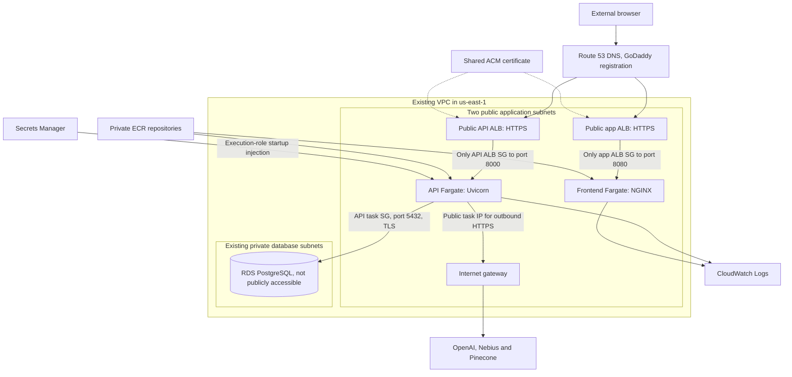

# Final AWS deployment design

This describes the completed development/demo deployment recorded November 6,
2026. The deployment workspace remains
[`hq-deployment`](../../hq-deployment/README.md), which owns the scripts,
CloudFormation, private configuration locations and immutable execution evidence.
This document consolidates that design; it does not execute a deployment.

## Public endpoints and traffic

| Endpoint | Purpose |
| --- | --- |
| `https://habitquest.quest` | React SPA served by the frontend Fargate service |
| `https://habitquest.quest/admin` | Separate operator login in the same frontend |
| `https://api.habitquest.quest` | Public FastAPI endpoint used directly by browsers |
| `https://api.habitquest.quest/health/ready` | Database-backed readiness check |
| `https://www.habitquest.quest` | Redirect to the canonical apex |

The domain is registered with GoDaddy and delegated to Route 53. One ACM
certificate covers the configured app/API/redirect names and is shared by two
separate ALBs. HTTP defaults redirect to canonical HTTPS hosts. HTTPS exact-host
rules forward requests; unknown HTTPS hosts are rejected. The API allows the exact production frontend origin
through CORS and still requires the appropriate application token on protected routes.

The Fargate tasks are **in public subnets with public IPs**, not private-subnet
tasks behind NAT. Inbound service ports accept traffic only from the respective
ALB security group. Public IPs provide inexpensive outbound access; no NAT gateway
was added. RDS remains private with SQL ingress scoped to approved clients.
This distinction is important when explaining the demo's cost/security tradeoff.

## Runtime footprint

| Component | Recorded configuration | Tradeoff |
| --- | --- | --- |
| ECS cluster | `habitquest-dev`, Fargate on demand | Existing recovered platform stack; no Spot dependency |
| API service | One Linux x86-64 task; 0.5 vCPU, 1 GiB, port 8000 | Always running, limited demo capacity |
| Frontend service | One Linux x86-64 task; 0.25 vCPU, 0.5 GiB, port 8080 | Static SPA delivery by NGINX |
| Database | RDS PostgreSQL 18.6, Single-AZ `db.t4g.micro`, 20 GiB encrypted gp3 | Always-on 1 GiB development database, not Aurora Serverless |
| Logs | Retained groups, seven-day retention | Short demo troubleshooting window |
| Application load balancers | Two public ALBs | Owner selected separation over a cheaper single-ALB alternative |

Each service maintains one healthy task while rolling to its replacement with
100% minimum / 200% maximum healthy capacity and an ECS rollback circuit breaker.
One steady-state task and Single-AZ RDS are not a high-availability production
design. They avoid intentional scale-to-zero/database auto-pause but cannot promise
zero latency after failure, restart or provider delay.

Containers run as non-root with read-only root filesystems, dropped capabilities
and a writable `/tmp` volume prepared with correct ownership. Task shutdown has
a grace period. ECS Exec is not enabled. Neither container runs migrations or
catalog seeding on startup.

## Configuration and secret boundary

| Surface | Source | Rule |
| --- | --- | --- |
| Local backend | Ignored `backend/.env` | Settings are read as environment variables |
| AWS backend secrets | ECS execution role reads selected Secrets Manager JSON keys | Inject `JWT_SECRET`, provider keys, admin credentials and `PGPASSWORD` at task start |
| AWS backend public settings | Versioned deployment configuration/task definition | Models, API modes, index contract, origins and feature flags are explicit |
| Frontend | Four public Vite build values | API URL, Google client ID, developer-login flag and buddy flag only |
| OAuth client secret | Private local env and dedicated retained Secrets Manager object | Stored for ownership continuity; current GIS ID-token flow does not consume it |

The seven injected backend secret fields are `JWT_SECRET`, `OPENAI_API_KEY`,
`PLANNING_OPENAI_API_KEY`, `PINECONE_API_KEY`, `ADMIN_PASSWORD`,
`ADMIN_JWT_SECRET` and `PGPASSWORD`. Runtime code does not call Secrets Manager
to fetch them itself. Changing a secret requires replacement tasks to load the
new value. The frontend receives no provider, database or admin secret.

Google sign-in obtains an ID token in the browser. The API verifies its audience
and Google signature, then issues the app's caregiver token. It does not perform
an authorization-code/client-secret exchange. Production origins use the apex;
the approved client also permits the documented local port 5180 origins. See
[OAuth setup and private storage references](../../hq-deployment/docs/29-google-oauth.md).

## Database setup and migration boundary

The local safety backup is retained under `hq-db/backups`, with setup documented
in the deployment workspace. Import used a CloudShell VPC environment in an
existing subnet, a scoped client security group and private encrypted S3 staging.
It did not require making RDS public or creating an SSH relay.

The successful restore verified 36 application tables plus the migration ledger,
row fingerprints and all 22 migration hashes. The application connects as
`hq_runtime`, a non-superuser NOINHERIT login able to assume only the intended
application roles. TLS uses `verify-full` and the packaged RDS CA.

The runtime role cannot read the operator migration ledger. Later image verification
matched packaged migration hashes to the verified restore manifest; this was not
a fresh privileged query of the live ledger. No privilege was widened to perform
that check. Direct laptop access still requires a private network access path;
the public app/API ALBs do not expose PostgreSQL.

Sources: [database import](../../hq-deployment/docs/13-import-execution.md),
[connection guidance](../../hq-deployment/docs/14-database-connections.md),
[runtime verification](../../hq-deployment/docs/26-ecs-staged-deployment.md).

## Repeatable release process

| Script/template group | Role |
| --- | --- |
| [Build helper](../../hq-deployment/scripts/build_application_images.py), [Docker/NGINX inputs](../../hq-deployment/containers/) | Allowlisted contexts, pinned bases, source fingerprints and public Vite configuration |
| [Image audit](../../hq-deployment/scripts/audit_application_images.py) | Verify packaged assets, credentials boundary and expected data |
| [Container verification](../../hq-deployment/scripts/verify_application_images.py) | Disposable PostgreSQL, restricted runtime, family/kid isolation, synthetic AI and browser checks |
| [Publisher](../../hq-deployment/scripts/publish_application_images.py) | Temporary ECR login, immutable tags/digests, remote filesystem/configuration comparison |
| [Release driver](../../hq-deployment/scripts/deploy_https_release.py) | Frozen plan/validation/prepare/inspect/execute/status receipts |
| [Current image-only preparation](../../hq-deployment/scripts/prepare_coach_credits_release.py) | Require the previous verified baseline and change only image parameters |
| [Public verification](../../hq-deployment/scripts/verify_https_release.py) | Exact task image, health, TLS, CORS, static bundle, auth boundary and Google public-ID consistency |
| [CloudFormation directory](../../hq-deployment/cloudformation/README.md) | Network, security, database, service and domain templates plus Guard rules |

Use the [container runbook](../../hq-deployment/docs/25-container-build-runbook.md),
[ECS runbook](../../hq-deployment/docs/27-ecs-deployment-runbook.md), and
[latest release commands](../../hq-deployment/docs/30-coach-credits-and-automatic-habits.md).
The scripts deliberately refuse stale baselines and overwritten evidence files.
For another release create fresh reviewed inputs/receipts; do not replay an old
execution receipt or silently replace frozen evidence. Network/security/resource
changes retain the owner's phase-specific approval requirement.

## Last verified application release

The November 6 Coach correction completed on API task revision 4 and frontend
revision 5. Both services had one healthy task, no pending tasks and completed
rollouts. The two existing service stacks were `UPDATE_COMPLETE` and protected:

- API: `habitquest-dev-ecs-api`.
- Frontend: `habitquest-dev-ecs-frontend-recovery`.
- Platform: `habitquest-dev-ecs-platform-recovery` owns the selected cluster/logs.

The `recovery` names record earlier first-use deployment failures; they do not
mean a second active frontend/platform is serving the app. Original failure
records were retained. Exact image digests and checks are in
[publication evidence](../../hq-deployment/evidence/application-coach-credits-published.json)
and [public verification](../../hq-deployment/evidence/https-coach-credits-verification.json).

The frontend scan had no findings; the API retained 9 high / 10 medium / 3 low
base-image findings, with no critical findings. The earlier exposure review and
remaining remediation are recorded in [HTTPS execution](../../hq-deployment/docs/28-domain-https.md).
These are dated scan results, not a claim of vulnerability-free software.

Rollback uses newly reviewed change sets restoring prior immutable images and
compatible configuration. It does not restore the database or reset Tokenomics.
Schema rollback would require a separate data/migration plan.

## Browser update behavior

NGINX serves HTML with `no-cache` and fingerprinted JS/CSS with immutable caching.
An already-open SPA retains its loaded JavaScript until refreshed; changing
routes does not fetch a replacement bundle. The November 6 visibility investigation
verified an ordinary reload removed old Coach credit copy while preserving saved
goals and habits. Local Vite's automatic code updates are not a production feature.

Public health checks prove route, container and database readiness. They do not
prove model key entitlement, generation quality, generation latency or a new
Google account sign-in. No paid provider calls were made for the latest release
verification, and this documentation task makes no new cloud claims beyond its
recorded evidence.
