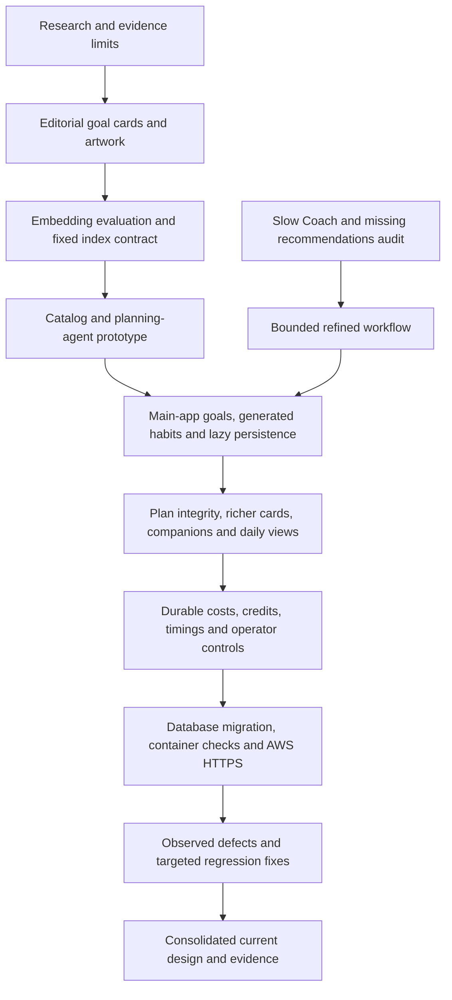

# Design decisions, verification and limits

This record connects the design process to the implemented November 6, 2026
snapshot. It distinguishes a reasoned choice, a completed code change, a measured
sample and an operational verification. They provide different kinds of evidence.

## How the design was developed

The process did not treat the earliest proposal as the final specification. Owner
decisions narrowed safety scope, rejected importing catalog rewards, required
on-demand goal persistence, separated planning and kept demos usable without
enforced budgets. The final documents preserve those decisions and their limits.

## Decisions that shape the current system

| Decision | Reason and resulting behavior | Evidence |
| --- | --- | --- |
| Keep frontend/backend together | One main app owns API/UI contracts; the old standalone backend is historical | [Repository guide](../README.md) |
| Use canonical cards as goals, actions as habits | Retain source evidence while generating small child-specific actions | [Integration plan](../docs-detailed/sys-design-update/pinecone-planner-integration-plan.md), [current data model](04-database-and-domain-model.md) |
| Import goals only after reviewed generation selects them | Retrieval/browsing should not bulk-populate the local goal database | [Catalog import](../backend/src/habitquest_backend/catalog_import.py), [research-to-runtime design](10-habit-research-and-pinecone-catalog.md) |
| Replace the multi-call crew with a bounded graph | Reduce unnecessary model work while preserving explicit stages and structured contracts; the earlier crew already had some parallel stages | [Refined graph](../backend/src/habitquest_backend/refined.py), [AI orchestration](05-ai-orchestration.md) |
| Review new Coach prose, trust validated canonical context | Keep retrieval fast; avoid repeated model review of researched cards | [AI operations](../docs-detailed/sys-design-update/refined-ai-operations.md) |
| Keep habit checks local and acceptance explicit | Bounded actions still require source/schema/age/privacy/novelty checks and parent choice | [Habit generation](06-habit-coach-and-habit-generation.md) |
| Separate explicit planner and review | History-based planning is a distinct user activity, not work hidden inside every chat | [Other capabilities](07-planner-review-and-other-ai.md) |
| Choose small/512 after quality comparison | Owner accepted lower embedding cost despite weaker top-five metrics than large/512 | [Embedding decision](09-embedding-model-selection.md) |
| Preserve rewards and approved instructions | Catalog reward recommendations must not rewrite the app economy or previously accepted behavior | [Database](04-database-and-domain-model.md), [research policy boundary](10-habit-research-and-pinecone-catalog.md) |
| Keep buddies local with a default | Small catalog, transparent age suggestions, no extra AI cost and no empty identity | [Buddy design](12-buddies-artwork-and-assets.md) |
| Meter attempts separately from useful credits | Failed/retried provider work can cost money; replay must not debit the family twice | [Tokenomics](11-tokenomics-latency-and-observability.md) |
| Use always-on micro RDS and one task per service | Avoid intentional idle pause/cold-start behavior for the limited demo | [Database decision](../../hq-deployment/docs/07-demo-database-decision.md), [AWS design](13-aws-deployment.md) |
| Retain two ALBs and public-IP tasks | Owner chose separate app/API endpoints; scoped task ingress and direct egress avoid NAT for the demo | [Two-ALB proposal](../../hq-deployment/docs/19-application-deployment-proposal.md), [AWS design](13-aws-deployment.md) |
| Publish immutable images through CloudFormation | Verify exact artifacts, inspect change scope and retain rollback evidence | [Latest release](../../hq-deployment/docs/30-coach-credits-and-automatic-habits.md) |

## Recent corrections included in this snapshot

| Observed issue | Implemented correction | Verification boundary |
| --- | --- | --- |
| Model/helpers frequently reported busy | Report-specific reasoning controls and fresh request IDs after confirmed failures; the model and 4,000-token allowance were unchanged | Mocked regression and source contract; not proof of universal provider availability |
| Reported wrong goal links or missing dashboard habits | The data audit found existing links consistent; exact navigation/provenance and Plan+Today synchronization were strengthened | Domain/screen tests and recorded audit, not a claim that existing family data was relinked |
| Full plans could not accept another habit | Expose actual capacity and remove/restore controls; preserve the six-slot rule | Atomic acceptance/capacity tests |
| Dense cards hid useful detail | Compact goal grids and habit rows; details/research in larger dialogs | UI and browser evidence |
| Valid Coach replies showed zero credits and no automatic habits | Recognize refined success outcomes before settlement; preserve bound habit slots | Actual API/SSE plus disposable PostgreSQL regression with synthetic usage |
| Cloud tab still showed removed credit messages | Ordinary reload loaded the already-deployed corrected bundle | Public asset/image comparison and same-tab before/after UI check |

Sources: [report reliability](../docs-detailed/sys-design-update/ai-helper-report-reliability.md),
[plan/link repairs](../docs-detailed/sys-design-update/goal-linking-and-saved-recommendations.md),
[capacity/UI repairs](../docs-detailed/sys-design-update/goal-plan-reliability.md),
[credit release and browser follow-up](../../hq-deployment/docs/30-coach-credits-and-automatic-habits.md).

## Recorded application verification

The latest code-changing release, before this documentation task, recorded:

- **1,073 backend tests passed**, with 100% statement and branch coverage
  across 5,091 statements and 1,234 branches; Ruff and mypy passed.
- **206 frontend tests passed**, plus TypeScript/Vite build and focused Coach/budget tests.
- Eleven release-boundary tests, image audit and full container/browser smoke passed.
- The new Coach regression verified retrieval cost, two useful Coach credits,
  a bound automatic slot, a three-habit batch, one batch credit and no extra
  dispatch/debit on replay.
- UI regression verified four goals, three choices per goal, two concurrent
  batches and meter updates without inline accounting text.
- All 824 packaged public assets matched source; container smoke used a disposable
  database and synthetic provider responses, then removed its synthetic resources.
- Both AWS service stacks completed and fourteen public checks verified deployed
  image/configuration identity, TLS, CORS, redirects, auth boundaries and DB readiness.

See [regression evidence](../../hq-deployment/evidence/application-coach-credits-regressions.json),
[container smoke](../../hq-deployment/evidence/application-coach-credits-smoke.json),
[public verification](../../hq-deployment/evidence/https-coach-credits-verification.json)
and [browser visibility investigation](../../hq-deployment/evidence/coach-credit-visibility-investigation.json).

These are dated records. This documentation update does not claim to have rerun
the full application suite or made paid model calls. Renamed evidence-output paths
are checked as filesystem references; no browser scenario is run merely to rename
its output folder.

## Documentation verification

The final integration checks cover:

1. Every original file remains under `docs-detailed`; screenshots and other binary
   evidence are byte-identical. Necessary text changes are navigation/path repairs
   and the historical-folder introduction.
2. README links to every capability document, each with a summary and key points.
3. New Markdown source links and cross-document paths resolve in the HQ workspace.
4. Mermaid blocks have balanced fences and valid syntax where a local renderer/parser
   is available; the recorded check states exactly what was exercised.
5. Active references to the renamed top-level folder are repaired, without changing
   `backend/docs`, public `/docs` routes or external providers' documentation URLs.
6. Independent reviewers compare AI call counts, model choices, data ownership,
   costs, catalog research and deployment boundaries across the documents.
7. No private environment payloads, credentials, vectors or family prose are copied.

The generated [documentation verification record](verification.json) gives the
final file/link/diagram counts and limitations. It is documentation evidence, not
a deployment receipt.

## Known limits and next engineering checkpoints

| Area | Remaining boundary |
| --- | --- |
| End-user latency | No representative cloud p50/p95 for current full interactions; text-ready and all-habits-ready differ |
| Embedding quality | Small synthetic study and incomplete editorial labels; actual small/512 ingestion did not repeat the whole held-out benchmark |
| Research | Evidence-informed cards are not trials of this app or generated actions; adaptations/exclusions must remain visible |
| Economics | Pinecone account tariff/minimums and invoices are not reconciled; historical missing usage remains unknown |
| Cost visibility | Coach inline accounting is hidden; detailed visibility remains surface-specific elsewhere |
| Provider verification | Network/TLS readiness is not an authenticated model-generation or entitlement test |
| Availability | One task per service and Single-AZ micro RDS are demo choices, not a resilient multi-AZ production tier |
| Security maintenance | Recorded API base-image findings remain open; proxy trust, in-memory rate limits and data/privacy controls need review before scale-out |
| Database assurance | Restore-time ledger verification is recorded; runtime cannot independently read the operator ledger |
| Live identity | Automated release checks did not complete a new Google account sign-in; later signed-in browser observations are a different check |
| Browser freshness | Open production tabs require refresh to load a new bundle; there is no automatic update notification yet |

Address those checkpoints with a separately scoped implementation/evaluation plan.
Do not silently expand this documentation task into paid benchmarks, model/index
changes, database migrations, budget edits or cloud resource changes.
