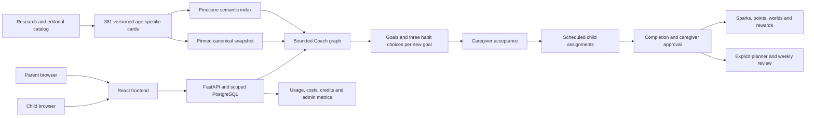

# HabitQuest: current system design

HabitQuest turns a parent's concern into a researched goal, a small set of
actionable habit choices, and a child-owned daily quest plan. AI proposes;
caregivers choose and approve. The app keeps planning, daily completion, rewards,
companions and AI accounting connected without giving a model authority to change
a child's plan on its own.

This is the consolidated **November 6, 2026 implemented design** of the main
`habbit-quest` repository and its recorded AWS release. It summarizes the final
state of the work reviewed here, rather than promising that the design will never
change. Current source and completed release evidence take precedence over older
proposals. The [detailed documentation plan](00-documentation-plan.md) records
scope, review responsibilities, document coverage and validation.

The former top-level `docs` is now [docs-detailed](../docs-detailed/README.md),
preserving all 209 files of investigations, benchmarks, decisions and visual
evidence. `backend/docs` remains unchanged. Links to research and deployment
sources expect the surrounding HQ workspace; the substantive design is explained
here so readers do not need to reconstruct it from that history.

## The application in one picture

The public app is `https://habitquest.quest`; browsers call
`https://api.habitquest.quest` directly. Two public ALBs front separate Fargate
services. The database is private, always-on RDS PostgreSQL. Research and index
publication happen outside user requests.

## 1. System overview and capability boundaries

[Read the system overview](01-system-overview.md).

The frontend handles interaction; the backend owns domain rules and approved
state. PostgreSQL stores family data. Pinecone finds canonical source cards.
Versioned catalog snapshots preserve the evidence and identity behind a goal.

- A catalog card maps to a **goal**; a generated action maps to a **habit**.
- An **assignment** schedules a habit for one child; generating a card alone does not assign it.
- The legacy seeded catalog, imported researched goals and generated habits coexist.
- Browser state is a projection of backend state, not a separate authority for points or plans.
- Research, operational generation and infrastructure deployment are separate processes.

## 2. Frontend and family workflows

[Read the frontend experience](02-frontend-experience.md).

React/Vite provides separate parent, kid and operator experiences. Parent flows
cover family setup, child details, Coach, plan management and approvals. Kid flows
show actionable instructions, today's quests and progress without exposing adult
guidance or sibling data.

- Coach combines child selection, compact budget meter, chat, stages and location icons.
- New goals appear before older recommendations and the saved-plan section.
- Three habit choices start automatically for eligible new goals, with at most two batches in flight.
- Quest Library keeps **Quests** as its default and offers **By goal** for the exact saved relationships.
- Dashboard combines Plan and Today, so unscheduled-for-today assignments still appear in the child's plan.
- Small cards open richer details; goal research, age/context and original artwork remain available.

## 3. Backend, identity and security

[Read the backend/API design](03-backend-api-and-security.md).

FastAPI validates requests, verifies identity, performs business operations and
enters scoped PostgreSQL transactions. Authentication and database isolation back
up frontend route guards. Caregiver, kid and operator identities are distinct.

- Google ID tokens are verified before issuing HabitQuest caregiver tokens.
- The current Google flow uses a public client ID, not a runtime client-secret exchange.
- Kid credentials scope actions to one child; caregiver membership scopes family access.
- Optional parent PIN confirmation is distinct from a child's login PIN and admin credentials.
- `hq_api`, `hq_kid`, `hq_meter` and `hq_admin` have different database responsibilities.
- AI request IDs, reset fences, row locks and revision checks protect retries and concurrent actions.

## 4. Database and daily quest model

[Read the database and domain model](04-database-and-domain-model.md).

PostgreSQL separates source goals, child goals, generated draft batches, approved
habit instructions and scheduled assignments. That separation supports precise
goal links, parent review, safe removal and retained completion history.

- The migration set defines 36 application tables plus the migration ledger across 22 files.
- Six non-removed assignments fill a child's current capacity; paused habits still occupy a slot.
- Accepted generated instructions retain ownership and cannot be silently regenerated in place.
- Child submissions and caregiver approval are separate states.
- Sparks track progress; points support rewards. Coaching credits are a separate AI allowance.
- Row-level policies, constraints and narrow database functions protect cross-family and cross-child boundaries.

## 5. Agentic AI architecture

[Read AI orchestration](05-ai-orchestration.md).

Agentic design here means an explicit, bounded workflow with structured outputs,
local tools/checks and controlled model invocations. LangGraph orchestrates the
stages; LangChain and the imported planner adapters handle provider calls. A graph
node does not automatically mean an independent LLM agent.

- The current refined Coach replaces the old multi-role crew as the configured path.
- Normal Coach uses one central generation plus one review of newly generated prose.
- Name masking, eligibility, canonical checks, context assembly and persistence run in code.
- Retrieval uses one embedding plus Pinecone search, without a research-generation or catalog Safety call.
- One bounded prose revision is permitted; SDK retries are counted separately from logical calls.
- Habit writing and explicit planner/review operations are separate from the Coach graph.

## 6. Habit Coach and generated habits

[Read the complete Coach/habit workflow](06-habit-coach-and-habit-generation.md).

Coach retrieves suitable source cards, creates reviewed guidance and returns
ordered goals. Only selected reviewed goals are materialized locally. The UI then
prepares small habit batches for the selected child and waits for caregiver acceptance.

- Up to four returned goals can receive three choices each; usable saved choices are reused.
- The writer normally makes one call for a batch, followed by local source/schema/age/action checks.
- One correction may repair a validation failure; there is no unbounded retry or whole-habit Safety loop.
- “Get more goals” and “More habit choices” preserve earlier choices and require explicit action.
- Research supports/limitations belong to the source goal; exact generated habits do not inherit an efficacy claim.
- The November 6 settlement fix keeps successful recommendations chargeable and their automatic slots intact.

## 7. Other AI capabilities

[Read planner, review and other AI](07-planner-review-and-other-ai.md).

Quest Planner and Weekly Review run when requested, using the family's existing
history and returning proposals. They are not hidden background stages on every
Coach turn. Other entry points have their own data and safety contracts.

- Planner proposes plan changes; Weekly Review summarizes patterns and suggests next steps.
- Schedule edits and proposal acceptance are database operations, not model calls.
- Legacy onboarding mapping has its own structured generation/fallback path.
- Optional legacy buddy prose and child-note screening use their established screening paths.
- Catalog buddy selection and catalog event lines are deterministic and local.
- Review behavior is capability-specific: do not assume every helper has the same extra Safety call as Coach.

## 8. Model decisions and runtime routing

[Read model selection and routing](08-model-selection-and-runtime-routing.md).

The implementation assigns models by role and keeps public routing configuration
separate from provider secrets. Selection considered structured-output behavior,
integration compatibility, measured useful results and cost—not only published
model throughput.

- OpenAI `gpt-6-luna` is configured for Coach writing and generated habit batches.
- Nebius `deepseek-ai/DeepSeek-V4.1-Flash-1017` serves generated-text Safety and the other configured helpers.
- OpenAI `text-embedding-3-small` produces 512-dimensional retrieval vectors.
- Report-helper reasoning settings address the observed DeepSeek response-budget failure.
- The initial Nebius shortlist and one-total-call proposal remain historical decision inputs.
- Model/provider/role/API-mode cohorts matter; the five-second objective is not a production latency guarantee.

## 9. Embedding research and selection

[Read the embedding selection study](09-embedding-model-selection.md).

The study compared lexical retrieval and eight embedding/dimension configurations
using frozen synthetic queries, eligibility rules and editorial relevance labels.
The executable results live under HQ infrastructure's embedding evaluation;
the broader behavioral research lives under HQ research.

- The study used 405 documents:381 habit cards and 24 buddies, with separate candidate sets.
- Large/512 was the original quality-first selection; small/512 was the owner's cost/quality decision.
- Small/512 and large/512 had the same first-useful-result MRR, while large/512 had stronger top-five coverage.
- The study did not establish matched API latency superiority for small/512.
- The live index contract fixes small/512/cosine; changing embedding geometry requires a coordinated rebuild.
- Buddies remained local because 24 choices do not justify an embedding dependency for ordinary selection.

## 10. Habit research and Pinecone publication

[Read research, catalog authoring and Pinecone](10-habit-research-and-pinecone-catalog.md).

Behavioral evidence and books informed editorial habit concepts, adaptations and
age-specific cards. Cross-review and deterministic validation prepared those
cards for public catalog browsing and later semantic search.

- The catalog contains 96 concepts across 24 categories, expanded to 381 age-specific cards.
- The evidence set contains 89 research records and 6 books, with population and applicability limits.
- Cards include observable actions, parent support, categories, age/context and source references.
- Offline ingestion validates canonical hashes and actual small/512 vectors before publishing to Pinecone.
- Runtime retrieval validates returned IDs/metadata against the packaged canonical snapshot.
- Pinecone stores public source records, while PostgreSQL owns family plans and generated actions.

## 11. Tokenomics and generation observability

[Read economics, credits and timing](11-tokenomics-latency-and-observability.md).

Durable operation/attempt records separate useful family activity from provider
spend. Costs include chat tokens, embeddings and Pinecone usage. Timers distinguish
server stages, provider attempts, browser response time and all-choices readiness.

- Seeded policy: 100 daily credits,2 per useful Coach/planner/review/mapping,1 per useful habit batch.
- Demo mode tracks usage beyond allowance without enforcing it; policy edits are audited and revision-checked.
- Retries/failures retain operator exposure even when they do not create a useful-result credit debit.
- Admin history shows input/output tokens with measured/partial/unknown distinctions.
- Coach keeps the compact allowance chip and omits inline credit/preparation copy.
- Historical benchmarks are dated samples; no invoice reconciliation or representative cloud p95 is claimed.

## 12. Buddies, graphics and presentation

[Read buddies and artwork](12-buddies-artwork-and-assets.md).

Companion selection uses local metadata and explicit choices. Catalog art improves
recognition and appeal without changing the underlying wardrobe or reward rules.

- Every child has a default or saved buddy; there is no empty buddy option.
- Twenty-four catalog characters supplement four original SVG buddies.
- Suggested age bands are soft; all current catalog buddies support ages 3–13.
- Name, characteristics and suggested ages appear during selection, with compact shortlists and a full chooser.
- Existing accessories use per-character overlay anchors on the generated artwork.
- Goal/Fluent assets ship with the frontend; versioned buddy PNGs load from public S3 URLs.

## 13. AWS deployment and operations

[Read the final AWS design](13-aws-deployment.md).

The demo runs continuously in `us-east-1`: two public ALBs, separate frontend/API
Fargate services and private RDS PostgreSQL. Source-hashed images and checked
CloudFormation change sets make releases reviewable and repeatable.

- GoDaddy registration delegates to Route 53; shared ACM HTTPS serves apex, API and redirect hosts.
- Public-IP tasks use the internet gateway for egress; inbound task ports accept only their own ALB group.
- RDS is always-on micro, Single-AZ, with scoped SQL access and verified TLS.
- ECS injects backend secrets from Secrets Manager; the browser receives public build configuration only.
- Builds, audits, synthetic container/browser tests, immutable ECR publication and rollout receipts are documented.
- The recorded current release passed public health/auth-boundary checks; provider generation and HA limits are stated separately.

## 14. Design process, validation and remaining limits

[Read the decision and verification record](14-validation-and-design-decisions.md).

The design evolved through research, retrieval experiments, catalog/prototype work,
main-app integration, call-stack simplification, plan/visual fixes, durable accounting
and staged deployment. The documentation preserves why choices were made and
where evidence is incomplete.

- Earlier alternatives remain in `docs-detailed`, clearly separated from the implemented path.
- The latest application baseline passed 1,073 backend tests at 100% statement/branch coverage and 206 frontend tests.
- Fresh disposable-database/container checks covered identity, child isolation, plans, assets and fake-provider flows.
- Documentation validation checks links, diagrams, retained files and consistency without making new provider calls.
- Outstanding limits include production latency sampling, exact Pinecone billing assumptions and retained base-image findings.
- Future work should update this index and its capability documents while retaining dated evidence.

## Suggested reading paths

- **Product/design:** overview → frontend → Coach → buddies → research.
- **Backend/data:** API/security → database → AI orchestration → Tokenomics.
- **AI/research:** orchestration → Coach → other AI → model routing → embeddings → catalog pipeline.
- **Deployment/demo:** AWS → validation/decisions → linked deployment runbooks.

The complete work plan and maintenance contract are in
[00-documentation-plan.md](00-documentation-plan.md).
