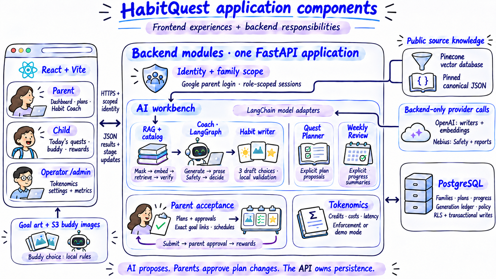
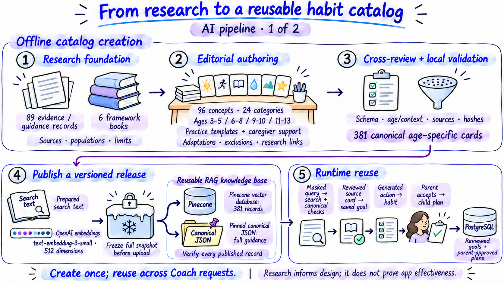
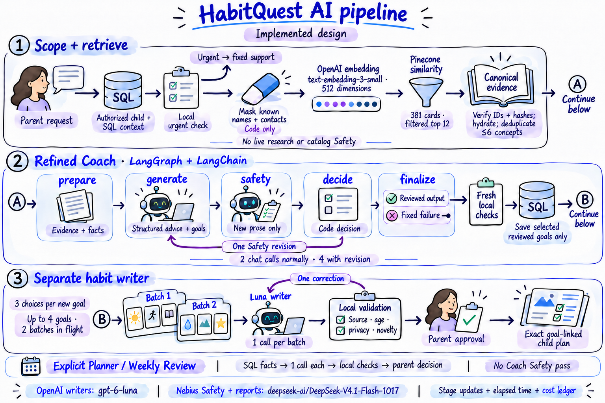
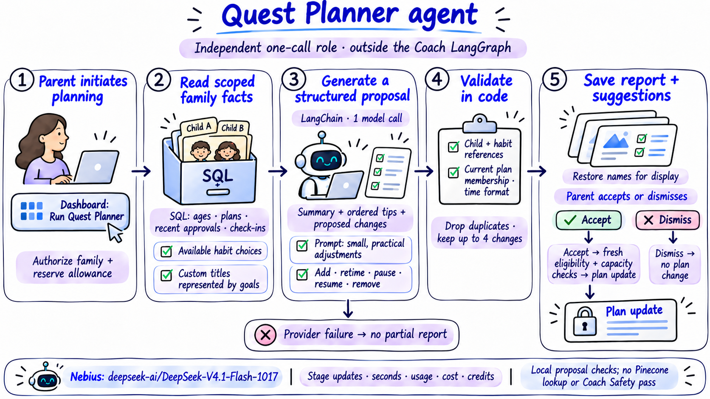
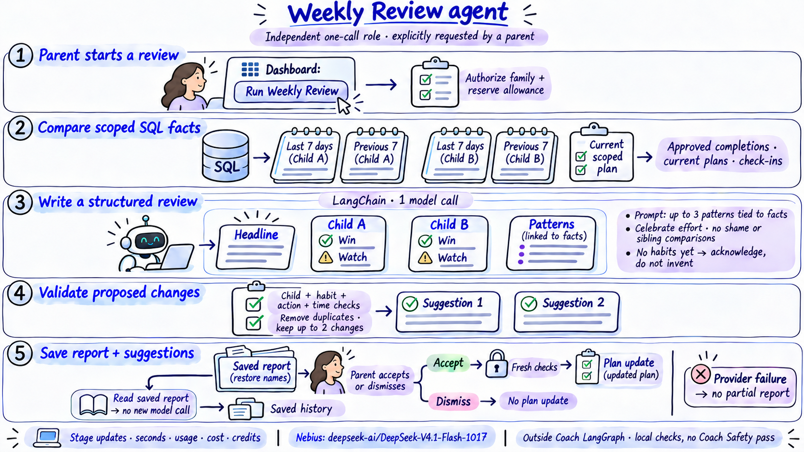
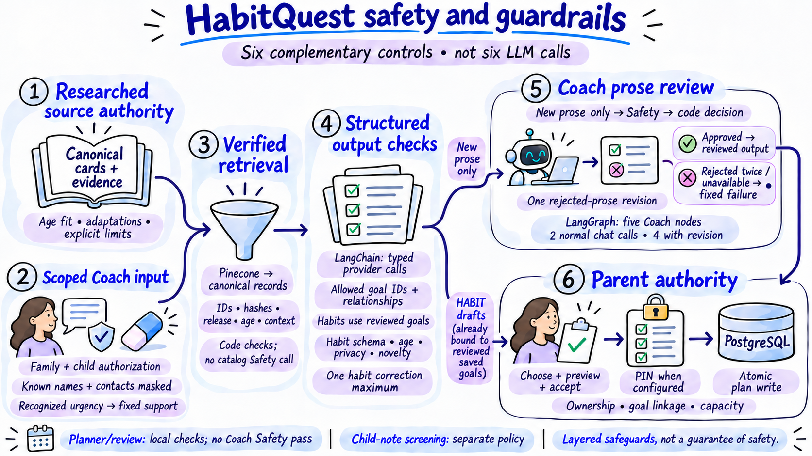
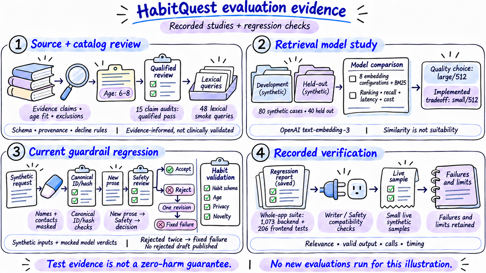
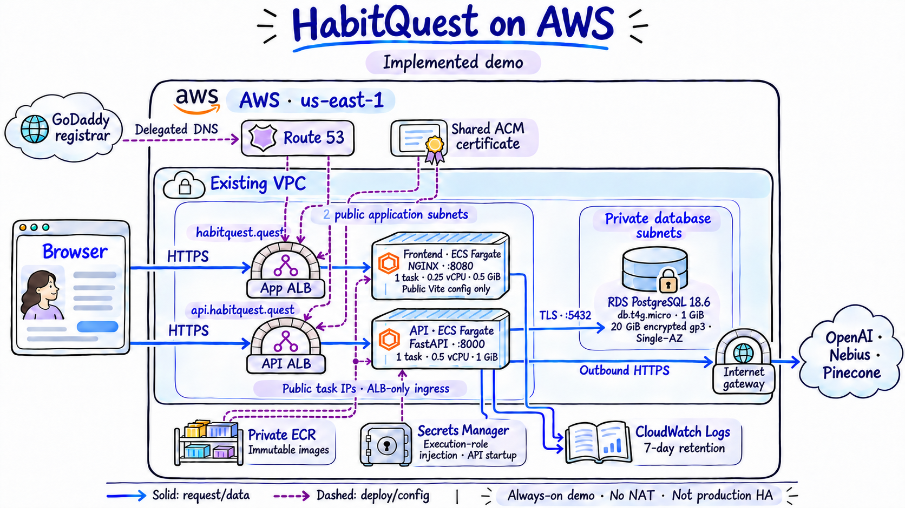
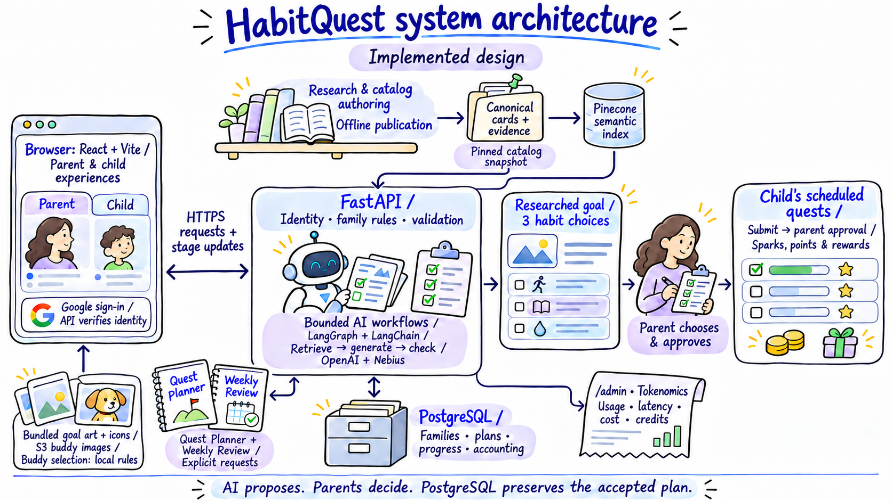

# HabitQuest · Illustrated architecture

## From researched guidance to a daily quest.

10 illustrated views preserve the detailed Coach runtime and give Quest Planner and Weekly Review their own full-size explanations, alongside the application, catalog, safeguards, Tokenomics, evaluations and deployment.

**[Open the HTML gallery](index.html)** · **[Present the slides](presentation.html)** · **[Asset documentation](README-assets.md)**

## Illustrations

- [01 Application components](#system)
- [02 AI pipeline · 1 of 2: research and catalog](#catalog)
- [03 AI pipeline · 2 of 2: runtime and agents](#runtime)
- [04 Habit Coach: detailed runtime pipeline](#coach-detail)
- [05 Quest Planner agent](#planner)
- [06 Weekly Review agent](#review)
- [07 Safety guardrails](#safety)
- [08 Tokenomics and monitoring](#tokenomics)
- [09 Evaluation evidence](#evaluations)
- [10 AWS deployment](#aws)
- [Preserved supplemental reference](#supplemental-heading)

## 01 Application components

The frontend presents parent, child and operator experiences. One modular FastAPI backend owns authorization, retrieval, bounded AI calls, exact goal links, plans, approval rules and accounting. LangGraph belongs to the Coach module; these responsibilities are not separate microservices.

[Full-size PNG](illustrations/01b-system-components.png) · [Read the content contract and source references](sources/01b-system-components-contract.md)

## 02 AI pipeline · 1 of 2: research and catalog

Offline research, editorial authoring and cross-review create reusable age-specific practice cards. Prepared search text is embedded, frozen and published to Pinecone; full guidance remains in pinned canonical JSON. Live requests reuse the release. Reviewed source cards become goals, while personalized habit choices are generated later.

[Full-size PNG](illustrations/04-research-catalog.png) · [Read the content contract and source references](sources/04-research-catalog-contract.md)

## 03 AI pipeline · 2 of 2: runtime and agents

RAG supplies verified context to the five-node Coach graph. New prose receives model Safety; separate writer batches prepare habit choices. Quest Planner and Weekly Review are independent, explicitly triggered agent roles outside that graph. Each helper is a structured model call plus local checks, not an autonomous multi-agent loop.

[Full-size PNG](illustrations/02b-ai-runtime-agents.png) · [Read the content contract and source references](sources/02b-ai-runtime-agents-contract.md)

## 04 Habit Coach: detailed runtime pipeline

Preserved original runtime illustration: it explains the API request-to-result pipeline without offline catalog creation. Follow A from verified retrieval into the Coach graph and B from reviewed saved goals into separate habit batches. Planner and Review retain their own dedicated slides.

[Full-size PNG](illustrations/02-ai-pipeline.png) · [Read the content contract and source references](sources/02-ai-pipeline-contract.md)

## 05 Quest Planner agent

Quest Planner focuses on practical adjustments to the family plan. One structured call uses scoped SQL facts; code checks references and retains up to four suggestions. The parent decides, with fresh eligibility and capacity checks before changes are applied. It runs outside the Coach graph.

[Full-size PNG](illustrations/08-quest-planner.png) · [Read the content contract and source references](sources/08-quest-planner-contract.md)

## 06 Weekly Review agent

Weekly Review interprets recent progress rather than creating a schedule automatically. It compares two seven-day SQL windows, produces a parent-facing report and at most two locally checked suggestions. Parents decide on changes; reading the saved report makes no new model call.

[Full-size PNG](illustrations/09-weekly-review.png) · [Read the content contract and source references](sources/09-weekly-review-contract.md)

## 07 Safety guardrails

Six complementary controls cover researched source authority, scoped Coach input, verified retrieval, structured output checks, Coach prose review and parent authority. They are not six LLM calls. Trusted catalog lookup and bounded habit checks do not receive an extra whole-content Safety pass.

[Full-size PNG](illustrations/07-safety-guardrails.png) · [Read the content contract and source references](sources/07-safety-guardrails-contract.md)

## 08 Tokenomics and monitoring

Every provider attempt retains usage, timing and estimated cost, including embeddings, search, retries and failures. Useful results settle family credits once; failed work releases credit holds without erasing provider cost. Admin can enforce allowance and exposure gates or track demo overage. Enforcement requires verified tariffs and bounded exposure.

[Full-size PNG](illustrations/05-tokenomics.png) · [Read the content contract and source references](sources/05-tokenomics-contract.md)

## 09 Evaluation evidence

Recorded source audits, a synthetic embedding study, mocked guardrail regressions and small live-provider samples answer different questions. They support content, model and control-flow decisions. They do not establish a zero-harm guarantee, clinical effectiveness or a new production latency benchmark.

[Full-size PNG](illustrations/06-evaluations.png) · [Read the content contract and source references](sources/06-evaluations-contract.md)

## 10 AWS deployment

The browser independently reaches the app and API through two public ALBs. Public-subnet Fargate tasks use restricted ALB-only ingress and internet-gateway egress; RDS stays private. ECR supplies both services, API secrets arrive at startup and CloudWatch retains logs. This always-on demo uses no NAT and is not production HA.

[Full-size PNG](illustrations/03-aws-deployment.png) · [Read the content contract and source references](sources/03-deployment-contract.md)

## Preserved supplemental reference

The original product journey remains available here. The original detailed AI pipeline is also preserved unchanged and appears in the main presentation.

### Original product journey overview

[Full-size PNG](illustrations/01-system-overview.png) · [Source notes](sources/01-system-contract.md)

---

Final artwork contains no implementation dates. [Open presentation mode](presentation.html) · [Slide inventory](slides.json) · [Provenance manifest](manifest.json) · [Visual review](VISUAL-QA.md). All gallery assets are local; no network requests or provider calls are made.
