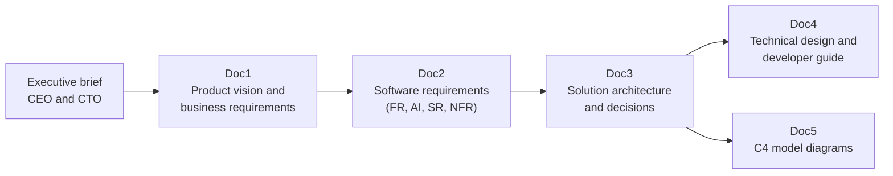

# Product and architecture documents

Six documents describe HabbitQuest from the business case down to the code, each with its diagrams. They were
brought up to date on 3 November 2026 and match the code on `main`. The PDFs here are snapshots; the live,
editable versions are on claude.ai (links below, private to the owner unless shared).

| Document | For | What it covers | PDF | Live version |
|---|---|---|---|---|
| Executive brief | CEO, CTO | The pitch, market, product, AI and safety, competitors, pricing, cost, risks, roadmap and the ask | [PDF](00-executive-brief-ceo-cto.pdf) | [claude.ai](https://claude.ai/artifact/EVZC7ULwwvDQa5Bh2kdjCR) |
| Doc1 Product vision and business requirements | Product, business | Problem, personas, KPIs, business requirements BR-01 to BR-15, scope, business model, compliance | [PDF](01-product-vision-and-business-requirements.pdf) | [claude.ai](https://claude.ai/artifact/ApBvvi3Y4w9NdNuUj9P7pr) |
| Doc2 Software requirements specification | Product, engineering, QA | Functional, AI, safety and non-functional requirements, data rules, the API, and which tests verify each | [PDF](02-software-requirements-specification.pdf) | [claude.ai](https://claude.ai/artifact/Cz75SA7py6d9rtp1QyyiRv) |
| Doc3 Solution architecture | Architects, CTO | Layers, the AI crew, data and row-level security, security gaps, deployment, decisions (ADRs), risks | [PDF](03-solution-architecture.pdf) | [claude.ai](https://claude.ai/artifact/BzTuiF3KBGsLui9QEafwxw) |
| Doc4 Technical design and developer guide | Developers | Setup, repository map, data model, frontend state, the API and crew, testing, how-to recipes | [PDF](04-technical-design-and-developer-guide.pdf) | [claude.ai](https://claude.ai/artifact/5DRJvgD5AmkNusVUSq7zw7) |
| Doc5 C4 model diagrams | Everyone | System context, containers, components, the crew graph, a coach request step by step, target deployment | [PDF](05-c4-model-diagrams.pdf) | [claude.ai](https://claude.ai/artifact/TZjeBJYEnqonWCMkFf2V9K) |

For the code itself, start with [../../ARCHITECTURE.md](../../ARCHITECTURE.md); every file also explains itself in
its comments. When the live documents change, export each one again as a PDF into this folder.
