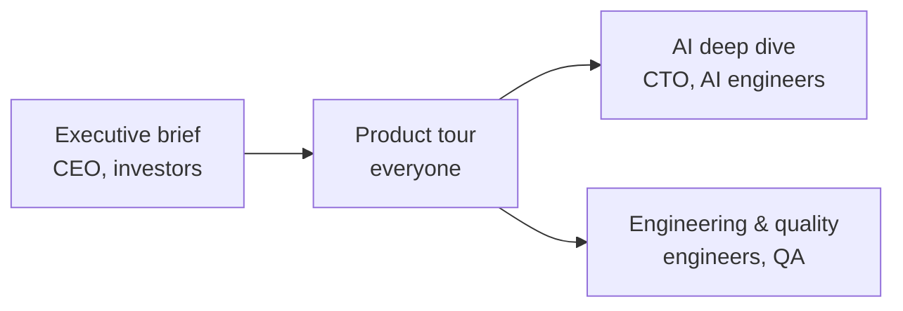

# Product documents

Four short, visual documents, each for a different reader. Start with the one that fits you.

| Document | For | What's inside | Read it |
|---|---|---|---|
| Executive brief | CEO, investors | Screenshots, why it wins, what's built in numbers, pricing and AI cost, roadmap and the ask | [PDF](01-executive-brief.pdf) · [live](https://claude.ai/artifact/Uu6rgrYDFwwbkcLq7VeFpN) |
| Product tour | Everyone | Every screen with screenshots, the two user journeys, every feature | **[On GitHub](PRODUCT-TOUR.md)** · [PDF](02-product-tour.pdf) · [live](https://claude.ai/artifact/XQzSkZfssZQ1jSeQsP5m5o) |
| AI deep dive | CTO, AI engineers | The agentic coach crew on LangGraph, six guardrail layers, evaluations (37 of 41 cases pass), LangSmith tracing | [PDF](03-ai-deep-dive.pdf) · [live](https://claude.ai/artifact/VxXpQUFQJ1MrSNYG2Dw2Qi) |
| Engineering & quality | Engineers, QA | Architecture, row-level security, data model, 452 automated tests, CI, production checklist | [PDF](04-engineering-and-quality.pdf) · [live](https://claude.ai/artifact/1UBdJuaSMthgEchmcHgi3E) |

The PDFs are snapshots from 3 November 2026; the live versions are on claude.ai (private to the owner unless
shared). The product tour PDF leaves out 3 screenshots because of the export's image limit; the GitHub page above
shows all of them. Screenshots are in [screenshots/](screenshots/).

The earlier six longer documents (executive brief, product vision, requirements, solution architecture, developer
guide, C4 diagrams) are kept in [archive/](archive/) for reference. For the code itself, start with
[../../ARCHITECTURE.md](../../ARCHITECTURE.md).
