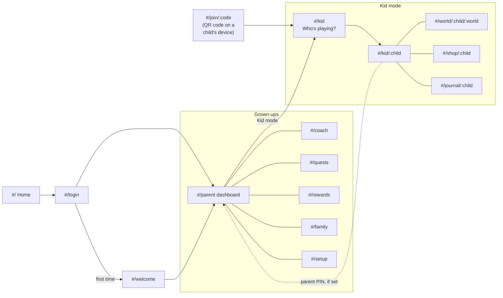
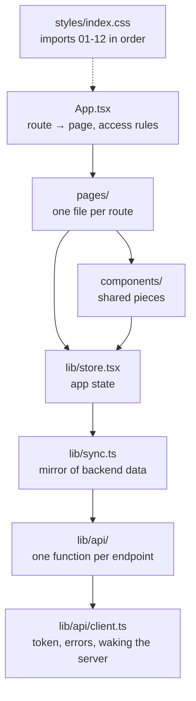
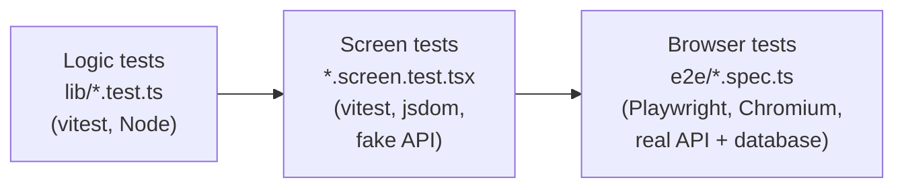

# HabbitQuest (prototype)

Picture quests that build good habits, for children aged 3 to 13. Parents choose habits and times, kids tap
**"I did it!"**, a grown-up approves, and kids earn **Sparks** and **points** with a sparkle celebration. Sparks walk
the child's buddy through six worlds (each one a new level, some unlocking harder quests); points buy real-world
rewards in the kid shop. Parents describe a problem to the habit coach in their own words and get suggested quests.

Everything is stored on the HabitQuest backend API (`../backend`): accounts, plans, the daily loop, points, rewards,
worlds found, the chest, the wardrobe, check-ins, surprises and the kid-mode time limit. The browser keeps only its
sign-in and which celebrations it has already shown.

## Run it

```bash
npm install
cp .env.example .env.local   # API URL, Google client id, VITE_DEV_LOGIN (git-ignored)
npm run dev        # http://localhost:5180  (also on your local network, for phones and tablets)
npm test           # unit tests (vitest), listed under Tests below
npm run build      # type-check (tsc) and production build in dist/
```

From the repository root, `npm run dev`, `npm test` and `npm run build` run these same scripts.

Keep the dev server on port 5180: the API and Google only allow that origin. The API sleeps on Render's free plan,
so the first request can take up to a minute; the app shows "Waking up the server…" while it waits.

With `VITE_DEV_LOGIN=true` the sign-in page also offers a development login: `parent`, or `parent:<label>` for a
separate test parent, with the shared password from the backend owner. Never put that password in an env file.

## Pages



| Route | Page |
|---|---|
| `#/` | Home: how it works, the habits, the worlds, the parent promise |
| `#/privacy` | What is stored and what reaches the AI provider |
| `#/login` | Google sign-in or "I'm a kid", plus the development login when enabled |
| `#/join[/:code]` | Opened from a family's QR code: "I'm a kid" (with the kid PIN) or "I'm a grown-up" (join the family) |
| `#/welcome` | First-time setup: create or join a family, add the first child |
| `#/setup[/:child]` | Child details: name, age, buddy and one row of routine times |
| `#/parent` | Dashboard: safety alerts, approvals, reward requests, each child's progress, kids' check-ins, surprises, AI helpers |
| `#/coach[/:child]` | Habit coach: describe a problem, get quest cards to accept |
| `#/quests[/:child]` | Quest library: the child's quests (up to 6); retime, pause, remove; Add quests by age group, goal and tier; the family's own custom habits |
| `#/rewards` | Rewards & limits: shop prices, record a reward, points history, the kid-mode time limit |
| `#/family` | Family settings: the family code for kids' devices, grown-ups and invite code, parent PIN, export and deletion |
| `#/kid` | Kid mode: "Who's playing?" |
| `#/kid/:child` | Today's picture quests, the world path, chest, surprises, check-in and celebrations |
| `#/world/:child/:world` | Explore a world the child has reached and find its landmarks |
| `#/shop/:child` | Reward shop, savings goal, mystery box, buddy wardrobe, points history |
| `#/journal/:child` | Field journal: buddy, stickers and quest stars |

## Game rules

The backend decides all of these; the frontend only shows them.

- **Sparks:** an approved quest earns Sparks equal to its tier (1-3), at most 6 a day. Never taken away.
- **Worlds and levels:** one ladder. Starter Camp (0 Sparks), Mosswood Forest (30, opens tier 2 quests), Sky Islands
  (90, opens tier 3), Coral Cove (180), Crystal Caves (300), Star Harbour (450). Each world brings a new rank, from
  Camp Sprout to Star Captain. A parent can also set a child's quest tier by hand.
- **Points:** tier 1 quests pay 10, tier 2 pay 15, tier 3 pay 20; a family's custom habits pay 10.
- **Boosts:** the day's **golden quest**, a **streak** from the third quest day in a row, a parent's **double day**
  and a **welcome back** day each add 1x, up to 3x.
- **Quest stars:** each quest earns up to three stars as it is approved more often; quests done on fewer days a
  week need fewer approvals.
- **Reward shop:** a child spends points on a reward; they are held until a grown-up approves, or say "not this
  time" and get them back. A mystery box picks a prize, and a jackpot pays straight away.
- **Treasure chest:** opens once every quest today is approved, for bonus points or a buddy accessory.
- **Surprises:** a parent can plant a note with bonus points, or a double-points day.
- **Kid-mode time limit:** kid mode counts time on screen; when today's limit is used up, a break screen appears
  and only a grown-up can add minutes.
- **Check-ins:** kids say how today felt (mood faces, tricky and favourite quests, stickers, and from age 6 a short
  note). Notes are safety-screened; a worrying one is shown to grown-ups as a safety alert.
- **Parent PIN (optional):** when a family sets one, approvals, rewards, leaving kid mode and accepting AI
  suggestions need it.

## AI helpers

All AI runs on the backend: the habit coach, quest planner, weekly review, buddy lines and note screening. No API
key reaches the browser. Helpers only suggest: each card waits for a grown-up to accept it (with the PIN, if set),
and the server checks it again.

## Code layout



```text
src/App.tsx          Which route shows which page, and who may open it
src/pages/           One file per route (Kid.tsx, KidShop.tsx, QuestLibrary.tsx, CoachPage.tsx, ...)
src/components/      Shared pieces: QuestCard, KidChrome, Coach, AiHelpers and AiParts, HabitCatalog,
                     ParentPanels, KidExtras, Journey, PinDialog, artwork (Buddy, HabitArt, WorldArt) ...
src/lib/api/         The typed API client, one file per area: accounts, plans, kid, rewards, family-extras, ai;
                     types.ts holds the shapes, client.ts the request logic, index.ts re-exports everything
src/lib/             store.tsx (app state), sync.ts, family.ts (worlds, celebrations), useKidDay.ts (kid session),
                     journeyPath.ts, schedule.ts, storage.ts, router.ts, buddy.ts and other helpers
src/styles/          One stylesheet per area (tokens, home, auth, parent, kid, overlays, shop, journey, ...)
```

Every file opens with a comment saying what it is for, and every export has one too. [../ARCHITECTURE.md](../ARCHITECTURE.md)
shows how the frontend and backend fit together.

## Tests

Three layers, from fastest to most real:



```bash
npm test         # logic and screen tests (seconds)
npm run e2e      # browser tests; needs the backend's PostgreSQL (see below)
```

**Logic tests** check the helpers on their own:

| File | What it checks |
|---|---|
| `lib/api.test.ts` | The API client: auth headers, error text, tokens, waiting for a sleeping server |
| `lib/sync.test.ts` | The mirror of the backend's data, and building a plan |
| `lib/family.test.ts` | Celebrations, discoveries, worlds and display formats |
| `lib/journeyPath.test.ts` | Where the buddy and landmarks sit on a world's path |
| `lib/catalog.test.ts` | Which catalog habits suit a child, and their standing in the plan |
| `lib/schedule.test.ts` | Day presets and toggling quest days |
| `lib/storage.test.ts` | What the browser remembers between visits |

**Screen tests** render the whole app (state, router, pages) and use it as a person would: they find buttons by
their names, type, click and read what appears. The app's real API client talks to a fake API
([src/test/fakeServer.ts](src/test/fakeServer.ts)) that keeps a small family in memory, so a kid's "I did it!"
really shows up in the parent's approvals. A test fails if a screen calls an endpoint the fake doesn't know.

| File | What it checks |
|---|---|
| `pages/SignIn.screen.test.tsx` | Signed-out visitors go to sign-in; the development login (and a wrong password); creating a family, with or without a PIN |
| `pages/Approvals.screen.test.tsx` | Approving and sending back quests with the parent PIN; a wrong PIN; families without a PIN; another grown-up deciding first |
| `pages/QuestLibrary.screen.test.tsx` | Listing a child's quests; adding one from Add quests; pausing, resuming and removing; a refused change |
| `pages/KidMode.screen.test.tsx` | Kid mode with the kid token; "I did it!"; the PIN before grown-up pages; a child's own kid PIN |

**Browser tests** ([e2e/](e2e/)) run the real app in Chromium against the real backend and database (with the
backend's fake AI). Each test signs in as a new development-login parent, so tests never share a family:

- A new family's first day: set up, add a quest, the child does it, a grown-up approves, the child sees the Spark.
- The parent PIN keeps a child in kid mode out of the grown-ups' pages until the right PIN.

`npm run e2e` starts the API (`../backend`, port 8000) and the dev server (port 5180) unless they are already
running. The backend needs its `.env` with `DEV_LOGIN=true`; the tests read `DEV_LOGIN_PASSWORD` from there (or
`E2E_DEV_PASSWORD`). The first time, install the browser with `npx playwright install chromium`.

In CI, [frontend.yml](../.github/workflows/frontend.yml) runs `npm test`, the type-check and the build whenever
`frontend/` changes, and [e2e.yml](../.github/workflows/e2e.yml) runs the browser tests whenever either half changes.
